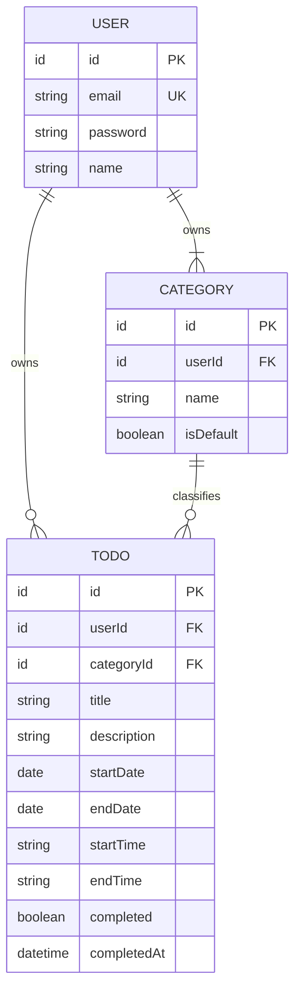

# TodoList 도메인 정의서 (초안)

## 문서 이력

### 버전 이력

| 버전 | 일자 | 작성자 | 상태 | 비고 |
|---|---|---|---|---|
| v0.1 | 2026-11-03 | pmsong | 초안 | 최초 작성 |
| v0.2 | 2026-11-03 | pmsong | 초안 | 품질 평가 개선 사항 Top 5 반영 |
| v0.3 | 2026-11-04 | pmsong | 초안 | PRD v0.3과 정합성 맞춤, 미결·가정 해소 |
| v0.4 | 2026-11-04 | pmsong | 초안 | PRD v0.4(가입 후 자동 로그인)와 정합성 맞춤 |
| v0.5 | 2026-11-04 | pmsong | 초안 | PRD v0.7(캘린더 표시 순서)과 정합성 맞춤 |
| v0.6 | 2026-11-04 | pmsong | 초안 | 와이어프레임 작성 중 발견한 불일치·미정의 해소 |
| v0.7 | 2026-11-04 | Claude | 초안 | API 명세 작성 중 결정 반영(비밀번호 trim 예외) |
| v0.8 | 2026-11-05 | Claude | 초안 | 캘린더 막대 표시에 맞춰 BR-20 예외 |
| v0.9 | 2026-11-05 | Claude | 초안 | 할일 시작·종료 시간(BR-24) |
| v0.10 | 2026-11-05 | Claude | 초안 | 4주 뷰 화면 기간(BR-17) |

### 변경 이력

| 버전 | 일자 | 변경 위치 | 변경 내용 | 변경 사유 | 작성자 |
|---|---|---|---|---|---|
| v0.1 | 2026-11-03 | 전체 | 최초 작성 | - | pmsong |
| v0.2 | 2026-11-03 | BR-11 | 수정 시 카테고리 미지정이면 기존 카테고리 유지로 명시 | 수정 시 기본 카테고리로 잘못 이동하는 해석 방지 | pmsong |
| v0.2 | 2026-11-03 | 2장 '오늘', A-03 | '오늘'을 사용자 단말의 현지 날짜로 정의, 미결 → 가정 | 상태 판정·필터 테스트의 전제 확정 | pmsong |
| v0.2 | 2026-11-03 | 4장, 6장 | 상태 규칙에 ST-01~04 ID 부여, UC 표에 '관련 규칙' 열 추가 | 추적성 확보 | pmsong |
| v0.2 | 2026-11-03 | 1장, 7장 | BR과 중복된 A-01·02·04~07 삭제, A-08을 정렬 미결로 한정, A-09 삭제 후 1장 범위 외에 통합, ID 운영 원칙 추가, A-10 추가 | 중복 제거·불일치 해소 | pmsong |
| v0.2 | 2026-11-03 | BR-15, BR-17, BR-19 | 필터 AND 결합·상태 단일 선택, 주 시작 요일·월 뷰 기간, 상태 값 제공을 명시 | 모호성 제거·검증 가능성 확보 | pmsong |
| v0.3 | 2026-11-04 | BR-20, A-08 | 목록 정렬 규칙 BR-20 신설, A-08 폐기 | 미결 해소(PRD P-07에서 이동) | pmsong |
| v0.3 | 2026-11-04 | BR-21, BR-22 | 비밀번호 정책·입력 길이 제한 규칙 신설 | 규칙 단일 출처 유지(PRD P-05·P-06에서 이동) | pmsong |
| v0.3 | 2026-11-04 | 1장, A-03, A-10 | 사용자별 시간대 설정을 범위 외로 이동, A-03(2장 '오늘'과 중복)·A-10(BR-17과 중복) 폐기 | 가정 해소·중복 제거 | pmsong |
| v0.3 | 2026-11-04 | 6장 | UC 관련 규칙에 BR-20~22 추가 | 추적성 유지 | pmsong |
| v0.3 | 2026-11-04 | 7장 | 작성 시 정한 규칙을 작성자 결정으로 확정 | 가정 해소 | pmsong |
| v0.4 | 2026-11-04 | 2장 '인증', UC-01 | 회원가입 직후 자동으로 인증된 상태가 됨을 명시 | PRD v0.4 FR-01과 불일치 해소 | pmsong |
| v0.5 | 2026-11-04 | BR-20, UC-10 | 정렬 규칙 적용 대상을 목록에서 캘린더 날짜 칸·일 뷰·그날 목록까지 확장, UC-10 관련 규칙에 BR-20 추가 | PRD v0.6 P-16이 BR-20을 캘린더에 적용했으나 BR-20은 목록만 정의 | pmsong |
| v0.6 | 2026-11-04 | 2장 '할일 상태' | '… / 지연 중 하나' → '… / 지연 네 가지 가운데 하나' | '지연 중'이라는 상태명으로 오독될 수 있음(ST-04 명칭은 '지연') | pmsong |
| v0.6 | 2026-11-04 | BR-23, UC-04, UC-05, UC-06 | 카테고리 목록·선택 상자 순서 규칙 신설 | 카테고리 순서 미정의(와이어프레임 L-15) | pmsong |
| v0.7 | 2026-11-04 | BR-22 | 비밀번호는 trim하지 않고 공백도 유효한 문자로 본다는 예외 추가 | API 명세(backend/swagger.yaml) 작성 중 발견한 미정의 사항 결정 | Claude |
| v0.8 | 2026-11-05 | BR-20 | 데스크톱 월·주 뷰의 이어진 막대는 칸 안 위치가 P-16 배치 순서를 따른다는 예외 추가 | 사용자 요청(2일 이상 할일을 연속 표시) | Claude |
| v0.9 | 2026-11-05 | 2장, 3.3, BR-24 | 할일에 선택 속성 `startTime`·`endTime`(시:분) 추가. 같은 날이면 시작 ≤ 종료, 상태·표시 날짜는 시간과 무관 | 사용자 요청(시작·종료 시간 입력) | Claude |
| v0.10 | 2026-11-05 | BR-17 | 4주 뷰 화면 기간(기준 날짜가 속한 주 일요일부터 28일) 추가 | 사용자 요청(월과 주 사이 4주 보기) | Claude |

## 1. 개요

- **목적**: 인증된 사용자가 시작일·종료일이 있는 할일을 카테고리별로 관리하고, 월/주/일 캘린더에서 한꺼번에 조회할 수 있게 한다.
- **문제 정의 요약**
  1. 사용자 개인별로 할일을 분리해 관리할 수단이 없다.
  2. 할일에 시작일과 종료일(기간)을 다룰 수 없다.
  3. 할일을 월별/주별/일별 캘린더에서 한눈에 볼 수 없다.
- **범위 외**: 할일 공유·협업, 알림, 반복 일정, 시간(시:분) 단위 일정, 소셜 로그인, 회원 탈퇴, 비밀번호 찾기, 이메일 인증, 사용자별 시간대 설정.

## 2. 유비쿼터스 언어

| 용어 | 영문 | 정의 |
|---|---|---|
| 사용자 | User | 회원가입 후 로그인(인증)한 앱 이용자. 모든 데이터의 소유자 |
| 인증 | Authentication | 이메일·비밀번호로 사용자 본인임을 확인하는 행위(로그인). 회원가입에 성공하면 별도 로그인 없이 인증된 상태가 된다 |
| 카테고리 | Category | 사용자가 할일을 분류하기 위해 만든 묶음 |
| 기본 카테고리 | Default Category | 회원가입 시 사용자별로 자동 생성되는 '기본' 카테고리. 카테고리 미지정 할일이 속함 |
| 할일 | Todo | 사용자가 수행할 작업. 제목, 기간(시작일~종료일), 선택적인 시작·종료 시간, 완료 여부를 가짐 |
| 시작일 / 종료일 | Start Date / End Date | 할일 기간의 첫날과 마지막 날(날짜 단위, 양 끝 포함) |
| 시작 시간 / 종료 시간 | Start Time / End Time | 시작일에 시작하는 시각과 종료일에 끝나는 시각(시:분, 24시간제). 없어도 된다(BR-24) |
| 완료 여부 | Completed | 사용자가 할일을 끝냈다고 표시했는지 여부(저장값) |
| 할일 상태 | Todo Status | 시작 전 / 진행 중 / 완료 / 지연 네 가지 가운데 하나. 완료 여부와 날짜로 파생 |
| 오늘 | Today | 상태 판정 기준 날짜. 사용자 단말의 현지 날짜 |
| 캘린더 뷰 | Calendar View | 할일을 월/주/일 단위로 날짜 위에 표시하는 조회 방식 |
| 목록 필터 | List Filter | 할일 목록을 카테고리 또는 상태로 걸러내는 조건 |

## 3. 핵심 엔티티와 관계

### 3.1 사용자 (User)

| 속성 | 필수 | 설명 |
|---|---|---|
| id | Y | 식별자 |
| email | Y | 로그인 ID. 전체 사용자 중 유일 |
| password | Y | 비밀번호(해시로 저장) |
| name | Y | 표시 이름 |
| createdAt / updatedAt | Y | 생성·수정 시각 |

### 3.2 카테고리 (Category)

| 속성 | 필수 | 설명 |
|---|---|---|
| id | Y | 식별자 |
| userId | Y | 소유 사용자 |
| name | Y | 이름. 같은 사용자 내 유일 |
| isDefault | Y | 기본 카테고리 여부. 사용자당 정확히 1개만 true |
| createdAt / updatedAt | Y | 생성·수정 시각 |

### 3.3 할일 (Todo)

| 속성 | 필수 | 설명 |
|---|---|---|
| id | Y | 식별자 |
| userId | Y | 소유 사용자 |
| categoryId | Y | 소속 카테고리. 미지정 시 기본 카테고리 |
| title | Y | 제목 |
| description | N | 상세 내용 |
| startDate | Y | 시작일(날짜) |
| endDate | Y | 종료일(날짜) |
| startTime | N | 시작 시간(시:분, BR-24) |
| endTime | N | 종료 시간(시:분, BR-24) |
| completed | Y | 완료 여부. 기본값 false |
| completedAt | N | 완료 처리 시각 |
| createdAt / updatedAt | Y | 생성·수정 시각 |

> 상태(status)는 저장하지 않는다. 4장 규칙으로 조회 시점에 파생한다.

### 3.4 관계

- 사용자 1 : N 카테고리 (사용자당 기본 카테고리 1개 포함, 최소 1개)
- 사용자 1 : N 할일
- 카테고리 1 : N 할일 (할일은 정확히 1개의 카테고리에 속함)

## 4. 할일 상태 정의

- **저장값**: `completed`(완료 여부)만 저장한다.
- **파생값**: 시작 전 / 진행 중 / 지연은 `startDate`, `endDate`, `오늘`로 조회 시점에 계산한다. (날짜가 지나면 별도 배치 없이 상태가 자동으로 바뀐다.)
- 모든 비교는 날짜 단위이며, 시작일·종료일 당일을 기간에 포함한다.

| ID | 우선순위 | 상태 | 판정 조건 |
|---|---|---|---|
| ST-01 | 1 | 완료 | `completed = true` (날짜와 무관) |
| ST-02 | 2 | 시작 전 | `completed = false` 이고 `오늘 < startDate` |
| ST-03 | 3 | 진행 중 | `completed = false` 이고 `startDate ≤ 오늘 ≤ endDate` |
| ST-04 | 4 | 지연 | `completed = false` 이고 `오늘 > endDate` |

- 위에서부터 차례로 판정하며 하나의 할일은 정확히 하나의 상태를 가진다.
- 완료를 취소하면(`completed = false`) 날짜 규칙에 따라 상태를 다시 판정한다.
- 시작 전 할일도 완료 처리할 수 있다.

## 5. 비즈니스 규칙

| ID | 구분 | 규칙 |
|---|---|---|
| BR-01 | 인증 | 회원가입·로그인을 제외한 모든 기능은 인증된 사용자만 쓸 수 있다. |
| BR-02 | 인증 | 이메일은 전체 사용자 중 유일해야 한다. |
| BR-03 | 소유권 | 사용자는 본인이 소유한 카테고리와 할일만 조회·등록·수정·삭제할 수 있다. 다른 사용자의 데이터는 존재 여부도 드러내지 않는다. |
| BR-04 | 소유권 | 할일의 카테고리는 같은 사용자의 카테고리만 지정할 수 있다. |
| BR-05 | 사용자 정보 | 사용자는 본인의 이름과 비밀번호를 수정할 수 있다. 비밀번호 변경 시 현재 비밀번호를 확인한다. 이메일(로그인 ID)은 변경할 수 없다. |
| BR-06 | 할일 | 제목, 시작일, 종료일은 필수다. |
| BR-07 | 할일 | 시작일 ≤ 종료일이어야 한다(같은 날 허용). 등록과 수정 모두에 적용한다. |
| BR-08 | 할일 | 과거 날짜로도 등록·수정할 수 있다(결과적으로 지연 상태일 수 있음). |
| BR-09 | 할일 | 삭제된 할일은 복구할 수 없다(물리 삭제). |
| BR-10 | 기본 카테고리 | 회원가입 시 사용자별로 '기본' 카테고리를 1개 자동 생성한다. |
| BR-11 | 기본 카테고리 | 할일 등록 시 카테고리를 지정하지 않으면 기본 카테고리에 속한다. 수정 시 카테고리를 지정하지 않으면 기존 카테고리를 유지한다. |
| BR-12 | 기본 카테고리 | 기본 카테고리는 삭제하거나 이름을 바꿀 수 없다. |
| BR-13 | 카테고리 | 카테고리 이름은 같은 사용자 안에서 중복될 수 없다('기본' 포함). |
| BR-14 | 카테고리 | 카테고리를 삭제하면 소속 할일은 삭제되지 않고 기본 카테고리로 이동한다. |
| BR-15 | 목록 필터 | 목록은 카테고리 필터와 상태 필터(ST-01~04 중 하나만 선택)를 제공한다. 둘을 함께 적용하면 두 조건을 모두 만족하는(AND) 할일만 보여준다. 필터를 지정하지 않으면 전체를 보여준다. |
| BR-16 | 캘린더 | 할일은 시작일부터 종료일까지(양 끝 포함) 기간에 속한 모든 날짜에 표시된다. |
| BR-17 | 캘린더 | 월·4주·주 뷰에서는 화면 기간과 할일 기간이 하루라도 겹치면 표시한다. 화면 기간은 월 뷰는 해당 월 1일~말일, 4주 뷰는 기준 날짜가 속한 주의 일요일부터 28일(4주), 주 뷰는 일요일~토요일이다. |
| BR-18 | 캘린더 | 일 뷰에서는 `startDate ≤ 해당 날짜 ≤ endDate`인 할일을 모두 표시한다. |
| BR-19 | 캘린더 | 캘린더에는 완료된 할일을 포함한 모든 상태의 할일을 표시하며, 각 할일은 4장의 상태 값(ST-01~04)을 함께 제공한다. |
| BR-20 | 정렬 | 할일 목록, 캘린더의 날짜 칸 안, 일 뷰와 그날 목록에서 할일은 종료일 오름차순으로, 종료일이 같으면 등록 시각(`createdAt`) 오름차순으로 정렬한다. 필터 적용 여부와 무관하다. 예외: 데스크톱 월·주 뷰에서 여러 날 할일을 이어진 막대로 그릴 때 칸 안 위치는 PRD P-16의 배치 순서를 따른다(그날 목록·일 뷰는 이 정렬). |
| BR-21 | 인증 | 비밀번호는 8자 이상 64자 이하이며 문자 조합 제한은 없다. 회원가입과 비밀번호 변경에 적용한다. |
| BR-22 | 입력 | 입력값 최대 길이: 이메일 254자, 이름 50자, 카테고리 이름 30자, 할일 제목 100자, 할일 설명 1000자. 문자열은 앞뒤 공백을 제거한 뒤 검사하며, 필수 항목이 빈 문자열이면 누락으로 본다. 단, 비밀번호는 앞뒤 공백을 제거하지 않고 공백도 유효한 문자로 본다(BR-21의 길이는 입력 그대로 센다). |
| BR-23 | 카테고리 | 카테고리 목록과 카테고리 선택 항목은 기본 카테고리를 맨 앞에, 나머지는 생성 시각(`createdAt`) 오름차순으로 보여준다. |
| BR-24 | 할일 | 시작 시간·종료 시간은 선택이며 각각 00:00~23:59의 시:분이다. 시작일과 종료일이 같고 둘 다 있으면 시작 시간 ≤ 종료 시간이어야 한다. 상태(ST-01~04)와 캘린더 표시 날짜는 시간과 무관하게 날짜로만 정한다. |

## 6. 주요 유스케이스

| ID | 유스케이스 | 설명 | 관련 규칙 |
|---|---|---|---|
| UC-01 | 회원가입 | 이메일·비밀번호·이름으로 가입하고 기본 카테고리가 생성되며, 가입 즉시 인증된 상태가 된다. | BR-02, BR-10, BR-21, BR-22 |
| UC-02 | 로그인 / 로그아웃 | 이메일·비밀번호로 인증하고, 로그아웃으로 인증을 해제한다. | BR-01 |
| UC-03 | 내 정보 수정 | 본인의 이름과 비밀번호를 수정한다. | BR-05, BR-21, BR-22 |
| UC-04 | 카테고리 관리 | 카테고리를 등록·이름 수정·삭제한다(기본 카테고리 제외). | BR-03, BR-12, BR-13, BR-14, BR-22, BR-23 |
| UC-05 | 할일 등록 | 제목·기간(캘린더로 선택)·카테고리를 입력해 할일을 등록한다. | BR-04, BR-06, BR-07, BR-08, BR-11, BR-22, BR-23 |
| UC-06 | 할일 수정 | 편집 화면에서 할일의 내용·기간·카테고리를 수정한다. | BR-03, BR-04, BR-06, BR-07, BR-08, BR-11, BR-22, BR-23 |
| UC-07 | 할일 완료 / 완료 취소 | 할일의 완료 여부를 바꾼다. | BR-03, ST-01~04 |
| UC-08 | 할일 삭제 | 본인의 할일을 삭제한다. | BR-03, BR-09 |
| UC-09 | 할일 목록 조회 | 카테고리·상태 필터로 할일 목록을 조회한다. | BR-03, BR-15, BR-20, ST-01~04 |
| UC-10 | 캘린더 조회 | 월/주/일 뷰에서 기간에 걸친 할일을 조회한다. | BR-03, BR-16~20 |

## 7. 미결 사항 / 가정

> ID 운영 원칙: BR·ST·UC·A의 ID는 재사용하거나 재번호하지 않는다. 규칙을 없애면 행을 지우지 말고 '폐기'로 표시한다. (v0.2에서 A-01·02·04~07은 BR과 중복되어, A-09는 1장 범위 외로 통합되어 삭제했으며 재사용하지 않는다.)
>
> 요구사항에 없어 작성 시 정한 규칙(BR-05, BR-09, BR-12, BR-14, BR-20~23, 4장 상태 파생 방식 등)은 v0.3에서 작성자 결정으로 확정했다. 이해관계자가 다르게 정하면 변경 이력을 남기고 수정한다.
>
> v0.3 기준 남은 미결·가정은 없다.

| 번호 | 내용 | 구분 |
|---|---|---|
| A-03 | '오늘'은 사용자 단말의 현지 날짜로 본다. → 2장 '오늘' 정의로 확정, 시간대 설정은 1장 범위 외로 이동 | 폐기(v0.3) |
| A-08 | 할일 목록의 정렬 기준 → BR-20으로 확정 | 폐기(v0.3) |
| A-10 | 주 뷰 일요일 시작, 월 뷰 1일~말일 → BR-17과 중복 | 폐기(v0.3) |
