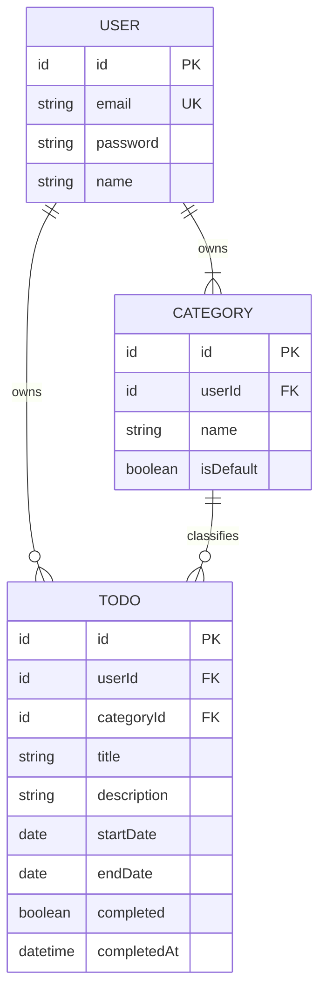

# TodoList 도메인 정의서 (초안)

## 문서 이력

### 버전 이력

| 버전 | 일자 | 작성자 | 상태 | 비고 |
|---|---|---|---|---|
| v0.1 | 2026-11-03 | pmsong | 초안 | 최초 작성 |

### 변경 이력

| 버전 | 일자 | 변경 위치 | 변경 내용 | 변경 사유 | 작성자 |
|---|---|---|---|---|---|
| v0.1 | 2026-11-03 | 전체 | 최초 작성 | - | pmsong |

## 1. 개요

- **목적**: 인증된 사용자가 시작일·종료일이 있는 할일을 카테고리별로 관리하고, 월/주/일 캘린더에서 한꺼번에 조회할 수 있게 한다.
- **문제 정의 요약**
  1. 사용자 개인별로 할일을 분리해 관리할 수단이 없다.
  2. 할일에 시작일과 종료일(기간)을 다룰 수 없다.
  3. 할일을 월별/주별/일별 캘린더에서 한눈에 볼 수 없다.
- **범위 외**: 할일 공유·협업, 알림, 반복 일정, 시간(시:분) 단위 일정, 소셜 로그인, 회원 탈퇴.

## 2. 유비쿼터스 언어

| 용어 | 영문 | 정의 |
|---|---|---|
| 사용자 | User | 회원가입 후 로그인(인증)한 앱 이용자. 모든 데이터의 소유자 |
| 인증 | Authentication | 이메일·비밀번호로 사용자 본인임을 확인하는 행위(로그인) |
| 카테고리 | Category | 사용자가 할일을 분류하기 위해 만든 묶음 |
| 기본 카테고리 | Default Category | 회원가입 시 사용자별로 자동 생성되는 '기본' 카테고리. 카테고리 미지정 할일이 속함 |
| 할일 | Todo | 사용자가 수행할 작업. 제목, 기간(시작일~종료일), 완료 여부를 가짐 |
| 시작일 / 종료일 | Start Date / End Date | 할일 기간의 첫날과 마지막 날(날짜 단위, 양 끝 포함) |
| 완료 여부 | Completed | 사용자가 할일을 끝냈다고 표시했는지 여부(저장값) |
| 할일 상태 | Todo Status | 시작 전 / 진행 중 / 완료 / 지연 중 하나. 완료 여부와 날짜로 파생 |
| 오늘 | Today | 상태 판정 기준 날짜(사용자 기준 현재 날짜) |
| 캘린더 뷰 | Calendar View | 할일을 월/주/일 단위로 날짜 위에 표시하는 조회 방식 |
| 목록 필터 | List Filter | 할일 목록을 카테고리 또는 상태로 걸러내는 조건 |

## 3. 핵심 엔티티와 관계

### 3.1 사용자 (User)

| 속성 | 필수 | 설명 |
|---|---|---|
| id | Y | 식별자 |
| email | Y | 로그인 ID. 전체 사용자 중 유일 |
| password | Y | 비밀번호(해시로 저장) |
| name | Y | 표시 이름 |
| createdAt / updatedAt | Y | 생성·수정 시각 |

### 3.2 카테고리 (Category)

| 속성 | 필수 | 설명 |
|---|---|---|
| id | Y | 식별자 |
| userId | Y | 소유 사용자 |
| name | Y | 이름. 같은 사용자 내 유일 |
| isDefault | Y | 기본 카테고리 여부. 사용자당 정확히 1개만 true |
| createdAt / updatedAt | Y | 생성·수정 시각 |

### 3.3 할일 (Todo)

| 속성 | 필수 | 설명 |
|---|---|---|
| id | Y | 식별자 |
| userId | Y | 소유 사용자 |
| categoryId | Y | 소속 카테고리. 미지정 시 기본 카테고리 |
| title | Y | 제목 |
| description | N | 상세 내용 |
| startDate | Y | 시작일(날짜) |
| endDate | Y | 종료일(날짜) |
| completed | Y | 완료 여부. 기본값 false |
| completedAt | N | 완료 처리 시각 |
| createdAt / updatedAt | Y | 생성·수정 시각 |

> 상태(status)는 저장하지 않는다. 4장 규칙으로 조회 시점에 파생한다.

### 3.4 관계

- 사용자 1 : N 카테고리 (사용자당 기본 카테고리 1개 포함, 최소 1개)
- 사용자 1 : N 할일
- 카테고리 1 : N 할일 (할일은 정확히 1개의 카테고리에 속함)

## 4. 할일 상태 정의

- **저장값**: `completed`(완료 여부)만 저장한다.
- **파생값**: 시작 전 / 진행 중 / 지연은 `startDate`, `endDate`, `오늘`로 조회 시점에 계산한다. (날짜가 지나면 별도 배치 없이 상태가 자동으로 바뀐다.)
- 모든 비교는 날짜 단위이며, 시작일·종료일 당일을 기간에 포함한다.

| 우선순위 | 상태 | 판정 조건 |
|---|---|---|
| 1 | 완료 | `completed = true` (날짜와 무관) |
| 2 | 시작 전 | `completed = false` 이고 `오늘 < startDate` |
| 3 | 진행 중 | `completed = false` 이고 `startDate ≤ 오늘 ≤ endDate` |
| 4 | 지연 | `completed = false` 이고 `오늘 > endDate` |

- 위에서부터 차례로 판정하며 하나의 할일은 정확히 하나의 상태를 가진다.
- 완료를 취소하면(`completed = false`) 날짜 규칙에 따라 상태를 다시 판정한다.
- 시작 전 할일도 완료 처리할 수 있다.

## 5. 비즈니스 규칙

| ID | 구분 | 규칙 |
|---|---|---|
| BR-01 | 인증 | 회원가입·로그인을 제외한 모든 기능은 인증된 사용자만 쓸 수 있다. |
| BR-02 | 인증 | 이메일은 전체 사용자 중 유일해야 한다. |
| BR-03 | 소유권 | 사용자는 본인이 소유한 카테고리와 할일만 조회·등록·수정·삭제할 수 있다. 다른 사용자의 데이터는 존재 여부도 드러내지 않는다. |
| BR-04 | 소유권 | 할일의 카테고리는 같은 사용자의 카테고리만 지정할 수 있다. |
| BR-05 | 사용자 정보 | 사용자는 본인의 이름과 비밀번호를 수정할 수 있다. 비밀번호 변경 시 현재 비밀번호를 확인한다. 이메일(로그인 ID)은 변경할 수 없다. |
| BR-06 | 할일 | 제목, 시작일, 종료일은 필수다. |
| BR-07 | 할일 | 시작일 ≤ 종료일이어야 한다(같은 날 허용). 등록과 수정 모두에 적용한다. |
| BR-08 | 할일 | 과거 날짜로도 등록·수정할 수 있다(결과적으로 지연 상태일 수 있음). |
| BR-09 | 할일 | 삭제된 할일은 복구할 수 없다(물리 삭제). |
| BR-10 | 기본 카테고리 | 회원가입 시 사용자별로 '기본' 카테고리를 1개 자동 생성한다. |
| BR-11 | 기본 카테고리 | 할일 등록·수정 시 카테고리를 지정하지 않으면 기본 카테고리에 속한다. |
| BR-12 | 기본 카테고리 | 기본 카테고리는 삭제하거나 이름을 바꿀 수 없다. |
| BR-13 | 카테고리 | 카테고리 이름은 같은 사용자 안에서 중복될 수 없다('기본' 포함). |
| BR-14 | 카테고리 | 카테고리를 삭제하면 소속 할일은 삭제되지 않고 기본 카테고리로 이동한다. |
| BR-15 | 목록 필터 | 목록은 카테고리 필터와 상태 필터(시작 전/진행 중/완료/지연)를 제공하며, 둘을 함께 적용할 수 있다. 필터를 지정하지 않으면 전체를 보여준다. |
| BR-16 | 캘린더 | 할일은 시작일부터 종료일까지(양 끝 포함) 기간에 속한 모든 날짜에 표시된다. |
| BR-17 | 캘린더 | 월·주 뷰에서는 화면 기간과 할일 기간이 하루라도 겹치면 표시한다. 화면 경계를 넘는 할일은 보이는 구간만 표시한다. |
| BR-18 | 캘린더 | 일 뷰에서는 `startDate ≤ 해당 날짜 ≤ endDate`인 할일을 모두 표시한다. |
| BR-19 | 캘린더 | 캘린더에는 완료된 할일을 포함한 모든 상태의 할일을 표시하며 상태를 구분할 수 있어야 한다. |

## 6. 주요 유스케이스

| ID | 유스케이스 | 설명 |
|---|---|---|
| UC-01 | 회원가입 | 이메일·비밀번호·이름으로 가입하고 기본 카테고리가 생성된다. |
| UC-02 | 로그인 / 로그아웃 | 이메일·비밀번호로 인증하고, 로그아웃으로 인증을 해제한다. |
| UC-03 | 내 정보 수정 | 본인의 이름과 비밀번호를 수정한다. |
| UC-04 | 카테고리 관리 | 카테고리를 등록·이름 수정·삭제한다(기본 카테고리 제외). |
| UC-05 | 할일 등록 | 제목·기간(캘린더로 선택)·카테고리를 입력해 할일을 등록한다. |
| UC-06 | 할일 수정 | 편집 화면에서 할일의 내용·기간·카테고리를 수정한다. |
| UC-07 | 할일 완료 / 완료 취소 | 할일의 완료 여부를 바꾼다. |
| UC-08 | 할일 삭제 | 본인의 할일을 삭제한다. |
| UC-09 | 할일 목록 조회 | 카테고리·상태 필터로 할일 목록을 조회한다. |
| UC-10 | 캘린더 조회 | 월/주/일 뷰에서 기간에 걸친 할일을 조회한다. |

## 7. 미결 사항 / 가정

| 번호 | 내용 | 구분 |
|---|---|---|
| A-01 | 시작일·종료일은 모두 필수이며 시간 없이 날짜 단위로만 관리한다. | 가정 |
| A-02 | 상태는 `completed`만 저장하고 나머지는 날짜로 파생한다. 완료가 날짜보다 우선한다. | 가정 |
| A-03 | '오늘'은 사용자 기준 현지 날짜로 본다. 시간대 처리 방식(사용자별 설정 여부)은 미결. | 미결 |
| A-04 | 기본 카테고리는 사용자별로 존재하며 삭제·이름 변경이 불가하다. | 가정 |
| A-05 | 카테고리 삭제 시 소속 할일은 기본 카테고리로 이동한다. | 가정 |
| A-06 | 로그인 ID는 이메일이며 변경 불가, 수정 가능한 정보는 이름·비밀번호다. | 가정 |
| A-07 | 할일 삭제는 복구 불가한 물리 삭제다. | 가정 |
| A-08 | 카테고리·상태 필터는 함께 적용할 수 있다. 목록 정렬 기준(예: 종료일 순)은 미결. | 가정 / 미결 |
| A-09 | 회원 탈퇴, 비밀번호 찾기, 이메일 인증은 요구사항에 없어 범위 외로 둔다. 필요하면 추후 결정. | 미결 |
