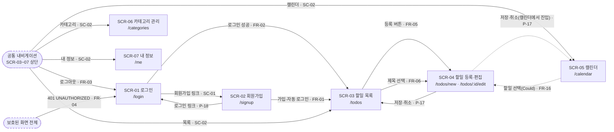

# TodoList 와이어프레임

## 문서 이력

### 버전 이력

| 버전 | 일자 | 작성자 | 상태 | 비고 |
|---|---|---|---|---|
| v0.1 | 2026-11-04 | pmsong | 초안 | 최초 작성 |
| v0.2 | 2026-11-04 | pmsong | 초안 | 임시 배치를 PRD v0.8 결정(P-17~21)·도메인 BR-23으로 대체 |
| v0.3 | 2026-11-04 | pmsong | 초안 | 품질 평가 Top 5 반영(PRD v0.9 P-22~24) |
| v0.4 | 2026-11-04 | pmsong | 초안 | 문서 간 정합성 검토 반영 |
| v0.5 | 2026-11-04 | Claude | 초안 | 참조 버전 동기화 |
| v0.6 | 2026-11-05 | Claude | 초안 | 캘린더 이어진 막대(PRD v0.17 P-16) |
| v0.7 | 2026-11-05 | Claude | 초안 | 시작·종료 시간 입력과 표시(P-26) |
| v0.8 | 2026-11-05 | Claude | 초안 | 제목 이모지, 주별 바탕·주차(P-27, P-28) |
| v0.9 | 2026-11-05 | Claude | 초안 | 4주 뷰(FR-17) |

### 변경 이력

| 버전 | 일자 | 변경 위치 | 변경 내용 | 변경 사유 | 작성자 |
|---|---|---|---|---|---|
| v0.1 | 2026-11-04 | 전체 | 최초 작성 | - | pmsong |
| v0.2 | 2026-11-04 | WF-03, 2장 | 로그인 이동 링크 추가 | PRD P-18 | pmsong |
| v0.2 | 2026-11-04 | WF-05, 2장, L-02·L-03 | 취소 버튼 추가, 저장·취소 후 진입 화면 복귀 | PRD P-17 | pmsong |
| v0.2 | 2026-11-04 | WF-09, L-15 | 카테고리 삭제 확인 대화상자 추가, 목록 순서를 BR-23으로 | PRD P-19, 도메인 BR-23 | pmsong |
| v0.2 | 2026-11-04 | WF-04, WF-06~08, L-11·L-12·L-18 | 0건 안내 문구, 긴 제목 말줄임, 모바일 주·일 뷰·초기 선택을 PRD 결정 참조로 | PRD P-20, P-21 | pmsong |
| v0.2 | 2026-11-04 | 단일 출처 원칙 | 도메인 v0.5 → v0.6, PRD v0.7 → v0.8, 시나리오 v0.5 → v0.6 | 버전 동기화 | pmsong |
| v0.3 | 2026-11-04 | 3.0, WF-13, WF-14 | 화면 × 상태 매트릭스, 처리 중 상태(WF-13)와 빈 상태·모바일 오류·모바일 대화상자(WF-14) 추가 | 상태 커버리지 부족, PRD P-22 | pmsong |
| v0.3 | 2026-11-04 | 2장 | 흐름도를 화면 노드(경로 포함)와 가상 노드로 구분하고 라벨 통일, 경로·상태 유지 규칙 참조 추가 | 흐름도 표현 불일치, PRD P-23 | pmsong |
| v0.3 | 2026-11-04 | WF-06, WF-07 | 데스크톱 칸 제목을 말줄임으로 다시 그리고 격자 정렬 | P-21과 그림 불일치 | pmsong |
| v0.3 | 2026-11-04 | WF-11, WF-02 | 화면에서 재현 불가한 404 예시를 500으로 교체, 로그인 비밀번호 사유 줄 추가 | 예시 부적절·누락 | pmsong |
| v0.3 | 2026-11-04 | WF-03, WF-10 | 비밀번호 확인 입력란 추가 | PRD P-24 | pmsong |
| v0.3 | 2026-11-04 | 4장 | P → WF, SC → WF 추적표와 커버리지 추가 | 추적성이 FR·SCR 단위에서 멈춤 | pmsong |
| v0.3 | 2026-11-04 | WF-01 | 사용자 이름 표시 우선순위 Must로 정정 | PRD v0.9 공통 내비게이션 | pmsong |
| v0.3 | 2026-11-04 | 단일 출처 원칙 | PRD v0.8 → v0.9, 시나리오 v0.6 → v0.7 | 버전 동기화 | pmsong |
| v0.4 | 2026-11-04 | WF-02, WF-03 모바일 | 데스크톱과 같게 이메일(로그인)·이름(회원가입) 입력란 아래 사유 줄 추가 | 데스크톱·모바일 그림 불일치 | pmsong |
| v0.4 | 2026-11-04 | 단일 출처 원칙 | PRD v0.9 → v0.11, 시나리오 v0.7 → v0.9 | 버전 동기화 | pmsong |
| v0.5 | 2026-11-04 | 단일 출처 원칙 | 도메인 v0.6 → v0.7, PRD v0.11 → v0.12, 시나리오 v0.9 → v0.10 | 버전 동기화 | Claude |
| v0.6 | 2026-11-05 | WF-06, WF-07 | 날짜 칸마다 반복 → 기간을 잇는 막대, 3건 초과 예시를 줄 배정에 맞춤 | PRD v0.17 P-16 | Claude |
| v0.7 | 2026-11-05 | WF-05, L-19 | 시간 선택기 줄 추가, 제목 앞 시작 시간 표시 배치 | PRD v0.18 P-26 | Claude |
| v0.8 | 2026-11-05 | L-20, L-21 | 이모지 위치, 월 뷰 주별 바탕과 일요일 칸 주차 위치 | PRD v0.19 P-27, P-28 | Claude |
| v0.9 | 2026-11-05 | L-09, L-22 | 4주 전환 버튼, 4주 뷰 배치, 다른 달 빈칸 바탕 | PRD v0.20 FR-17, P-30 | Claude |

> 단일 출처 원칙: 용어, 엔티티, 상태 규칙(ST), 비즈니스 규칙(BR), 유스케이스(UC)는 [도메인 정의서 v0.7](./1-domain-definition.md)가, 기능(FR)·화면(SCR)·비기능(NFR)·결정 사항(P)은 [PRD v0.12](./2-PRD.md)이, 시나리오(SC)와 예시 데이터는 [사용자 시나리오 v0.10](./3-user-scenario.md)가 정의한다. 이 문서는 해당 ID를 참조만 하며 화면 구성 요소·동작·오류 코드·규칙을 다시 정의하지 않는다. 충돌하면 도메인 정의서 > PRD > 시나리오 > 이 문서 순으로 따른다.
>
> ID 운영 원칙: 와이어프레임 ID(WF-xx)는 재사용하거나 재번호하지 않는다. 와이어프레임을 없애면 행을 지우지 말고 '폐기'로 표시한다.

## 1. 개요

| 항목 | 내용 |
|---|---|
| 목적 | PRD 4.2의 화면(SCR-01~07, 공통 내비게이션)을 개발자가 바로 만들 수 있는 수준의 배치로 보여준다. |
| 범위 | 저충실도(구조·배치만). 색·폰트·브랜딩 등 시각 디자인은 다루지 않는다. 접근성은 PRD 3.2에 따라 범위 외. 데스크톱(폭 768px 이상)과 모바일(폭 360px, 768px 미만, NFR-13)을 그린다. |
| 예시 데이터 | 시나리오 3.0의 T1~T4, 오늘 = 2026-11-04. 목록·캘린더 칸 안 순서는 BR-20(종료일 → 등록 시각), 상태 명칭은 ST-01~04(완료/시작 전/진행 중/지연). |
| 오류 문구 | `<message>`, `<사유>`는 서버가 내려주는 값(NFR-15)을 그대로 표시한다는 뜻이다. 문구는 이 문서가 정하지 않는다. |

**표기 규칙**

| 기호 | 의미 |
|---|---|
| `[ 저장 ]` | 버튼 |
| `[-수정-]` | 비활성 버튼 |
| `[__________]` | 입력란 |
| `[v]` / `[ ]` | 완료 토글 켜짐 / 꺼짐 |
| `[~]` | 저장 중이라 비활성인 완료 토글(P-22) |
| `(지연)` | 캘린더 칸 안의 상태 표시(ST-01~04) |
| `…` | 말줄임(P-21) |
| `[▼ 전체]` | 선택 상자(드롭다운) |
| `[2026-11-02 ▼]` | 날짜 선택기 |
| `<링크>` | 링크·내비게이션 이동 |
| `(*)` | 현재 선택된 항목 |
| `!` | 오류 사유 표시 |
| `...` | 생략 |

## 2. 화면 흐름도



- 사각형은 화면(아래 줄은 경로, PRD P-23), 점선 둥근 상자는 실제 화면이 아닌 가상 노드다. 점선 화살표는 조건부 이동이다(Could 기능, 또는 캘린더에서 진입했을 때).
- `/`와 정의되지 않은 경로, 로그인 상태의 `/login`·`/signup` 접근, URL로 직접 연 SCR-04의 저장·취소 후 이동은 P-23을 따른다.
- 화면을 오갈 때 캘린더 뷰·기준 날짜는 URL로, 목록 필터·선택한 날짜는 클라이언트 상태로 유지된다(P-23).

- SCR-01·SCR-02에는 내비게이션을 두지 않는다(비로그인 화면, BR-01).
- 필터 변경, 완료 토글, 삭제, 뷰 전환, 날짜 선택은 화면 이동 없이 같은 화면에서 목록·캘린더를 다시 조회한다(FR-07~FR-12, P-15).

## 3. 화면별 와이어프레임

우선순위(MoSCoW)는 관련 FR의 값(PRD 4.1)을 따른다.

### 3.0 화면 × 상태

| 화면 | 기본 | 처리 중(P-22) | 빈 상태(P-21) | 오류(PRD 4장 머리말) |
|---|---|---|---|---|
| 공통 내비게이션 | WF-01 | - | - | WF-01 화면 상단 영역 |
| SCR-01 로그인 | WF-02 | 버튼 비활성(WF-13) | - | WF-02 |
| SCR-02 회원가입 | WF-03 | 버튼 비활성(WF-13) | - | WF-03 |
| SCR-03 할일 목록 | WF-04 | WF-13 | WF-14 | WF-12 |
| SCR-04 등록·편집 | WF-05 | WF-13 폼 | - | WF-11, WF-14(모바일) |
| SCR-05 캘린더 | WF-06~08 | WF-13과 같음 | WF-14(그날 목록), 일 뷰도 같음 | WF-12(화면 상단) |
| SCR-06 카테고리 | WF-09 | 버튼 비활성(WF-13) | 해당 없음('기본'이 항상 있음, BR-10·BR-12) | WF-09 |
| SCR-07 내 정보 | WF-10 | 버튼 비활성(WF-13) | - | WF-10 |
| 삭제 확인 대화상자 | WF-04, WF-09, WF-14 | 확인 버튼 비활성(WF-13) | - | 실패 시 대화상자를 닫고 화면 상단에 표시 |

### WF-01 공통 내비게이션 (SCR-03~07 상단에 공통)

**데스크톱**

```
+----------------------------------------------------------------------------+
| <목록>  <캘린더>  <카테고리>  <내 정보>              {사용자 이름} [로그아웃] |
+----------------------------------------------------------------------------+
| ! <message>   <- 화면 상단 오류 영역(폼 없는 화면: SCR-03, SCR-05)             |
|                                                                            |
|  본문                                                                      |
```

**모바일 (360px)**

```
+------------------------------------+
| {사용자 이름}            [로그아웃] |
| <목록> <캘린더> <카테고리> <내 정보> |
+------------------------------------+
| ! <message>                        |
|  본문                              |
```

| 구성 요소 | 관련 FR / BR / SC | 우선순위 |
|---|---|---|
| 사용자 이름 표시 | PRD 4.2 공통, SC-02 | Must |
| 이름 수정 후 새 이름 반영 | FR-14, SC-11 | Should |
| 목록 / 캘린더 / 카테고리 / 내 정보 이동 | PRD 4.2 공통, SC-02 | Must (내 정보 이동은 Should) |
| 로그아웃 | FR-03, SC-02 | Must |
| 화면 상단 오류 영역 | PRD 4장 머리말, FR-04, P-15 | Must |

### WF-02 로그인 (SCR-01)

**데스크톱**

```
              로그인
   ! <message>                       <- 401 INVALID_CREDENTIALS 등(폼 상단)
   이메일     [______________________]
              ! <사유>               <- 400 VALIDATION_ERROR fields
   비밀번호   [______________________]
              ! <사유>
   [ 로그인 ]
   <회원가입>
```

**모바일 (360px)**

```
+------------------------------------+
|  로그인                            |
|  ! <message>                       |
|  이메일                            |
|  [______________________________]  |
|  ! <사유>                          |
|  비밀번호                          |
|  [______________________________]  |
|  ! <사유>                          |
|  [ 로그인 ]                        |
|  <회원가입>                        |
+------------------------------------+
```

| 구성 요소 | 관련 FR / BR / SC | 우선순위 |
|---|---|---|
| 이메일, 비밀번호 입력, 로그인 버튼 → 성공 시 SCR-03 | FR-02, SC-02 | Must |
| 오류 표시(INVALID_CREDENTIALS는 폼 상단) | FR-02, NFR-15, E-02-1 | Must |
| 회원가입 이동 링크 → SCR-02 | SC-01 | Must |
| 401 UNAUTHORIZED/로그아웃 후 도착 지점 | FR-03, FR-04, SC-02 | Must |

### WF-03 회원가입 (SCR-02)

**데스크톱**

```
              회원가입
   ! <message>                       <- 409 DUPLICATE_EMAIL 등(폼 상단)
   이메일     [______________________]
              ! <사유>
   비밀번호   [______________________]
              ! <사유>
   비밀번호 확인 [______________________]
              ! <사유: 불일치>          <- 화면에서 검사, 요청 미전송(P-24)
   이름       [______________________]
              ! <사유>
   [ 가입 ]
   이미 계정이 있나요? <로그인>
```

**모바일 (360px)**

```
+------------------------------------+
|  회원가입                          |
|  ! <message>                       |
|  이메일                            |
|  [______________________________]  |
|  ! <사유>                          |
|  비밀번호                          |
|  [______________________________]  |
|  ! <사유>                          |
|  비밀번호 확인                     |
|  [______________________________]  |
|  ! <사유: 불일치>                  |
|  이름                              |
|  [______________________________]  |
|  ! <사유>                          |
|  [ 가입 ]                          |
|  이미 계정이 있나요? <로그인>      |
+------------------------------------+
```

| 구성 요소 | 관련 FR / BR / SC | 우선순위 |
|---|---|---|
| 이메일·비밀번호·이름 입력, 가입 버튼 → 성공 시 자동 로그인 후 SCR-03 | FR-01, BR-10, SC-01 | Must |
| 입력란별 사유(형식·BR-21·BR-22 위반) | FR-01, BR-21, BR-22, E-01-2, E-01-3 | Must |
| 폼 상단 message(DUPLICATE_EMAIL) | FR-01, BR-02, E-01-1 | Must |
| 비밀번호 확인(불일치면 요청 미전송, 확인란 옆 사유) | FR-01, P-24, E-01-4 | Must |
| 로그인 이동 링크 → SCR-01 | P-18 | Must |

### WF-04 할일 목록 (SCR-03)

**데스크톱**

```
[ 내비게이션: WF-01 ]
+----------------------------------------------------------------------------+
| ! <message>                                    <- 화면 상단 오류(P-15, 필터 오류)
| [ + 할일 등록 ]
| 카테고리 [▼ 전체]    상태 [▼ 전체]
+----------------------------------------------------------------------------+
| 완료 | 제목          | 기간                      | 카테고리 | 상태    |        |
| [ ]  | 보고서 작성   | 2026-10-28 ~ 2026-11-03   | 업무     | 지연    | [삭제] |
| [v]  | 장보기        | 2026-11-04 ~ 2026-11-04   | 기본     | 완료    | [삭제] |
| [ ]  | 시험 공부     | 2026-11-02 ~ 2026-11-10   | 학습     | 진행 중 | [삭제] |
| [ ]  | 여행 준비     | 2026-11-20 ~ 2026-12-02   | 기본     | 시작 전 | [삭제] |
+----------------------------------------------------------------------------+
  (제목을 누르면 SCR-04 편집)       (0건이면 행 대신 '할일이 없습니다.', P-21)
```

삭제 확인(FR-08): `[삭제]`를 누르면 확인 대화상자를 띄운다.

```
+------------------------------+
| 이 할일을 삭제할까요?         |
|        [ 취소 ]  [ 확인 ]     |
+------------------------------+
```

**모바일 (360px)**

```
+------------------------------------+
| (내비게이션: WF-01 모바일)         |
| ! <message>                        |
| [ + 할일 등록 ]                    |
| 카테고리 [▼ 전체]                  |
| 상태     [▼ 전체]                  |
+------------------------------------+
| [ ] 보고서 작성            [삭제]  |
|     2026-10-28 ~ 2026-11-03        |
|     업무 · 지연                    |
|------------------------------------|
| [v] 장보기                 [삭제]  |
|     2026-11-04 ~ 2026-11-04        |
|     기본 · 완료                    |
|------------------------------------|
| [ ] 시험 공부              [삭제]  |
|     2026-11-02 ~ 2026-11-10        |
|     학습 · 진행 중                 |
|------------------------------------|
| [ ] 여행 준비              [삭제]  |
|     2026-11-20 ~ 2026-12-02        |
|     기본 · 시작 전                 |
+------------------------------------+
```

| 구성 요소 | 관련 FR / BR / SC | 우선순위 |
|---|---|---|
| 카테고리 필터(전체 + 본인 카테고리) | FR-09, BR-15, SC-08 | Must |
| 상태 필터(전체 + ST-01~04 중 하나) | FR-09, BR-15, ST-01~04, SC-08 | Must |
| 행 순서(종료일 → 등록 시각) | BR-20, SC-08 | Must |
| 제목(누르면 SCR-04 편집) | FR-06, SC-05 | Must |
| 기간, 카테고리, 상태 표시 | FR-09, ST-01~04 | Must |
| 완료 토글(1회 조작, 저장 성공 후 재조회로 표시, 실패 시 원상태 유지) | FR-07, P-15, SC-06 | Must |
| 삭제 버튼 + 확인 | FR-08, BR-09, SC-07 | Must |
| 등록 버튼 → SCR-04 | FR-05, SC-04 | Must |
| 0건 안내 '할일이 없습니다.' | P-21 | Must |
| 화면 상단 오류(404 NOT_FOUND 필터, 400 VALIDATION_ERROR, 500) | PRD 4장 머리말, P-14, P-15, E-08-2, E-08-3, E-06-2 | Must |

### WF-05 할일 등록·편집 (SCR-04)

등록과 편집은 같은 배치다. 편집은 현재 값이 채워진 채로 열린다(FR-06, SC-05 단계 0). 아래는 편집 예(T2).

**데스크톱**

```
[ 내비게이션: WF-01 ]
 할일 편집                          <- 등록일 때 "할일 등록"
 ! <message>                        <- 폼 상단 오류
 제목      [시험 공부____________________]
           ! <사유>
 설명      [______________________________]
           [______________________________]
           ! <사유>
 시작일    [2026-11-02 ▼]     종료일  [2026-11-10 ▼]
 시작 시간 [09:00 ▼]          종료 시간 [18:00 ▼]      <- 선택(P-26), 비우면 시간 없음
           ! <사유>                     ! <사유>
 카테고리  [▼ 학습]
 [ 저장 ]  [ 취소 ]
```

**모바일 (360px)**

```
+------------------------------------+
| (내비게이션: WF-01 모바일)         |
| 할일 편집                          |
| ! <message>                        |
| 제목                               |
| [시험 공부______________________]  |
| ! <사유>                           |
| 설명                               |
| [______________________________]  |
| [______________________________]  |
| 시작일                             |
| [2026-11-02 ▼]                     |
| 종료일                             |
| [2026-11-10 ▼]                     |
| 카테고리                           |
| [▼ 학습]                           |
| [ 저장 ]  [ 취소 ]                 |
+------------------------------------+
```

| 구성 요소 | 관련 FR / BR / SC | 우선순위 |
|---|---|---|
| 제목(필수) | FR-05, BR-06, BR-22, E-04-1 | Must |
| 설명(선택) | FR-05, BR-22, E-04-3 | Must |
| 시작일·종료일 날짜 선택기(필수, 시작일 ≤ 종료일, 과거 허용) | FR-05, BR-06, BR-07, BR-08, SC-04 | Must |
| 시작·종료 시간 선택기(선택, 같은 날이면 시작 ≤ 종료) | FR-05, FR-06, BR-24, P-26 | Must |
| 카테고리 선택(등록 시 선택 안 함 = 기본, 편집 시 미지정 = 기존 유지) | FR-05, FR-06, BR-04, BR-11, A-04-1, A-05-1 | Must |
| 저장·취소 버튼 → 저장 성공·취소 시 진입 화면(SCR-03/SCR-05)으로 복귀 | FR-05, FR-06, P-17, A-05-4 | Must |
| 카테고리 선택 항목 순서(기본 먼저, 이후 생성 순) | BR-23 | Must |
| 입력란 옆 사유(400), 폼 상단 message(404 등) | PRD 4장 머리말, E-04-1~E-04-4, E-05-1, E-05-2 | Must |
| 편집 화면 진입(목록 제목) | FR-06, SC-05 | Must |
| 편집 화면 진입(캘린더 할일) | FR-16, SC-12 | Could |

### WF-06 캘린더 월 뷰 (SCR-05)

**데스크톱** (`/calendar?view=month&date=2026-11-04`, 첫 두 주만 그림. 칸 폭에 맞춰 제목을 말줄임한 예, P-21)

```
[ 내비게이션: WF-01 ]
 ! <message>                                  <- 화면 상단 오류(P-14 등)
 [월(*)] [주] [일]        [ < ]  2026-11  [ > ]
+--------------+--------------+--------------+--------------+--------------+--------------+--------------+
| 일           | 월           | 화           | 수           | 목           | 금           | 토           |
+--------------+--------------+--------------+--------------+--------------+--------------+--------------+
| 1            | 2            | 3            | 4 (*)        | 5            | 6            | 7            |
|[== 보고서 작성 (지연) =======================]|[장보기(완료)]|              |              |              |
|              |[== 시험 공부 (진행 중) =====================================================================]|
+--------------+--------------+--------------+--------------+--------------+--------------+--------------+
| 8            | 9            | 10           | 11           | 12           | 13           | 14           |
|[== 시험 공부 (진행 중) =======================]|              |              |              |              |
+--------------+--------------+--------------+--------------+--------------+--------------+--------------+
  ... 15~19 빈 칸, 20~30: '여행 준비 (시작 전)' 막대(주마다 끊김)        <- 막대는 주 단위(P-16)
 그날 목록: 2026-11-04                 <- 처음 열면 오늘 선택(P-20). 날짜·'+N'을 누르면 바뀜
   장보기     완료                      <- 그날 목록은 전체 제목(P-21)
   시험 공부  진행 중
```

한 칸에 3건을 넘으면(SC-09 A-09-2의 11-04 칸):

```
| 4 (*)        |
| 장보기(완료) |                       <- 1줄
|== 시험 공부 =|=====                  <- 2줄: 11-02~11-07 막대가 이어짐
| 회의(진행 중)|                       <- 3줄
| +1           |   <- '운동'. 누르면 그날 목록 4건(T4, 회의, 운동, T2, BR-20)
```

**모바일 (360px)** (2026-11)

```
+------------------------------------+
| (내비게이션: WF-01 모바일)         |
| ! <message>                        |
| [월(*)] [주] [일]                  |
| [ < ]     2026-11      [ > ]       |
| 일  월  화  수  목  금  토         |
|  1   2   3  (4)  5   6   7         |   <- (4) 오늘 선택(P-20)
| •1  •2  •2  •2  •1  •1  •1        |
|  8   9  10  11  12  13  14         |
| •1  •1  •1                         |
| ... (15~21: 20·21에 •1) ...        |
+------------------------------------+
| 2026-11-04                         |
|  장보기      완료                  |
|  시험 공부   진행 중               |
+------------------------------------+
```

| 구성 요소 | 관련 FR / BR / SC | 우선순위 |
|---|---|---|
| 월/주/일 전환, 이전/다음 월 이동 | FR-10, SC-09 | Must |
| 데스크톱 기간을 잇는 막대 '제목 + 상태'(주 단위로 끊김, 월 경계 포함). 긴 제목은 한 줄 말줄임(…) | FR-10, BR-16, BR-17, BR-19, P-16, P-21, SC-09 | Must |
| 처음 열면 오늘 선택·그날 목록 표시, 오늘 없는 월로 이동하면 선택 해제. 0건 칸은 표시 없음 | P-20 | Must |
| 칸 안·그날 목록 순서 | BR-20, P-16 | Must |
| 칸당 줄 3개, 넘친 할일이 있는 날짜에 '+N' | P-16, A-09-2 | Must |
| 날짜·'+N' 선택 → 아래 그날 목록 | P-16, SC-09 | Must |
| 모바일 날짜 칸 개수 점·숫자(완료 포함) | SCR-05 모바일, BR-19, A-09-1, R-07 | Must |
| 모바일 날짜 선택 → 아래 그날 목록 | SCR-05 모바일, A-09-1 | Must |
| 칸·그날 목록의 할일 선택 → SCR-04 | FR-16, SC-12 | Could |
| 화면 상단 오류(조회 기간 오류) | P-14, E-09-2 | Must |

### WF-07 캘린더 주 뷰 (SCR-05)

**데스크톱** (`/calendar?view=week&date=2026-11-04`)

```
[ 내비게이션: WF-01 ]
 ! <message>
 [월] [주(*)] [일]       [ < ]  2026-11-01 ~ 2026-11-07  [ > ]
+--------------+--------------+--------------+--------------+--------------+--------------+--------------+
| 일 11-01     | 월 11-02     | 화 11-03     | 수 11-04 (*) | 목 11-05     | 금 11-06     | 토 11-07     |
+--------------+--------------+--------------+--------------+--------------+--------------+--------------+
|[== 보고서 작성 (지연) =======================]|[장보기(완료)]|              |              |              |
|              |[== 시험 공부 (진행 중) =====================================================================]|
+--------------+--------------+--------------+--------------+--------------+--------------+--------------+
 그날 목록: 2026-11-04        <- 월 뷰와 같은 구성 요소, 전체 제목
   장보기     완료
   시험 공부  진행 중
```

**모바일 (360px)**

```
+------------------------------------+
| (내비게이션: WF-01 모바일)         |
| [월] [주(*)] [일]                  |
| [ < ]  11-01 ~ 11-07  [ > ]        |
| 일  월  화  수  목  금  토         |
|  1   2   3   4   5   6   7         |
| •1  •2  •2  •2  •1  •1  •1        |
+------------------------------------+
| 2026-11-04                         |
|  장보기      완료                  |
|  시험 공부   진행 중               |
+------------------------------------+
```

| 구성 요소 | 관련 FR / BR / SC | 우선순위 |
|---|---|---|
| 일요일~토요일 표시, 이전/다음 주 이동 | FR-11, BR-17, SC-10 | Should |
| 기간을 잇는 막대 '제목 + 상태'(데스크톱), 줄 3개 초과 날짜 '+N', 그날 목록 | FR-11, BR-19, BR-20, P-16 | Should |
| 모바일 표시(개수 + 그날 목록) | P-20, R-07 | Should |
| 할일 선택 → SCR-04 | FR-16, SC-12 | Could |
| 조회 기간 오류 표시 | FR-11, P-14, E-09-2 | Should |

### WF-08 캘린더 일 뷰 (SCR-05)

**데스크톱**

```
[ 내비게이션: WF-01 ]
 ! <message>
 [월] [주] [일(*)]       [ < ]  2026-11-04 (수)  [ > ]
+----------------------------------------------------+
|  장보기        완료                                |
|  시험 공부     진행 중                             |
+----------------------------------------------------+
```

**모바일 (360px)**

```
+------------------------------------+
| (내비게이션: WF-01 모바일)         |
| [월] [주] [일(*)]                  |
| [ < ]  2026-11-04 (수)  [ > ]      |
|------------------------------------|
|  장보기        완료                |
|  시험 공부     진행 중             |
+------------------------------------+
```

| 구성 요소 | 관련 FR / BR / SC | 우선순위 |
|---|---|---|
| 이전/다음 날 이동 | FR-12, SC-10 | Should |
| 해당 날짜 포함 할일 전부, 상태와 함께 BR-20 순서. 0건이면 '할일이 없습니다.' | FR-12, BR-18, BR-19, BR-20, P-21, SC-10 | Should |
| 모바일도 데스크톱과 같은 목록 | P-20 | Should |
| 할일 선택 → SCR-04 | FR-16, SC-12 | Could |
| 조회 기간 오류 표시 | FR-12, P-14, E-09-2 | Should |

### WF-09 카테고리 관리 (SCR-06)

**데스크톱**

```
[ 내비게이션: WF-01 ]
 ! <message>                         <- 폼 상단 오류(409 DUPLICATE_CATEGORY 등)
 새 카테고리  [______________]  [ 추가 ]
              ! <사유>
+----------------------------------------------+
| 기본                   [-수정-]  [-삭제-]     |   <- 기본 카테고리는 비활성(FR-13)
| 업무                   [ 수정 ]  [ 삭제 ]     |
| 학습                   [ 수정 ]  [ 삭제 ]     |
+----------------------------------------------+
 수정 중인 행:
| 학습 -> [시험__________]  [ 저장 ]             |
```

삭제 확인(P-19): `[ 삭제 ]`를 누르면 확인 대화상자를 띄운다(WF-04 대화상자와 같은 구성 요소).

```
+------------------------------------------+
| '업무' 카테고리를 삭제할까요?             |
| 소속 할일은 '기본'으로 옮겨집니다.         |
|            [ 취소 ]  [ 확인 ]             |
+------------------------------------------+
```

**모바일 (360px)**

```
+------------------------------------+
| (내비게이션: WF-01 모바일)         |
| ! <message>                        |
| 새 카테고리                        |
| [______________________]  [ 추가 ] |
| ! <사유>                           |
|------------------------------------|
| 기본              [-수정-] [-삭제-] |
| 업무              [ 수정 ] [ 삭제 ] |
| 학습              [ 수정 ] [ 삭제 ] |
|  수정 중: [시험________]  [ 저장 ] |
+------------------------------------+
```

| 구성 요소 | 관련 FR / BR / SC | 우선순위 |
|---|---|---|
| 카테고리 목록(기본 먼저, 이후 생성 순) | FR-13, BR-23, SC-03 | Must |
| 추가(입력란 + 버튼) | FR-13, BR-13, BR-22, SC-03 | Must |
| 이름 수정 | FR-13, BR-13, BR-22, SC-03 | Must |
| 삭제 + 확인 대화상자(소속 할일은 기본으로 이동 안내) | FR-13, BR-14, P-19, SC-03 | Must |
| 기본 카테고리 수정·삭제 비활성 | FR-13, BR-12, SC-03 | Must |
| 오류 표시(400 입력란 옆, 409 폼 상단) | PRD 4장 머리말, E-03-1, E-03-3 | Must |

### WF-10 내 정보 (SCR-07)

**데스크톱**

```
[ 내비게이션: WF-01 ]
 ! <message>                         <- 폼 상단 오류(400 INVALID_PASSWORD 등)
 이메일          u1@example.com  (읽기 전용)
 이름            [______________________]  [ 이름 저장 ]
                 ! <사유>
 ---- 비밀번호 변경 ----
 현재 비밀번호   [______________________]
 새 비밀번호     [______________________]
                 ! <사유>
 새 비밀번호 확인 [______________________]
                 ! <사유: 불일치>      <- 화면에서 검사(P-24)
 [ 비밀번호 변경 ]
```

**모바일 (360px)**

```
+------------------------------------+
| (내비게이션: WF-01 모바일)         |
| ! <message>                        |
| 이메일                             |
| u1@example.com (읽기 전용)         |
| 이름                               |
| [______________________________]  |
| ! <사유>                           |
| [ 이름 저장 ]                      |
| ---- 비밀번호 변경 ----            |
| 현재 비밀번호                      |
| [______________________________]  |
| 새 비밀번호                        |
| [______________________________]  |
| ! <사유>                           |
| 새 비밀번호 확인                   |
| [______________________________]  |
| ! <사유: 불일치>                   |
| [ 비밀번호 변경 ]                  |
+------------------------------------+
```

| 구성 요소 | 관련 FR / BR / SC | 우선순위 |
|---|---|---|
| 이메일(읽기 전용) | FR-14, BR-05, SC-11 | Should |
| 이름 수정 + 저장(성공 시 내비게이션 이름도 갱신) | FR-14, BR-22, E-11-1, SC-11 | Should |
| 현재 비밀번호·새 비밀번호·새 비밀번호 확인 + 변경 버튼 | FR-15, BR-05, BR-21, P-24, E-11-2~E-11-4, SC-11 | Should |
| 오류 표시 | PRD 4장 머리말 | Should |

### WF-11 오류 표시 상태 예 — 폼 화면 (SCR-04, 대표)

시작일 > 종료일이고 제목이 비었을 때(400, E-04-1·E-04-2)와 서버 오류(500, E-C3)를 한 그림에 모았다. 실제로는 응답에 따라 한쪽만 나타난다. 타인 카테고리 지정(404, E-04-4)은 화면의 선택 항목에 본인 카테고리만 있어 API로만 재현되므로 그리지 않는다.

```
 할일 등록
 ! <message>                        <- 500 INTERNAL_ERROR 등 fields 없는 오류(폼 상단)
 제목      [______________________]
           ! <사유: 제목 누락>      <- 400 VALIDATION_ERROR fields, 입력란 옆
 시작일    [2026-11-10 ▼]     종료일  [2026-11-02 ▼]
           ! <사유: 기간 오류>
 카테고리  [▼ 선택 안 함]
 [ 저장 ]
```

모바일은 WF-14에 그렸다. 같은 규칙이 SCR-01·02·06·07에 적용된다(PRD 4장 머리말).

| 구성 요소 | 관련 FR / BR / SC | 우선순위 |
|---|---|---|
| 입력란 옆 `fields` 사유 | FR-05, BR-06, BR-07, NFR-15, E-04-1, E-04-2 | Must |
| 폼 상단 `message` | FR-05, NFR-15, E-C3 | Must |

### WF-12 오류 표시 상태 예 — 폼 없는 화면 (SCR-03, 대표)

완료 토글 저장 실패(E-06-2) 예. 토글은 원래 상태로 남고 오류는 화면 상단에 표시된다(P-15).

```
[ 내비게이션 ]
+----------------------------------------------------------------------------+
| ! <message>                        <- 500 INTERNAL_ERROR, 화면 상단            |
| [ + 할일 등록 ]
| 카테고리 [▼ 전체]    상태 [▼ 전체]
| [ ]  | 시험 공부  | 2026-11-02 ~ 2026-11-10 | 학습 | 진행 중 | [삭제]        <- 토글 그대로 [ ]
```

SCR-05의 조회 기간 오류(E-09-2)도 같은 위치(화면 상단)에 표시한다.

| 구성 요소 | 관련 FR / BR / SC | 우선순위 |
|---|---|---|
| 화면 상단 `message` | PRD 4장 머리말, P-15, E-06-2, E-09-2 | Must |
| 실패 시 토글 원상태 유지 | FR-07, P-15 | Must |

### WF-13 처리 중 상태 (SCR-03 대표, P-22)

첫 조회(본문 대신 표시):

```
[ 내비게이션: WF-01 ]
 불러오는 중…
```

재조회와 완료 토글 저장 중(이전 목록을 유지):

```
[ 내비게이션: WF-01 ]
+----------------------------------------------------------------------------+
| 갱신 중…                                         <- 화면 상단(P-22)
| [ + 할일 등록 ]
| 카테고리 [▼ 전체]    상태 [▼ 전체]
| [ ]  | 보고서 작성 | 2026-10-28 ~ 2026-11-03 | 업무 | 지연    | [삭제]
| [~]  | 시험 공부   | 2026-11-02 ~ 2026-11-10 | 학습 | 진행 중 | [-삭제-]   <- 저장 중인 행만 비활성
+----------------------------------------------------------------------------+
```

폼 저장 중(SCR-04. SCR-01·02·06·07과 삭제 확인 대화상자도 같은 규칙):

```
 [-저장-]  [-취소-]          <- 요청이 끝날 때까지 비활성, 끝나면(성공·실패) 다시 활성
```

모바일은 같은 문구·같은 비활성 규칙을 각 모바일 배치(WF-04·05 모바일)에 적용한다. 캘린더(SCR-05)의 첫 조회·재조회도 같다.

| 구성 요소 | 관련 FR / BR / SC | 우선순위 |
|---|---|---|
| 첫 조회 '불러오는 중…' | P-22 | Must |
| 재조회 시 이전 내용 유지 + '갱신 중…' | P-22, P-15 | Must |
| 저장 중 버튼·토글 비활성(중복 제출 방지) | FR-07, P-22, SC-06 | Must |

### WF-14 빈 상태·모바일 오류·모바일 대화상자

**모바일 (360px)** 빈 목록 / 0건인 날짜를 고른 월 뷰 / 등록 폼 오류 / 삭제 확인

```
+------------------------------------+   +------------------------------------+
| (내비게이션: WF-01 모바일)         |   | [월(*)] [주] [일]                  |
| [ + 할일 등록 ]                    |   | [ < ]     2026-11      [ > ]       |
| 카테고리 [▼ 전체]                  |   | ... (15) 선택, 칸에 개수 표시 없음 |
| 상태     [▼ 지연]                  |   +------------------------------------+
+------------------------------------+   | 2026-11-15                         |
| 할일이 없습니다.                   |   | 할일이 없습니다.                   |
+------------------------------------+   +------------------------------------+

+------------------------------------+   +------------------------------------+
| 할일 등록                          |   | 이 할일을 삭제할까요?              |
| ! <message>                        |   |                                    |
| 제목                               |   |   [ 취소 ]          [ 확인 ]       |
| [______________________________]  |   +------------------------------------+
| ! <사유: 제목 누락>                |    (카테고리 삭제는 P-19 안내 문구 추가)
| 시작일 [2026-11-10 ▼]              |
| 종료일 [2026-11-02 ▼]              |
| ! <사유: 기간 오류>                |
| [ 저장 ]  [ 취소 ]                 |
+------------------------------------+
```

데스크톱의 빈 목록·빈 그날 목록·빈 일 뷰도 같은 자리에 '할일이 없습니다.'를 표시한다(P-21). 상태 필터 '지연'으로 0건이 되는 예는 시나리오 3.0 데이터에서 T1을 완료한 경우다.

| 구성 요소 | 관련 FR / BR / SC | 우선순위 |
|---|---|---|
| 0건 안내 '할일이 없습니다.'(목록·그날 목록·일 뷰) | P-21, SC-01, SC-08 | Must |
| 0건 칸 표시 없음, 선택한 날짜의 빈 그날 목록 | P-20, P-21 | Must |
| 모바일 입력란 아래 사유·폼 상단 message | PRD 4장 머리말, E-04-1, E-04-2 | Must |
| 모바일 삭제 확인 대화상자 | FR-08, FR-13, P-19 | Must |

## 4. 추적성

### 4.1 SCR → WF

| SCR | 화면 | WF |
|---|---|---|
| 공통 | 내비게이션 | WF-01 |
| SCR-01 | 로그인 | WF-02 |
| SCR-02 | 회원가입 | WF-03 |
| SCR-03 | 할일 목록 | WF-04, WF-12, WF-13, WF-14 |
| SCR-04 | 할일 등록·편집 | WF-05, WF-11, WF-13, WF-14 |
| SCR-05 | 캘린더 | WF-06(월), WF-07(주), WF-08(일), WF-12, WF-14 |
| SCR-06 | 카테고리 관리 | WF-09 |
| SCR-07 | 내 정보 | WF-10 |

### 4.2 FR → WF

| FR | 우선순위 | WF |
|---|---|---|
| FR-01 | Must | WF-03 |
| FR-02 | Must | WF-02 |
| FR-03 | Must | WF-01, WF-02 |
| FR-04 | Must | 2장 흐름도, WF-02 |
| FR-05 | Must | WF-04, WF-05, WF-11 |
| FR-06 | Must | WF-04, WF-05 |
| FR-07 | Must | WF-04, WF-12, WF-13 |
| FR-08 | Must | WF-04, WF-14 |
| FR-09 | Must | WF-04 |
| FR-10 | Must | WF-06 |
| FR-11 | Should | WF-07 |
| FR-12 | Should | WF-08 |
| FR-13 | Must | WF-09, WF-14 |
| FR-14 | Should | WF-01, WF-10 |
| FR-15 | Should | WF-10 |
| FR-16 | Could | 2장 흐름도, WF-05, WF-06, WF-07, WF-08 |

### 4.3 P → WF (화면에 영향을 주는 결정)

| P | 내용 | WF |
|---|---|---|
| P-14 | 조회 조건 오류 | WF-04, WF-06~08, WF-12 |
| P-15 | 완료 토글 표시 | WF-04, WF-12, WF-13 |
| P-16 | 데스크톱 칸 표시·'+N'·그날 목록 | WF-06, WF-07 |
| P-17 | 저장·취소 후 복귀 | 2장, WF-05 |
| P-18 | 가입 → 로그인 링크 | 2장, WF-03 |
| P-19 | 카테고리 삭제 확인 | WF-09, WF-14 |
| P-20 | 모바일 주·일 뷰, 오늘 선택, 0건 칸 | WF-06~08, WF-14 |
| P-21 | 빈 상태 문구, 긴 제목 말줄임 | WF-04, WF-06~08, WF-14 |
| P-22 | 처리 중 상태 | 3.0, WF-13 |
| P-23 | 경로·상태 유지 | 2장, WF-06, WF-07 |
| P-24 | 비밀번호 확인 입력란 | WF-03, WF-10 |

### 4.4 SC → WF

| SC | WF |
|---|---|
| SC-01 | WF-02, WF-03, WF-14 |
| SC-02 | 2장, WF-01, WF-02 |
| SC-03 | WF-09, WF-14 |
| SC-04 | WF-04, WF-05, WF-11, WF-14 |
| SC-05 | WF-04, WF-05 |
| SC-06 | WF-04, WF-12, WF-13 |
| SC-07 | WF-04, WF-14 |
| SC-08 | WF-04, WF-12, WF-14 |
| SC-09 | WF-06, WF-14 |
| SC-10 | WF-07, WF-08 |
| SC-11 | WF-01, WF-10 |
| SC-12 | 2장, WF-05, WF-06 |
| SC-13 | 2장, WF-03, WF-04, WF-05, WF-06, WF-09 |

### 4.5 커버리지 확인

| 대상 | 전체 | 커버 | 누락 |
|---|---|---|---|
| SCR | 7 (SCR-01~07) + 공통 내비게이션 | 7 + 1 | 0 |
| FR | 16 (FR-01~16) | 16 | 0 |
| P(화면 영향) | 11 (P-14~24) | 11 | 0 |
| SC | 13 (SC-01~13) | 13 | 0 |

## 5. 와이어프레임에서 정한 배치

PRD·도메인·시나리오에 없어 그림을 그리려고 최소한으로 정한 배치다. 기능·규칙 수준의 결정은 포함하지 않는다. 이해관계자가 다르게 정하면 변경 이력을 남기고 수정한다.

| 번호 | 배치 | 정한 내용 | 근거 |
|---|---|---|---|
| L-01 | 등록·편집 화면 형태 | 모달이 아닌 별도 화면(페이지 이동)으로 연다. | 시나리오가 'SCR-03 → SCR-04' 화면 이동으로 기술. 360px에서 폼 입력 공간 확보 |
| L-02 | 저장 후 이동 | PRD P-17로 확정: 저장 성공·취소 시 진입한 화면(SCR-03 또는 SCR-05)으로 돌아간다. | P-17 (v0.2에서 PRD 결정으로 대체) |
| L-03 | SCR-04 취소 버튼 | PRD P-17로 확정: 저장 옆에 취소 버튼을 둔다. 확인 없이 입력을 버린다. | P-17 (v0.2에서 '두지 않음'을 변경) |
| L-04 | 내비게이션 배치 | 데스크톱은 한 줄(이동 링크 좌, 사용자 이름·로그아웃 우). 모바일은 윗줄 이름·로그아웃, 아랫줄 이동 링크 4개. SCR-01·02에는 표시하지 않는다. | PRD 4.2 공통 구성 요소 목록만 있고 배치 없음. BR-01 |
| L-05 | 필터 해제 | 선택 상자의 '전체'를 고르면 해제. 데스크톱은 한 줄 가로, 모바일은 세로 배치. | BR-15 '지정하지 않으면 전체', SC-08 단계 3 |
| L-06 | 목록 행 | 데스크톱은 표 형태 한 행, 모바일은 3줄 카드(제목·삭제 / 기간 / 카테고리·상태). | NFR-13 가로 스크롤 금지 |
| L-07 | 삭제 확인 방식 | 확인 대화상자(취소/확인). 카테고리 삭제(P-19)도 같은 대화상자를 쓴다. | FR-08이 '삭제 전 확인'만 정의 |
| L-08 | 카테고리 선택 상자 | 항목에 '선택 안 함'을 둔다. 등록 시 기본값, 편집 시에는 기존 값이 선택된 상태로 열린다. | BR-11 '지정하지 않으면' 동작을 입력으로 표현해야 함 |
| L-09 | 캘린더 컨트롤 | 월/4주/주/일 전환 버튼 묶음 + 이전/다음 버튼 + 현재 기간 라벨을 격자 위에 둔다. | SCR-05 주요 구성에 배치 없음 |
| L-10 | 그날 목록 위치 | 월·주 뷰 격자 바로 아래, 선택한 날짜를 제목으로 둔다. | P-16 '아래에' |
| L-11 | 모바일 월 뷰 초기 선택·0건 칸 | PRD P-20으로 확정(데스크톱 월·주 뷰에도 적용). | P-20 (v0.2에서 PRD 결정으로 대체) |
| L-12 | 모바일 주·일 뷰 | PRD P-20으로 확정: 주 뷰는 모바일 월 뷰 방식, 일 뷰는 데스크톱과 같은 목록. | P-20 (v0.2에서 PRD 결정으로 대체) |
| L-13 | 칸 안 항목 선택 | 제목을 누르면 SCR-04(FR-16 구현 시), 날짜 숫자·'+N'을 누르면 그날 목록. | SCR-05, FR-16 |
| L-14 | 카테고리 이름 수정 방식 | 행 안에서 이름이 입력란으로 바뀌고 '저장' 버튼이 나타난다. | FR-13이 방식 미정의 |
| L-15 | 카테고리 목록 순서 | 도메인 BR-23으로 확정: '기본' 맨 앞, 나머지는 생성 시각 오름차순. | BR-23 (v0.2에서 도메인 규칙으로 대체) |
| L-16 | 내 정보 폼 | 이름 저장과 비밀번호 변경을 별도 버튼으로 나눈다. | FR-14·FR-15가 별도 요구사항 |
| L-17 | 오류 영역 위치 | 폼 상단·화면 상단 모두 내비게이션 바로 아래 본문 맨 위. | PRD 4장 머리말은 '상단'만 정의 |
| L-18 | 빈 목록 | PRD P-21로 확정: 0건이면 '할일이 없습니다.' 표시. | P-21 (v0.2에서 PRD 결정으로 대체) |
| L-19 | 시작 시간 표시 | 시작 시간이 있는 할일은 목록 행·그날 목록·캘린더 막대에서 제목 바로 앞에 'HH:MM'을 둔다(예: `08:00 보고서 작성`). 시작·종료 시간 입력란은 등록·편집 화면에서 각각 시작일·종료일 아래에 둔다. | P-26 |
| L-20 | 제목 이모지 | 목록 행은 `[ ] 🍱 12:00 점심` 순(완료 토글 → 이모지 → 시작 시간 → 제목), 그날 목록·캘린더 막대는 `🍱 12:00 점심 (진행 중)` 순. 모바일 카드도 같다. | P-27 |
| L-21 | 주별 바탕·주차 | 월 뷰 격자의 짝수째 주 줄은 옅은 바탕. 일요일 칸 오른쪽 아래(마지막 줄, '+N'과 같은 높이)에 `45주차`. 주 뷰도 일요일 칸에 주차를 둔다. 모바일 개수 점 격자에는 두지 않는다. | P-28 |
| L-22 | 4주 뷰 | `[월] [4주(*)] [주] [일]   [ < ]  2026-11-01 ~ 2026-11-28  [ > ]`. 격자·막대·'+N'·그날 목록·주별 바탕·주차는 월 뷰(WF-06)와 같고 4줄이다. 다른 달 빈칸이 없으며 첫 칸·매달 1일은 'M/D'. 모바일은 월 뷰 모바일과 같은 개수 점 격자 4줄. 월 뷰의 다른 달 빈칸은 바탕을 따로 칠하지 않고 그 줄의 바탕을 따른다. | FR-17, P-30 |
