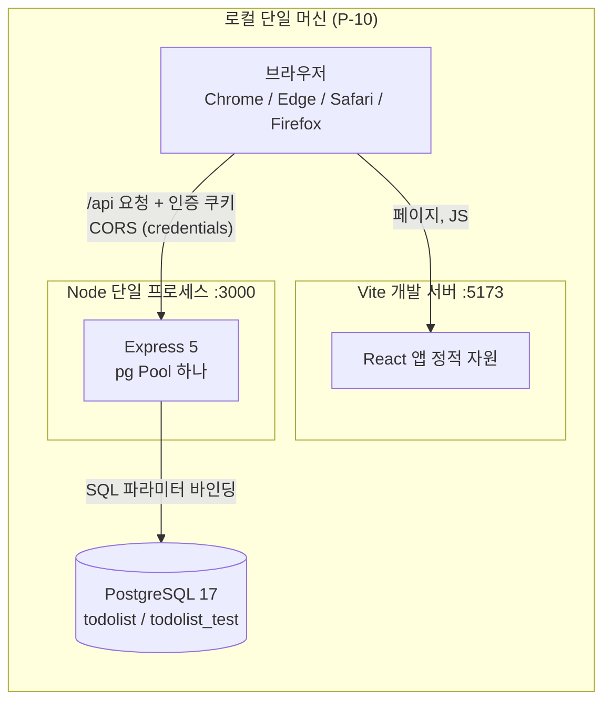
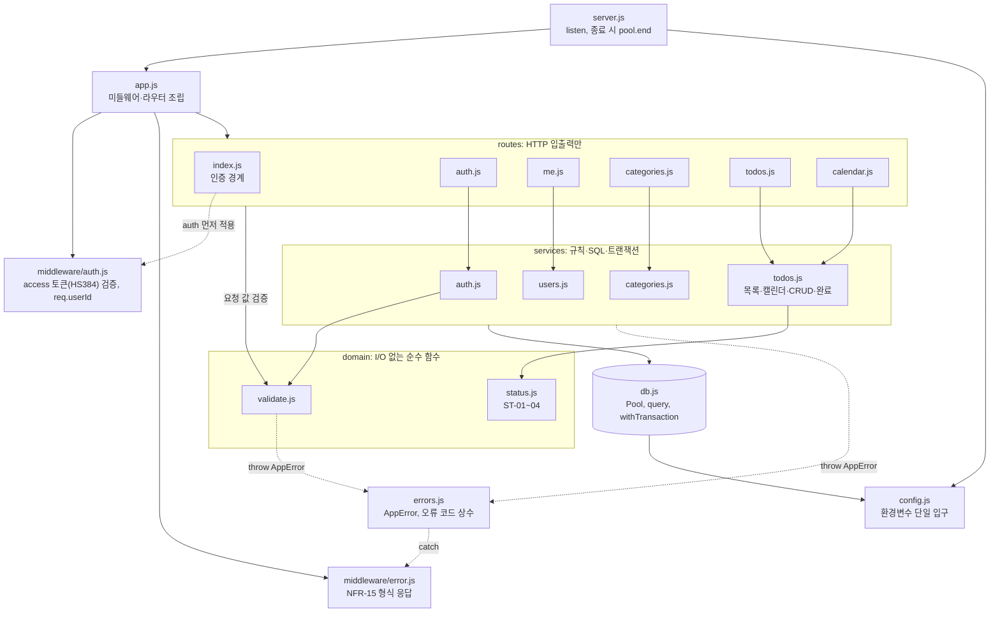
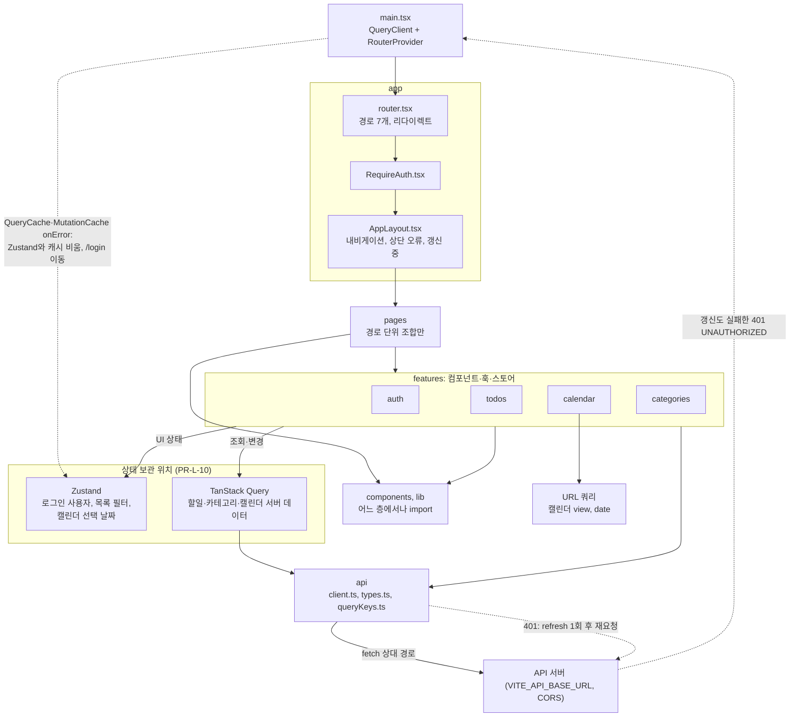
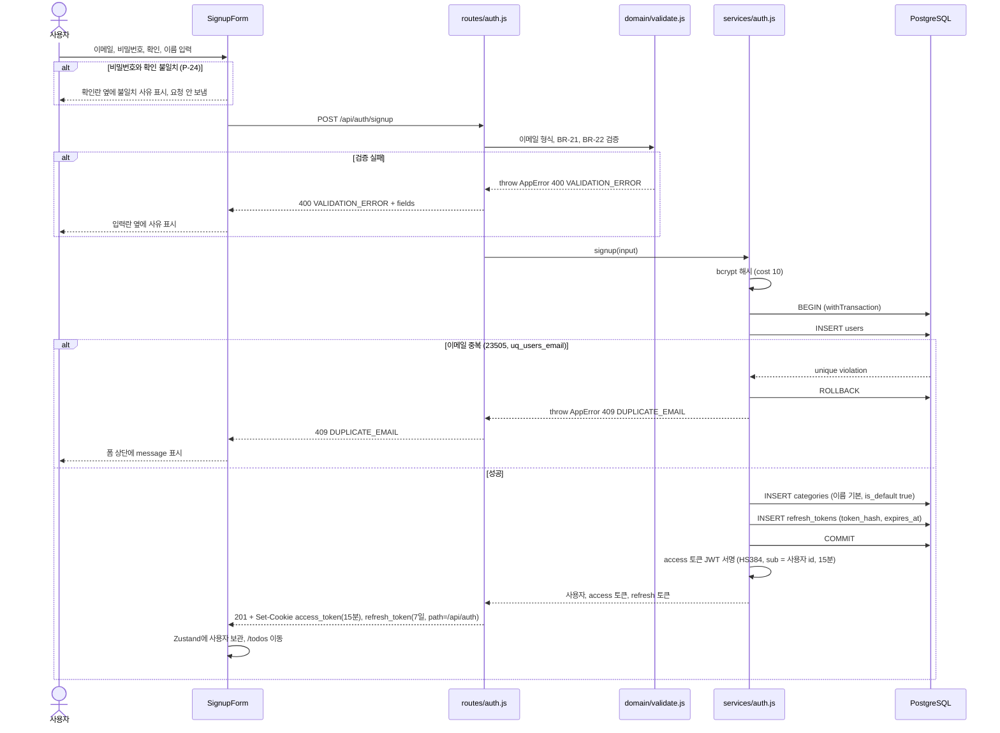
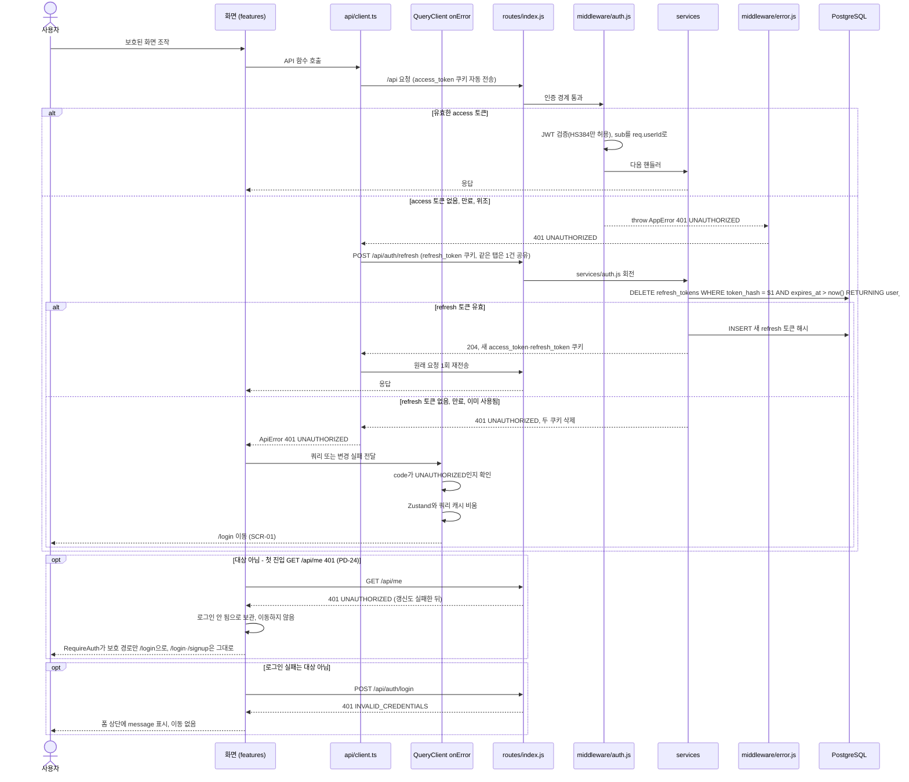
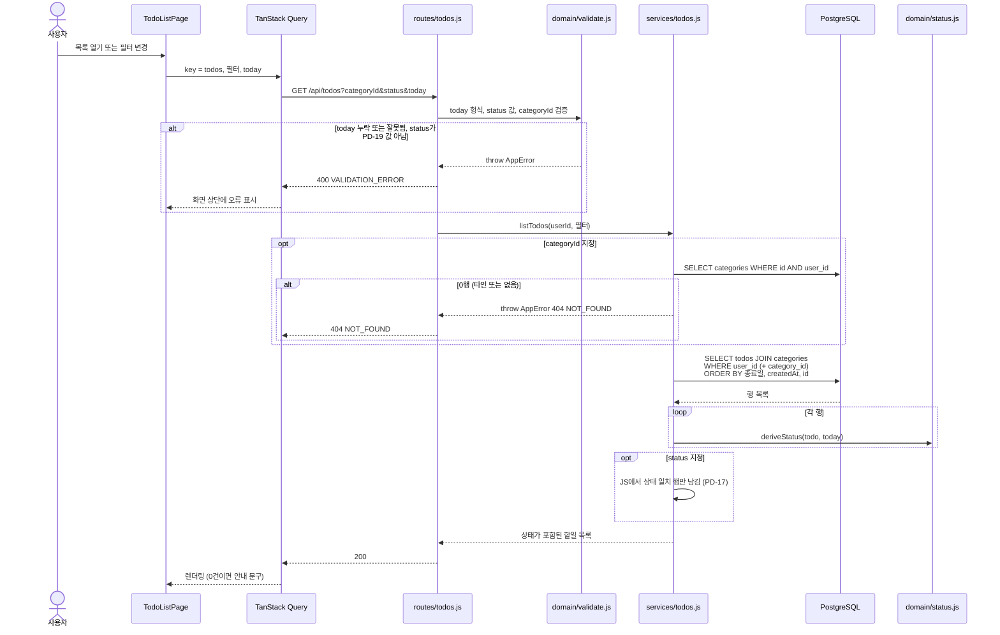
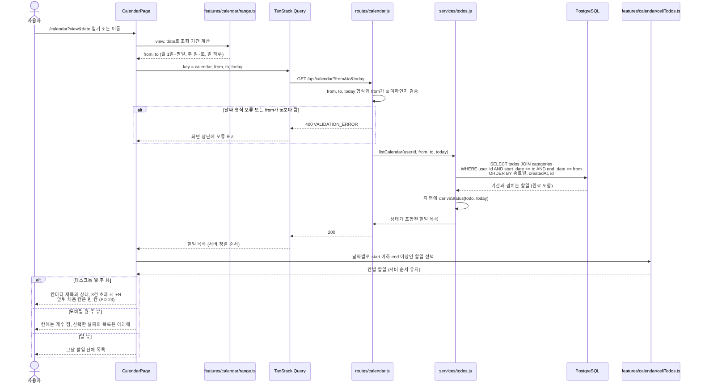
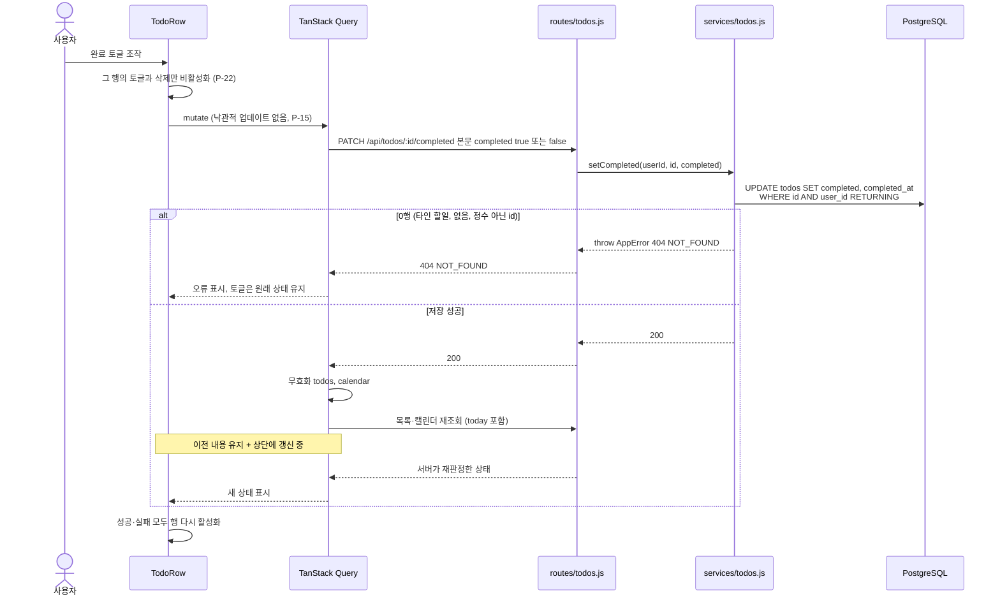
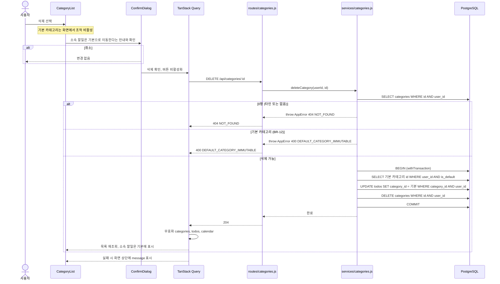
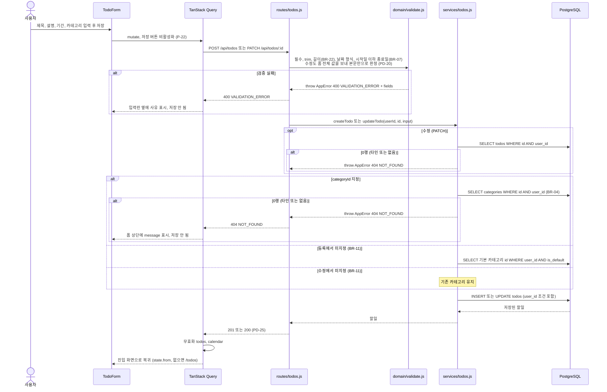

# TodoList 기술 아키텍처 다이어그램

## 문서 이력

### 버전 이력

| 버전 | 일자 | 작성자 | 상태 | 비고 |
|---|---|---|---|---|
| v0.1 | 2026-11-04 | pmsong | 초안 | 최초 작성 |
| v0.2 | 2026-11-04 | pmsong | 초안 | 데이터 구조(물리 ERD, AD-04) 추가 |
| v0.3 | 2026-11-04 | pmsong | 초안 | AD-04를 폐기하고 ERD를 7-erd.md로 분리 |
| v0.4 | 2026-11-04 | pmsong | 초안 | SD-02에 refresh 토큰 갱신 흐름 반영 |
| v0.5 | 2026-11-04 | pmsong | 초안 | 문서 간 정합성 검토 반영 |
| v0.6 | 2026-11-04 | Claude | 초안 | 참조 버전 동기화 |
| v0.7 | 2026-11-05 | Claude | 초안 | 부하 테스트 제외 |
| v0.8 | 2026-11-05 | Claude | 초안 | 프록시 대신 CORS |

### 변경 이력

| 버전 | 일자 | 변경 위치 | 변경 내용 | 변경 사유 | 작성자 |
|---|---|---|---|---|---|
| v0.1 | 2026-11-04 | 전체 | 최초 작성 | - | pmsong |
| v0.2 | 2026-11-04 | AD-04, 머리말, 4장 | 테이블·컬럼·타입·제약·인덱스를 그린 물리 ERD와 도메인 속성 대응표 추가 | `schema.sql` 작성 기준이 되는 데이터 구조 그림 필요 | pmsong |
| v0.3 | 2026-11-04 | AD-04, 머리말, 1장, 4장 | AD-04 본문(ERD·제약 표·설계 메모)을 삭제하고 개요 표는 '폐기'로 표시, 머리말·커버리지 갱신 | ERD가 개념·물리·테이블 명세·결정으로 커져 [ERD v0.1](./7-erd.md)로 분리 | pmsong |
| v0.4 | 2026-11-04 | SD-02, 참조 문서 | access 토큰 만료 시 `api/client.ts`의 갱신 후 재요청, 갱신 실패 시 전역 401 처리. 참조 버전 PRD v0.10, 시나리오 v0.8, 구조 설계 원칙 v0.3, ERD v0.2 | PRD v0.10 P-04 | pmsong |
| v0.5 | 2026-11-04 | AD-02, AD-03, SD-01 | access 토큰(HS384) 검증, 인증 경계 제외 목록에 refresh 추가, 401 시 `api/client.ts` 갱신 후 전역 처리, 가입 시 refresh 토큰 INSERT와 두 쿠키 발급(1일 쿠키 삭제) | PRD v0.10 P-04·구조 설계 원칙 v0.3 반영 누락(SD-02만 갱신됨) | pmsong |
| v0.5 | 2026-11-04 | 참조 문서 | PRD v0.10 → v0.11, 시나리오 v0.8 → v0.9, 와이어프레임 v0.3 → v0.4, 구조 설계 원칙 v0.3 → v0.4, ERD v0.2 → v0.3 | 버전 동기화 | pmsong |
| v0.6 | 2026-11-04 | 참조 문서 | 도메인 v0.6 → v0.7, PRD v0.11 → v0.12, 시나리오 v0.9 → v0.10, 와이어프레임 v0.4 → v0.5, 구조 설계 원칙 v0.4 → v0.5, ERD v0.3 → v0.4 | 버전 동기화 | Claude |
| v0.7 | 2026-11-05 | AD-01, 4.3, 참조 문서 | k6 노드와 설명 삭제. PRD v0.12 → v0.13, 구조 설계 원칙 v0.5 → v0.6 | PRD v0.13 부하 테스트 제외 | Claude |
| v0.8 | 2026-11-05 | AD-01, 프론트 구조 | Vite 프록시 노드를 없애고 브라우저가 API(:3000)를 CORS로 직접 호출 | PRD v0.15 P-04, 구조 설계 원칙 v0.10 PR-S-04 | Claude |

> 단일 출처 원칙: 용어, 엔티티, 상태 규칙(ST), 비즈니스 규칙(BR), 유스케이스(UC)는 [도메인 정의서 v0.7](./1-domain-definition.md)이, 기능(FR)·화면(SCR)·비기능(NFR)·목표(G)·일정(M)·리스크(R)·결정(P)은 [PRD v0.13](./2-PRD.md)이, 시나리오(SC)는 [사용자 시나리오 v0.10](./3-user-scenario.md)이, 화면 배치(WF·L)는 [와이어프레임 v0.5](./4-wireframe.md)이, 구조(PR·PD)는 [프로젝트 구조 설계 원칙 v0.6](./5-project-principle.md)이, 데이터 구조(ERD-xx·DB-xx)는 [ERD v0.4](./7-erd.md)이 정의한다. 이 문서는 해당 ID를 참조만 하며 규칙·오류 코드·수치를 다시 정의하지 않는다. 충돌하면 도메인 정의서 > PRD > 시나리오 > 와이어프레임 > 프로젝트 구조 설계 원칙 > 이 문서 순으로 따른다.
>
> ID 운영 원칙: 다이어그램 ID(AD-xx 구조, SD-xx 순서)는 재사용하거나 재번호하지 않는다. 다이어그램을 없애면 행을 지우지 말고 '폐기'로 표시한다.
>
> 데이터 구조(개념 ERD, 물리 ERD, 테이블·제약·인덱스)는 [ERD v0.4](./7-erd.md)이 정의하고, 이 문서에는 그리지 않는다. 엔티티·관계의 정의는 [도메인 정의서 3.4](./1-domain-definition.md)가 맡는다. 오류 코드는 NFR-15에 있는 것만 쓴다.

## 1. 개요

| ID | 종류 | 제목 | 근거 문서 |
|---|---|---|---|
| AD-01 | 구조 | 시스템 컨텍스트와 배포 구성 | P-10, PR-S-04, PR-S-11 |
| AD-02 | 구조 | 백엔드 레이어와 모듈 의존 | 구조 원칙 3.1, 7.2 |
| AD-03 | 구조 | 프론트엔드 레이어와 상태 분담 | 구조 원칙 3.1, 7.3, PRD 6장 |
| AD-04 | 구조 | 폐기(v0.3) → 7-erd.md로 이동 | [ERD v0.4](./7-erd.md) ERD-02 |
| SD-01 | 순서 | 회원가입 트랜잭션 | FR-01, NFR-10 |
| SD-02 | 순서 | 인증 미들웨어와 401 전역 처리 | FR-04, PR-L-12 |
| SD-03 | 순서 | 할일 목록 조회 | FR-09, P-14, PD-17 |
| SD-04 | 순서 | 캘린더 기간 조회 | FR-10~12, P-16 |
| SD-05 | 순서 | 완료 토글 | FR-07, P-15, P-22 |
| SD-06 | 순서 | 카테고리 삭제 트랜잭션 | FR-13, BR-14 |
| SD-07 | 순서 | 할일 등록·수정 검증과 타인 카테고리 지정 | FR-05, FR-06, BR-04 |

## 2. 구조 다이어그램

### AD-01 시스템 컨텍스트와 배포 구성

브라우저는 화면을 Vite 서버(:5173)에서, API를 Express(:3000)에서 직접 받는다. 출처가 달라 Express가 CORS로 `CORS_ORIGIN` 하나만 쿠키 포함 요청을 허용한다(PR-S-04). 두 서버는 같은 사이트(localhost)라 `SameSite=Lax` 쿠키가 실린다. 운영도 같은 방식이며 프론트와 API를 같은 사이트에 둔다. 운영 배포(호스팅, HTTPS)는 범위 외다.

관련 ID: P-04, P-10, NFR-02, NFR-03, PR-S-04, PR-S-11

### AD-02 백엔드 레이어와 모듈 의존

의존은 위에서 아래로만 흐른다. routes는 SQL을 직접 실행하지 않고, domain은 다른 모듈을 import하지 않는다. 모든 오류는 `AppError`로 던져 `middleware/error.js` 한 곳에서만 응답으로 바꾼다. `auth` 미들웨어는 `routes/index.js`가 signup, login, refresh, logout, health를 제외한 모든 라우트 앞에 건다.

관련 ID: PR-L-01~08, PR-N-07, PR-S-01, PR-S-05, NFR-07, NFR-08, NFR-15, G-04

### AD-03 프론트엔드 레이어와 상태 분담

서버 데이터는 TanStack Query에만, UI 상태는 Zustand에만 두며 서로 복사하지 않는다. 토큰은 어디에도 저장하지 않고 httpOnly 쿠키만 쓴다. 401 `UNAUTHORIZED`는 먼저 `api/client.ts`가 refresh 토큰으로 한 번 갱신해 다시 요청하고, 갱신도 실패한 401만 어떤 API에서 오든 `main.tsx`의 QueryClient `onError` 한 곳에서 처리한다(PR-L-12). features끼리는 직접 import하지 않는다.

관련 ID: PRD 6장, PR-L-09~12, FR-04, P-04, P-12, P-15, P-23, PD-04

### AD-04 데이터 구조 (물리 ERD)

폐기(v0.3). [ERD v0.4](./7-erd.md)로 이동했다.

## 3. Sequence Diagram

### SD-01 회원가입 트랜잭션

사용자, 기본 카테고리, refresh 토큰은 한 트랜잭션이라 일부만 생기는 일이 없다. refresh 토큰은 해시만 저장한다(DB-13). 해시 계산은 트랜잭션 밖에서 해 커넥션 점유를 줄인다. 이메일 중복은 제약 이름(`uq_users_email`)으로 구분해 409로 바꾼다. 가입 성공 응답이 곧 로그인(쿠키 발급)이다.

관련 ID: FR-01, UC-01, BR-02, BR-10, BR-21, BR-22, NFR-06, NFR-09, NFR-10, NFR-15, P-04, P-24, PR-L-06, PR-N-04, PR-S-03, PD-22, PD-25, DB-13, SC-01

### SD-02 인증 미들웨어와 401 전역 처리

인증은 기본 적용이고 공개 라우트만 예외로 열어 둔다. access 토큰이 만료되면 `api/client.ts`가 refresh 토큰으로 한 번 갱신하고 원래 요청을 다시 보낸다(PR-L-12). 갱신도 실패해 401 `UNAUTHORIZED`가 올라오면 화면은 어느 API에서든 같은 방식으로 로그인 화면으로 이동한다. `INVALID_CREDENTIALS`와 첫 진입 로그인 확인(`GET /api/me`)의 401은 이 처리 대상이 아니라서, 미로그인 상태로 `/login`을 열 때 이동이 반복되지 않는다(PD-24).

관련 ID: FR-02, FR-03, FR-04, BR-01, NFR-02, NFR-15, P-04, P-23, PD-24, PD-26, PR-S-03, PR-S-05, PR-L-12, DB-13, SC-02

### SD-03 할일 목록 조회

카테고리 필터는 소유권 확인 뒤 SQL이, 상태 필터는 판정 함수가 처리한다. 두 필터는 AND이고 정렬은 필터와 무관하게 BR-20이다. 상태는 서버가 `today`로 한 번만 판정하고 화면은 표시만 한다. 판정 순서는 입력 검증(400) → 소유권(404)이다(PD-22).

관련 ID: FR-09, UC-09, BR-03, BR-15, BR-20, ST-01~04, NFR-04, NFR-07, NFR-12, P-11, P-12, P-14, PD-17, PR-L-05, PR-L-08, SC-08

### SD-04 캘린더 기간 조회

월·주·일 뷰는 같은 API를 쓰며 기간만 다르다. 기간 계산과 칸 배치는 프론트의 순수 함수가, 겹침 조건과 정렬은 SQL 한 곳이 맡는다. 여러 날에 걸친 할일은 기간 안 모든 날짜 칸에 반복 표시한다.

관련 ID: FR-10, FR-11, FR-12, FR-16, UC-10, BR-16, BR-17, BR-18, BR-19, BR-20, NFR-04, NFR-11, P-12, P-14, P-16, P-20, P-23, PR-C-05, PR-T-06, SC-09, SC-10

### SD-05 완료 토글

화면은 상태를 미리 계산하지 않는다. 저장이 성공해야 재조회하고, 서버가 `today`로 판정한 결과만 표시한다. 완료를 취소하면 날짜 규칙에 따라 ST-02~04로 돌아간다. 본문은 원하는 값(`completed`)을 보내므로 재시도해도 결과가 같고, `completed_at`은 완료 시 현재 시각, 취소 시 비운다(PD-21).

관련 ID: FR-07, UC-07, BR-03, ST-01~04, NFR-07, NFR-12, P-12, P-15, P-22, P-25, PD-21, PD-25, PR-C-03, PR-L-11, SC-06

### SD-06 카테고리 삭제 트랜잭션

이동과 삭제는 한 트랜잭션이라 삭제만 되고 할일이 사라지는 일이 없다. 소유권(404)을 기본 카테고리 보호(400)보다 먼저 확인해 타인 카테고리의 존재 여부를 드러내지 않는다. 카테고리 삭제 후에는 할일 소속이 바뀌므로 할일·캘린더 캐시도 무효화한다.

관련 ID: FR-13, UC-04, BR-03, BR-12, BR-14, BR-23, NFR-07, NFR-10, NFR-15, P-19, P-22, PR-L-06, PR-L-11, SC-03

### SD-07 할일 등록·수정 검증과 타인 카테고리 지정

형식·길이·날짜 순서는 `domain/validate.js`가 DB 없이 판정하고, 카테고리 소유권은 DB를 거쳐 서비스가 판정한다. 타인 카테고리는 없는 카테고리와 같은 404라 존재 여부가 드러나지 않는다. 과거 날짜는 거절하지 않는다(BR-08).

관련 ID: FR-05, FR-06, UC-05, UC-06, BR-03, BR-04, BR-06, BR-07, BR-08, BR-11, BR-22, NFR-07, NFR-09, NFR-15, P-17, P-22, PD-18, PR-L-05, PR-T-03, SC-04, SC-05

## 4. 커버리지

### 4.1 FR 커버리지

| FR | 다이어그램 | 비고 |
|---|---|---|
| FR-01 | SD-01, AD-02 | |
| FR-02 | SD-02 | 로그인 실패 분기만. 로그인 성공 흐름은 SD-01의 쿠키 발급과 같은 구조 |
| FR-03 | SD-02, AD-03 | 로그아웃 시 캐시 초기화는 AD-03 |
| FR-04 | SD-02, AD-02, AD-03 | |
| FR-05 | SD-07 | |
| FR-06 | SD-07 | |
| FR-07 | SD-05 | |
| FR-08 | 해당 없음 | 단순 삭제라 다이어그램을 만들지 않음. 소유권 규칙은 SD-05와 같은 패턴(PR-L-05) |
| FR-09 | SD-03 | |
| FR-10 | SD-04 | |
| FR-11 | SD-04 | Should, 기간 계산만 다름 |
| FR-12 | SD-04 | Should, 하루 기간 |
| FR-13 | SD-06 | 등록·이름 수정의 DUPLICATE_CATEGORY는 SD-01과 같은 23505 패턴이라 생략 |
| FR-14, FR-15 | AD-02 | 내 정보(Should)는 구조 다이어그램에서만 |
| FR-16 | SD-04 | 선택 시 이동은 SD-07 복귀 규칙과 연결 |

### 4.2 BR 커버리지

| BR | 다이어그램 |
|---|---|
| BR-01 | SD-02, AD-02 |
| BR-02 | SD-01, 7-erd.md |
| BR-03 | SD-03, SD-05, SD-06, SD-07 |
| BR-04 | SD-07 |
| BR-06, BR-07, BR-08 | SD-07 |
| BR-10 | SD-01, 7-erd.md |
| BR-11 | SD-07 |
| BR-12 | SD-06, 7-erd.md |
| BR-14 | SD-06 |
| BR-15 | SD-03 |
| BR-16, BR-17, BR-18, BR-19 | SD-04 |
| BR-20 | SD-03, SD-04 |
| BR-21, BR-22 | SD-01, SD-07 |
| BR-23 | SD-06, SD-07의 카테고리 선택 순서는 서버 순서 그대로(AD-03) |
| BR-13 | 7-erd.md |
| BR-05, BR-09 | 해당 없음 (단순 규칙) |

### 4.3 NFR 커버리지

| NFR | 다이어그램 |
|---|---|
| NFR-01, NFR-05 | 해당 없음 (NFR-01 폐기) |
| NFR-02 | AD-01, SD-02 |
| NFR-03 | AD-01, AD-02 |
| NFR-04 | 7-erd.md (인덱스), SD-03, SD-04 (필터·겹침 조건이 DB에서 처리됨) |
| NFR-06 | SD-01 |
| NFR-07 | SD-03, SD-05, SD-06, SD-07 |
| NFR-08 | AD-01, AD-02 |
| NFR-09 | SD-01, SD-07, AD-02 |
| NFR-10 | SD-01, SD-06 |
| NFR-11 | 7-erd.md, SD-04 |
| NFR-12 | 7-erd.md, SD-03, SD-04, SD-05 |
| NFR-13, NFR-14 | 해당 없음 (배치·브라우저 요구, SD-04의 데스크톱·모바일 분기만 관련) |
| NFR-15 | SD-01~SD-07 전체, AD-02 |
