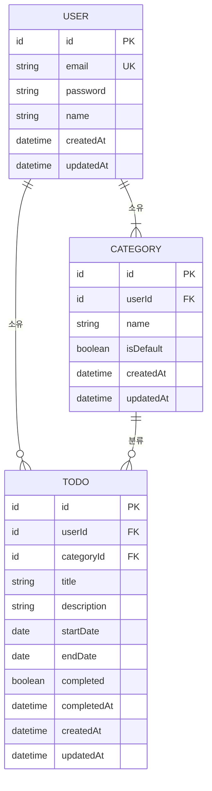
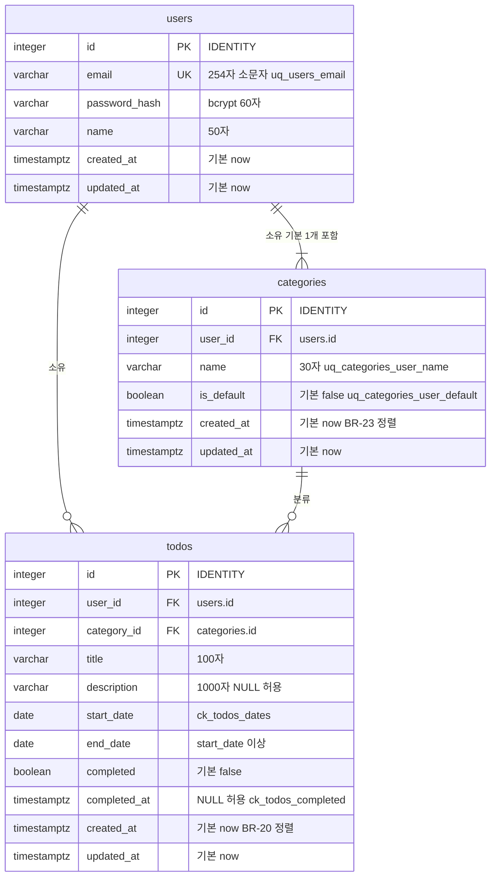

# TodoList ERD (개념·물리 데이터 구조)

## 문서 이력

### 버전 이력

| 버전 | 일자 | 작성자 | 상태 | 비고 |
|---|---|---|---|---|
| v0.1 | 2026-11-04 | pmsong | 초안 | 최초 작성. 아키텍처 다이어그램 v0.2의 AD-04를 옮겨 보강 |

### 변경 이력

| 버전 | 일자 | 변경 위치 | 변경 내용 | 변경 사유 | 작성자 |
|---|---|---|---|---|---|
| v0.1 | 2026-11-04 | 전체 | 최초 작성. 개념 ERD, 물리 ERD, 테이블 명세, 제약·인덱스, 파생값, 속성 대응표, DB 결정(DB-01~12) | ERD를 아키텍처 다이어그램에서 분리하고 `schema.sql`의 작성 기준을 한 문서로 모음 | pmsong |

> 단일 출처 원칙: 엔티티·속성·관계, 용어, 상태 규칙(ST), 비즈니스 규칙(BR)은 [도메인 정의서 v0.6](./1-domain-definition.md)이, 기능(FR)·비기능(NFR)·결정(P)은 [PRD v0.9](./2-PRD.md)이, 이름 규칙·API 경로(PR·PD)는 [프로젝트 구조 설계 원칙 v0.2](./5-project-principle.md)이 정의한다. 이 문서는 도메인 3장의 엔티티와 관계를 PostgreSQL 17 물리 구조로 옮긴 것이며, 규칙·오류 코드·수치를 다시 정의하지 않고 ID로 참조한다. 충돌하면 도메인 정의서 > PRD > 시나리오 > 와이어프레임 > 프로젝트 구조 설계 원칙 > [아키텍처 다이어그램](./6-arch-diagram.md) > 이 문서 순으로 따른다.
>
> ID 운영 원칙: ERD-xx(다이어그램)와 DB-xx(이 문서에서 정한 결정)는 재사용하거나 재번호하지 않는다. 없애면 행을 지우지 말고 '폐기'로 표시한다. 실제 DDL의 단일 출처는 `backend/sql/schema.sql`이다(PR-S-10). 이 문서와 그 파일이 다르면 이 문서를 먼저 고치고 파일을 맞춘다.

## 1. 개요

| ID | 종류 | 제목 | 근거 |
|---|---|---|---|
| ERD-01 | 개념 | 개념 ERD | 도메인 3.1~3.4 |
| ERD-02 | 물리 | 물리 ERD | NFR-04, NFR-11, NFR-12, PR-N-04, PR-S-10 |

- 테이블은 `users`, `categories`, `todos` 세 개다(PR-N-04). 마이그레이션 도구와 ORM은 쓰지 않는다(PR-S-10, PR-C-02).
- 사용자 수 약 1000명, 사용자당 할일 약 100건(P-11)을 기준으로 한 규모 판단은 DB-01, DB-10에 있다.

## 2. 개념 ERD

### ERD-01 개념 ERD

도메인 3.4와 같은 관계를 엔티티 단위로 그린다. 속성 이름은 도메인 속성명(camelCase)이고, 상태(status)는 저장하지 않으므로 없다.

| 관계 | 카디널리티 | 설명 | 관련 ID |
|---|---|---|---|
| USER - CATEGORY | 1 : N (사용자 쪽 1, 카테고리 쪽 1 이상) | 사용자는 카테고리를 최소 1개(기본)부터 가진다. 카테고리는 정확히 한 사용자의 것이다. | BR-03, BR-10 |
| USER - TODO | 1 : N (할일 쪽 0 이상) | 할일이 없는 사용자도 있다. 할일은 정확히 한 사용자의 것이다. | BR-03 |
| CATEGORY - TODO | 1 : N (할일 쪽 0 이상) | 할일은 정확히 한 카테고리에 속하고, 카테고리는 할일이 없을 수 있다. 같은 사용자의 카테고리만 지정할 수 있다. | BR-04, BR-11, BR-14 |

"카테고리 쪽 1 이상"(`||--|{`)은 도메인 3.4의 "최소 1개"를 그대로 옮긴 것이고, DB가 아니라 가입 트랜잭션(NFR-10)과 기본 카테고리 삭제 금지(BR-12)가 지킨다(DB-05).

## 3. 물리 ERD

### ERD-02 물리 ERD

타입에 괄호를 쓰지 않으므로 길이는 따옴표 안 주석에 적는다. 키 표기는 PK, FK, UK만 쓴다. 제약·인덱스 이름은 4장 표와 5장 표가 정한다.

관련 ID: 도메인 3.1~3.4, NFR-04, NFR-11, NFR-12, PR-N-04, PR-S-10, DB-01~12

## 4. 테이블 명세

공통: 모든 컬럼은 `snake_case`이며 NULL 허용으로 표시한 것 외에는 `NOT NULL`이다(PR-N-04). 길이는 문자(character) 수이고 BR-22 값과 같다. 길이·공백·형식의 판정 주체는 `domain/validate.js`이며 DB는 방어용이다(NFR-09, DB-09).

### 4.1 users

| 컬럼 | 타입 | NULL | 기본값 | 제약 | 도메인 속성 | 관련 ID |
|---|---|---|---|---|---|---|
| `id` | `INTEGER` | N | `GENERATED ALWAYS AS IDENTITY` | PK | id | DB-01, PD-13 |
| `email` | `VARCHAR(254)` | N | - | `uq_users_email` UNIQUE, `ck_users_email_lower` CHECK(`email = lower(email)`) | email | BR-02, BR-22, DB-03 |
| `password_hash` | `VARCHAR(60)` | N | - | - | password | NFR-06, PR-S-06, BR-21 |
| `name` | `VARCHAR(50)` | N | - | - | name | BR-22 |
| `created_at` | `TIMESTAMPTZ` | N | `now()` | - | createdAt | DB-02 |
| `updated_at` | `TIMESTAMPTZ` | N | `now()` | - | updatedAt | DB-02, BR-05 |

### 4.2 categories

| 컬럼 | 타입 | NULL | 기본값 | 제약 | 도메인 속성 | 관련 ID |
|---|---|---|---|---|---|---|
| `id` | `INTEGER` | N | `GENERATED ALWAYS AS IDENTITY` | PK | id | DB-01, PD-13 |
| `user_id` | `INTEGER` | N | - | `fk_categories_user` FK → `users(id)` `ON DELETE RESTRICT` | userId | BR-03, DB-05, DB-12 |
| `name` | `VARCHAR(30)` | N | - | `uq_categories_user_name` UNIQUE(`user_id`, `name`) | name | BR-13, BR-22, DB-04 |
| `is_default` | `BOOLEAN` | N | `false` | `uq_categories_user_default` 부분 UNIQUE(`user_id`) WHERE `is_default` | isDefault | BR-10, BR-12 |
| `created_at` | `TIMESTAMPTZ` | N | `now()` | - | createdAt | BR-23, DB-02 |
| `updated_at` | `TIMESTAMPTZ` | N | `now()` | - | updatedAt | DB-02 |

### 4.3 todos

| 컬럼 | 타입 | NULL | 기본값 | 제약 | 도메인 속성 | 관련 ID |
|---|---|---|---|---|---|---|
| `id` | `INTEGER` | N | `GENERATED ALWAYS AS IDENTITY` | PK | id | DB-01, PD-13 |
| `user_id` | `INTEGER` | N | - | `fk_todos_user` FK → `users(id)` `ON DELETE RESTRICT` | userId | BR-03, DB-05, DB-12 |
| `category_id` | `INTEGER` | N | - | `fk_todos_category` FK → `categories(id)` `ON DELETE RESTRICT` | categoryId | BR-04, BR-11, BR-14, DB-05, DB-06 |
| `title` | `VARCHAR(100)` | N | - | - | title | BR-06, BR-22 |
| `description` | `VARCHAR(1000)` | Y | - | - | description | BR-22, DB-11 |
| `start_date` | `DATE` | N | - | `ck_todos_dates` CHECK(`start_date <= end_date`) | startDate | BR-06, BR-07, NFR-11, DB-07 |
| `end_date` | `DATE` | N | - | (위 CHECK) | endDate | BR-06, BR-07, NFR-11, DB-07 |
| `completed` | `BOOLEAN` | N | `false` | `ck_todos_completed` CHECK(`completed = (completed_at IS NOT NULL)`) | completed | ST-01, PD-21, DB-08 |
| `completed_at` | `TIMESTAMPTZ` | Y | - | (위 CHECK) | completedAt | PD-21, DB-08 |
| `created_at` | `TIMESTAMPTZ` | N | `now()` | - | createdAt | BR-20, DB-02 |
| `updated_at` | `TIMESTAMPTZ` | N | `now()` | - | updatedAt | DB-02 |

## 5. 제약·인덱스 목록

이름은 PR-N-04가 정한 것에 `fk_*`, `ck_users_email_lower`, `ck_todos_completed`를 더했다(DB-03, DB-08, DB-12). 위반 오류의 응답 코드는 NFR-15를 따른다.

| 이름 | 테이블 | 종류 | 정의 | 쓰임새 | 관련 BR·NFR |
|---|---|---|---|---|---|
| (기본 이름) | 세 테이블 | PK | `id` | 정수 식별자, 경로 `:id` | PD-13 |
| `uq_users_email` | `users` | UNIQUE | (`email`) | 이메일 전체 유일. 로그인 조회에도 쓰인다. 위반(23505)은 409 `DUPLICATE_EMAIL` | BR-02, NFR-04, PR-N-04 |
| `ck_users_email_lower` | `users` | CHECK | `email = lower(email)` | 소문자 정규화 누락 방어(DB-03) | BR-02 |
| `uq_categories_user_name` | `categories` | UNIQUE | (`user_id`, `name`) | 같은 사용자 안에서 이름 유일. 위반은 409 `DUPLICATE_CATEGORY` | BR-13, NFR-04 |
| `uq_categories_user_default` | `categories` | 부분 UNIQUE | (`user_id`) WHERE `is_default` | 사용자당 기본 카테고리 최대 1개. 기본 카테고리 조회에도 쓰인다 | BR-10, BR-12, NFR-04 |
| `fk_categories_user` | `categories` | FK | (`user_id`) → `users(id)` RESTRICT | 소유 사용자 존재 보장 | BR-03 |
| `fk_todos_user` | `todos` | FK | (`user_id`) → `users(id)` RESTRICT | 소유 사용자 존재 보장 | BR-03 |
| `fk_todos_category` | `todos` | FK | (`category_id`) → `categories(id)` RESTRICT | 카테고리 존재 보장. 이동 없이 삭제하면 막는다 | BR-04, BR-14 |
| `ck_todos_dates` | `todos` | CHECK | `start_date <= end_date` | 방어용. 판정은 `domain/validate.js`가 먼저 한다 | BR-07, PD-20 |
| `ck_todos_completed` | `todos` | CHECK | `completed = (completed_at IS NOT NULL)` | 완료 여부와 완료 시각의 일관성 방어 | PD-21 |
| `idx_todos_user_dates` | `todos` | 인덱스 | (`user_id`, `start_date`, `end_date`) | 캘린더 기간 겹침 조회, 사용자 단위 목록 조회 | NFR-04, BR-17, BR-18 |
| `idx_todos_user_category` | `todos` | 인덱스 | (`user_id`, `category_id`) | 목록 카테고리 필터, 카테고리 삭제 시 할일 이동 | NFR-04, BR-14, BR-15 |

정렬 전용 인덱스, `category_id` 단독 인덱스, `todos(user_id, end_date, created_at, id)` 인덱스는 만들지 않는다(DB-10).

## 6. 파생값과 저장하지 않는 값

| 값 | 저장 | 이유와 계산 위치 | 관련 ID |
|---|---|---|---|
| 할일 상태(완료·시작 전·진행 중·지연) | 안 함 | `completed`, 두 날짜, 요청의 `today`로 `domain/status.js`가 조회 시 판정한다. 상태 컬럼도 만들지 않는다. | ST-01~04, NFR-12, PD-17, PR-S-10 |
| 비밀번호 확인값 | 안 함 | 화면에서만 비교하고 서버로 보내지 않는다. | P-24 |
| 비밀번호 평문 | 안 함 | bcrypt cost 10 해시만 `password_hash`에 저장하고 응답·로그에 내보내지 않는다. | NFR-06, PR-S-06 |
| 오늘(`today`) | 안 함 | 요청마다 클라이언트가 보낸다. DB는 현재 날짜를 판정에 쓰지 않는다. | NFR-12, P-12 |
| 캘린더 날짜 칸 배치 | 안 함 | 기간과 겹치는 할일만 SQL이 거르고, 칸 배치는 프론트 순수 함수가 한다. | BR-16, BR-17 |
| 카테고리별 할일 수 | 안 함 | 필요한 화면이 없다. | - |

## 7. 도메인 속성 ↔ 컬럼 ↔ API 필드 대응표

API 필드는 도메인 속성명(camelCase)과 같고 SELECT 별칭(`AS "startDate"`)으로 바꾼다(PR-N-05, P-25). 범용 변환기는 두지 않는다.

| 엔티티 | 도메인 속성 | 컬럼 | API 필드 | 비고 |
|---|---|---|---|---|
| User | id | `users.id` | `id` | |
| User | email | `users.email` | `email` | 저장 전 소문자(DB-03). 변경 불가(BR-05) |
| User | password | `users.password_hash` | 요청 `password`만, 응답 없음 | 응답에 해시를 내보내지 않는다(PR-S-06) |
| User | name | `users.name` | `name` | |
| User | createdAt / updatedAt | `users.created_at` / `updated_at` | 응답에 필요할 때만 `createdAt` / `updatedAt` | 별칭 사용 |
| Category | id | `categories.id` | `id` | |
| Category | userId | `categories.user_id` | 응답 미포함(소유자는 항상 본인) | 요청 값으로 받지 않고 `req.userId`를 쓴다(BR-03) |
| Category | name | `categories.name` | `name` | trim 후 저장(DB-04) |
| Category | isDefault | `categories.is_default` | `isDefault` | |
| Category | createdAt / updatedAt | `categories.created_at` / `updated_at` | `createdAt` / `updatedAt` | BR-23 정렬은 서버가 한다 |
| Todo | id | `todos.id` | `id` | |
| Todo | userId | `todos.user_id` | 응답 미포함 | 요청 값으로 받지 않는다(BR-03) |
| Todo | categoryId | `todos.category_id` | `categoryId` | 요청에서 생략하면 BR-11 |
| Todo | title | `todos.title` | `title` | |
| Todo | description | `todos.description` | `description` | 빈 값은 `null`(DB-11) |
| Todo | startDate / endDate | `todos.start_date` / `end_date` | `startDate` / `endDate` | `'YYYY-MM-DD'` 문자열(NFR-11, PR-S-09) |
| Todo | completed | `todos.completed` | `completed` | 완료 토글 본문 `{ completed }`(PD-21) |
| Todo | completedAt | `todos.completed_at` | `completedAt` | 기록용(PD-21) |
| Todo | createdAt / updatedAt | `todos.created_at` / `updated_at` | `createdAt` / `updatedAt` | |
| (파생) | status | 없음 | `status` | `completed`·`not_started`·`in_progress`·`overdue`(PD-19). 서버가 `today`로 판정 |

## 8. 이 문서에서 정한 결정 (DB-xx)

도메인·PRD·원칙 문서에 없던 물리 수준의 결정이다. 상위 문서가 다르게 정하면 그쪽을 따르고 변경 이력을 남긴다.

| ID | 결정 | 근거 | 검토한 대안 |
|---|---|---|---|
| DB-01 | 모든 `id`는 `INTEGER GENERATED ALWAYS AS IDENTITY`다. | `INTEGER`의 최대값은 약 21억이다. 사용자 1000명 × 할일 100건 = 약 10만 행(카테고리·사용자는 그보다 적다)이라 약 2만 배의 여유가 있다. 삭제·재등록이 많아도 시퀀스는 INSERT 횟수만큼 늘 뿐이라 수천 배가 되어야 닿는다. `ALWAYS`는 id를 직접 넣는 실수를 막는다. PD-13의 정수 경로와 맞다. | `BIGINT`: 이 규모에 8바이트가 과하다. `SERIAL`: 표준 SQL이 아니고 직접 INSERT를 막지 못한다. UUID: PD-13이 배제 |
| DB-02 | `created_at`은 `DEFAULT now()`. `updated_at`도 `DEFAULT now()`이고 UPDATE를 하는 서비스 SQL이 `updated_at = now()`를 직접 넣는다. 트리거는 쓰지 않는다. | 수정 SQL이 서비스마다 한 개 안팎이라 한 줄이면 된다. 트리거는 `schema.sql`에 함수와 트리거를 더하고 동작이 SQL 밖에 숨는다(PR-C-02, PR-L-04). 서비스 SQL 한 곳에서 보인다. 완료 토글(PD-21)과 카테고리 삭제 시 할일 이동(BR-14)의 UPDATE에도 넣는다. | 트리거: 누락 방지가 강점이나 과설계. 앱 시각(JS `new Date()`): 서버 시계와 DB 시계가 둘이 된다 |
| DB-03 | 이메일은 `domain/validate.js`가 trim 후 소문자로 바꿔 저장하고 조회도 소문자로 비교한다. 유일 제약은 `uq_users_email` UNIQUE(`email`) 그대로이며, 정규화 누락을 막으려 `ck_users_email_lower`를 둔다. | PRD NFR-04와 PR-N-04가 `users(email)` 유일과 제약 이름을 정했고, 소문자 저장이면 일반 인덱스 하나로 대소문자 중복(`A@x.com`과 `a@x.com`)이 막힌다. 로그인 입력의 대소문자 실수도 허용된다. 이메일은 변경 불가(BR-05)라 원문 보존 요구가 없다. | `UNIQUE (lower(email))` 식 인덱스: PR-N-04 정의와 달라지고 모든 조회에 `lower()`가 필요하다. `citext`: 확장 설치가 필요하다(P-10 로컬 단일 머신, 설치 부담). |
| DB-04 | 카테고리 이름은 trim 후 있는 그대로 저장하고, 중복은 대소문자를 구분해 `UNIQUE(user_id, name)`로 판정한다. 안쪽 공백은 바꾸지 않는다. | BR-13은 중복 금지만 정하고 대소문자를 말하지 않는다. BR-22가 앞뒤 공백 제거를 정했으므로 trim으로 `' 업무'`와 `'업무'`는 같은 이름이다. 소문자·공백 접기 비교는 PRD NFR-04의 `categories(user_id, name)` 유일 정의와 PR-N-04 제약 이름을 바꾸게 한다. 한국어 이름이 주라 대소문자 문제가 작다. | `UNIQUE(user_id, lower(name))`: 영문 이름 `Work`/`work` 혼동을 막지만 규칙이 늘고 PR-N-04와 어긋난다. 구현 후 요구가 나오면 재검토 |
| DB-05 | 모든 FK는 `ON DELETE RESTRICT`다. `CASCADE`와 `SET NULL`은 쓰지 않는다. 카테고리 삭제는 서비스가 한 트랜잭션에서 할일을 기본 카테고리로 옮긴 뒤 삭제한다. 사용자당 카테고리 최소 1개와 기본 카테고리 삭제 금지는 서비스·가입 트랜잭션이 지킨다. | 회원 탈퇴는 범위 외(도메인 1장)라 사용자 삭제 경로가 없다. 카테고리 삭제는 BR-14가 이동 후 삭제로 정했으므로 CASCADE는 서비스 버그를 할일 소실로 키운다. RESTRICT는 이동을 빠뜨리면 삭제가 실패해 버그가 드러난다. | `CASCADE`: 버그 시 데이터 소실. `NO ACTION`: 동작은 비슷하나 의도가 불명확 |
| DB-06 | 할일의 카테고리가 같은 사용자 것인지(BR-04)는 서비스가 `WHERE id AND user_id` 조회로 확인하고, DB 복합 FK는 두지 않는다. | 타인 카테고리는 없는 카테고리와 같은 404여야 한다(BR-03, SD-07). 복합 FK는 위반 시 23503이라 서비스가 어차피 먼저 조회해 404를 만들어야 하고, `categories(id, user_id)` 유일 제약과 인덱스가 더 필요하며 `todos`가 FK를 두 개 갖게 된다. 장점은 서비스 버그의 최종 방어선이 되는 점이다. 이 규모(과설계 금지, PR-C-02)에서 서비스 확인과 통합 테스트(소유권 테스트)로 충분하다고 본다. | 복합 FK `(category_id, user_id)` → `categories(id, user_id)`: 위 단점 때문에 보류. 소유권 사고가 나면 도입 |
| DB-07 | CHECK는 `ck_todos_dates`(`start_date <= end_date`)만 날짜 방어용으로 둔다. 길이·빈 문자열 CHECK는 두지 않는다. | 검증 주체는 `domain/validate.js`다(NFR-09, PD-20). 날짜 순서는 한 줄이라 방어 비용이 작다. 길이는 `VARCHAR(n)`이 이미 방어하고, JS 길이(UTF-16 단위)는 DB 문자 수 이상이므로 서비스 검증을 통과한 값이 DB 길이에 걸리지 않는다. 빈 문자열은 trim과 필수 검증(BR-22)이 먼저 막는다. | 길이·빈 값 CHECK: 규칙이 두 곳이 되어 BR-22 변경 시 DDL도 고쳐야 한다. |
| DB-08 | `ck_todos_completed` CHECK(`completed = (completed_at IS NOT NULL)`)를 둔다. 완료 토글 SQL은 `completed_at = CASE WHEN $완료 THEN COALESCE(completed_at, now()) ELSE NULL END`처럼 같은 문장에서 두 컬럼을 함께 바꾼다. | PD-21(완료 시 현재 시각, 취소 시 NULL, 완료 재전송 시 유지)이 항상 두 값의 일치를 만든다. 한 줄 CHECK로 ST-01 판정의 기반인 `completed`와 기록이 어긋나는 UPDATE 실수를 잡는다. 등록 시 `completed`는 `false`, `completed_at`은 NULL이다. | CHECK 없음: 일관성이 서비스 한 곳에만 의존 |
| DB-09 | 길이는 `VARCHAR(n)`(BR-22 값)으로, 필수는 `NOT NULL`로 DB에 건다. 공백·형식 검증은 DB에 두지 않는다. | DB-07과 같다. 비밀번호 해시는 bcrypt 출력 길이 60자에 맞춰 `VARCHAR(60)`이다. | `TEXT`: 길이 방어가 없다 |
| DB-10 | BR-20(종료일 → 등록 시각 → id)·BR-23(기본 우선 → 생성 시각) 정렬 전용 인덱스는 만들지 않는다. 정렬은 `ORDER BY`가 한다. `category_id` 단독 인덱스도 두지 않는다. | 목록·캘린더는 `user_id` 조건으로 사용자당 약 100건(P-11)만 읽으므로 메모리 정렬 비용이 무시할 만하고, `idx_todos_user_dates`·`idx_todos_user_category`의 첫 컬럼이 `user_id`라 사용자 단위 범위를 좁힌다. 카테고리는 사용자당 수 건이다. 카테고리 삭제 시 RESTRICT 검사가 `category_id` 단독으로 `todos`를 훑지만 드문 작업이라 약 10만 행 규모에서 허용한다. 인덱스는 실행 계획으로 검증한다(NFR-04). | `(user_id, end_date, created_at, id)`: 쓰기 비용만 늘고 이득이 없다 |
| DB-11 | `description`은 trim 후 빈 문자열이면 서비스가 `NULL`로 저장하고 API는 `null`로 돌려준다. | `''`와 `NULL` 두 표현이 같은 뜻이라 하나로 모은다. 도메인 3.3이 `description`을 선택 속성(N)으로 정의한다. | 빈 문자열 그대로 저장: 표시 쪽이 둘을 다 처리해야 한다. API 계약에는 아직 명시가 없다. |
| DB-12 | FK 이름은 `fk_<테이블>_<참조>` 형식으로 명시한다(`fk_categories_user`, `fk_todos_user`, `fk_todos_category`). PK는 기본 이름을 쓴다. | PR-N-04가 제약 이름을 명시하는 방침이다. 오류 분기에는 23505만 쓰지만 로그에서 위반 원인을 읽기 쉽다. | 기본 이름: 자동 생성 이름은 읽기 어렵다 |

## 9. 커버리지

### 9.1 도메인 엔티티·속성

| 도메인 | 반영 위치 |
|---|---|
| 3.1 User: id, email, password, name, createdAt, updatedAt | 4.1 (password는 `password_hash`, 7장) |
| 3.2 Category: id, userId, name, isDefault, createdAt, updatedAt | 4.2 |
| 3.3 Todo: id, userId, categoryId, title, description, startDate, endDate, completed, completedAt, createdAt, updatedAt | 4.3 |
| 3.3 '상태는 저장하지 않는다' | 6장, ERD-02에 컬럼 없음 |
| 3.4 관계 3개 | ERD-01, ERD-02, 5장 FK |

### 9.2 BR

| BR | 반영 위치 |
|---|---|
| BR-02 이메일 유일 | `uq_users_email`, DB-03 |
| BR-03 소유권 | `user_id` 컬럼·FK, 서비스 조건 |
| BR-04 같은 사용자 카테고리 | DB-06(서비스 확인) |
| BR-06 필수 | `NOT NULL` (`title`, `start_date`, `end_date`) |
| BR-07 시작일 ≤ 종료일 | `ck_todos_dates`, DB-07 |
| BR-09 물리 삭제 | 삭제 컬럼 없음(소프트 삭제 안 함) |
| BR-10 기본 카테고리 자동 생성 | `uq_categories_user_default`, NFR-10 트랜잭션 |
| BR-11 카테고리 미지정 | `todos.category_id` NOT NULL, 서비스가 기본 카테고리 조회 |
| BR-12 기본 카테고리 삭제·이름 변경 금지 | 부분 유일 인덱스(조회용), 금지는 서비스 |
| BR-13 카테고리 이름 유일 | `uq_categories_user_name`, DB-04 |
| BR-14 카테고리 삭제 시 이동 | DB-05, `idx_todos_user_category` |
| BR-17, BR-18 캘린더 겹침 | `idx_todos_user_dates` |
| BR-20 정렬 | `created_at` 컬럼, DB-10 |
| BR-21 비밀번호 | `password_hash`(정책은 서비스 검증) |
| BR-22 길이·trim | `VARCHAR(n)`, DB-04, DB-09 |
| BR-23 카테고리 정렬 | `created_at`, `is_default` 컬럼, DB-10 |
| BR-01, BR-05, BR-08, BR-15, BR-16, BR-19 | 별도 구조 없음. BR-05는 `updated_at`(DB-02), BR-15는 `idx_todos_user_category` |

### 9.3 NFR·PRD 결정

| ID | 반영 위치 |
|---|---|
| NFR-04 인덱스 5종 | 5장 `uq_users_email`, `uq_categories_user_name`, `uq_categories_user_default`, `idx_todos_user_dates`, `idx_todos_user_category` 모두 반영. 실행 계획 검증은 구현 단계 |
| NFR-06 비밀번호 저장 | 4.1 `password_hash`, 6장 |
| NFR-10 트랜잭션 | DB-05(가입·삭제 모두 서비스 트랜잭션) |
| NFR-11 DATE | 4.3 `start_date`·`end_date` |
| NFR-12 상태 파생 | 6장 |
| P-04 | 해당 구조 없음(토큰은 DB에 저장하지 않음) |
| P-11 규모(사용자당 약 100건) | DB-01, DB-10 |
| P-24 확인값 | 6장 |
| P-25 정수 `:id` | DB-01, 7장 |
