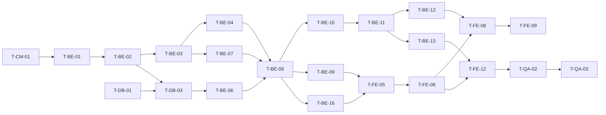

# TodoList 실행 계획 (WBS)

## 문서 이력

### 버전 이력

| 버전 | 일자 | 작성자 | 상태 | 비고 |
|---|---|---|---|---|
| v0.1 | 2026-11-04 | pmsong | 초안 | 최초 작성 |
| v0.2 | 2026-11-04 | pmsong | 초안 | 인증 방식 변경(JWT HS384 + refresh 토큰) 반영 |
| v0.3 | 2026-11-04 | pmsong | 초안 | 문서 간 정합성 검토 반영 |
| v0.4 | 2026-11-04 | Claude | 초안 | API 명세 작성 중 결정 반영 |
| v0.5 | 2026-11-05 | Claude | 초안 | 부하 테스트 제외 |
| v0.6 | 2026-11-05 | Claude | 초안 | 헬스 체크 DB 연결 확인 반영 |
| v0.7 | 2026-11-05 | Claude | 초안 | 스키마 원본 경로 변경 반영 |

### 변경 이력

| 버전 | 일자 | 변경 위치 | 변경 내용 | 변경 사유 | 작성자 |
|---|---|---|---|---|---|
| v0.1 | 2026-11-04 | 전체 | 최초 작성 | - | pmsong |
| v0.2 | 2026-11-04 | T-DB-02~04, T-BE-02, T-BE-06~08, T-BE-15, T-BE-16(신설), T-FE-02, T-FE-05, T-QA-01, 2장, 8장 | HS384 서명, access·refresh 토큰 발급·갱신·폐기, `refresh_tokens` 테이블, 화면의 401 시 갱신 후 재요청 작업·완료 조건 추가 | 사용자 결정(PRD v0.10 P-04) | pmsong |
| v0.3 | 2026-11-04 | T-BE-12, T-BE-16, T-FE-13 | 테스트 파일을 구조 설계 원칙 7.2 구성(auth·todos)에 맞춤, 일 뷰 11-04 순서를 BR-20(T4 → T2)으로 명시 | 7.2 `test/api` 목록과 불일치, 순서 표기 모호 | pmsong |
| v0.3 | 2026-11-04 | 참조 문서 | PRD v0.10 → v0.11, 시나리오 v0.8 → v0.9, 와이어프레임 v0.3 → v0.4, 구조 설계 원칙 v0.3 → v0.4 | 버전 동기화 | pmsong |
| v0.4 | 2026-11-04 | T-BE-03 | 본문 한도 초과는 413 또는 400 → 400 `VALIDATION_ERROR`(오류 미들웨어 변환) | API 명세(backend/swagger.yaml) 작성 중 발견한 미정의 사항 결정 | Claude |
| v0.4 | 2026-11-04 | T-BE-04, T-BE-11, T-BE-12 | 비밀번호 trim 예외, `null` 처리, 쿼리 형식 오류 400, 할일 응답 `categoryName` | API 명세(backend/swagger.yaml) 작성 중 발견한 미정의 사항 결정 | Claude |
| v0.4 | 2026-11-04 | T-BE-08, T-BE-10, T-BE-15 | 로그인·카테고리 수정·이름 수정 응답 본문, 비밀번호 변경 200 → 204 | API 명세(backend/swagger.yaml) 작성 중 발견한 미정의 사항 결정 | Claude |
| v0.4 | 2026-11-04 | 참조 문서 | 도메인 v0.6 → v0.7, PRD v0.11 → v0.12, 시나리오 v0.9 → v0.10, 와이어프레임 v0.4 → v0.5, 구조 설계 원칙 v0.4 → v0.5 | 버전 동기화 | Claude |
| v0.5 | 2026-11-05 | T-CM-01, T-DB-05, T-DB-06, T-QA-01, 2장, 9장, 참조 문서 | T-QA-01 폐기, 시드는 실행 계획 확인용으로 이름 변경, 기록 위치를 루트 `README.md`로. PRD v0.12 → v0.13, 구조 설계 원칙 v0.5 → v0.6 | PRD v0.13 부하 테스트 제외 | Claude |
| v0.6 | 2026-11-05 | T-BE-03 | `/api/health`가 `SELECT 1`로 DB 연결 확인(200 `db: 'up'` / 503 `db: 'down'`) | 구조 설계 원칙 v0.8 PD-14 | Claude |
| v0.7 | 2026-11-05 | T-DB-02, T-DB-03 | 스키마 단일 출처가 `docs/schema.sql`로 바뀜(T-DB-02의 이동을 되돌림, `backend/sql/` 삭제). 완료 기록은 그대로 둔다 | 구조 설계 원칙 v0.12 PR-S-10 | Claude |

> 단일 출처 원칙: 규칙(ST·BR·UC)은 [도메인 정의서 v0.7](./1-domain-definition.md), 기능·비기능·일정(FR·NFR·SCR·M·P)은 [PRD v0.14](./2-PRD.md), 시나리오·예외(SC·E)는 [사용자 시나리오 v0.10](./3-user-scenario.md), 화면 배치(WF·L)는 [와이어프레임 v0.5](./4-wireframe.md), 구조·레이어·파일 위치(PR·PD)는 [프로젝트 구조 설계 원칙 v0.8](./5-project-principle.md), 흐름(AD·SD)은 [아키텍처 다이어그램](./6-arch-diagram.md), 테이블·제약(DB)은 [ERD](./7-erd.md)가 정의한다. 이 문서는 **작업 순서·완료 조건만** 정하며 규칙·코드·수치를 다시 정의하지 않는다. 충돌하면 위 문서를 따른다.
>
> ID 운영 원칙: T-CM·T-DB·T-BE·T-FE·T-QA의 ID는 재사용하거나 재번호하지 않는다. Task를 없애면 행을 지우지 말고 '폐기'로 표시한다.

## 1. 개요

| 항목 | 내용 |
|---|---|
| 목적 | 2일·1인 개발(PRD 1장)에서 M-01~M-06을 달성하도록 작업을 독립적인 Task로 분해하고, Task마다 수행 작업·완료 조건·선행 Task를 정한다. |
| 분해 단위 | 공통(T-CM) → 데이터베이스(T-DB) → 백엔드(T-BE) → 프론트엔드(T-FE) → 검증(T-QA) |
| Task 크기 | 1~3시간. 한 Task는 한 번의 커밋(PR-C-07)으로 닫을 수 있고, 완료 조건을 혼자 확인할 수 있다. |
| 진행 규칙 | 기능 하나를 백엔드 → 프론트 순으로 끝까지 닫는다(PR-C-07). Must를 먼저 끝내고, 일정이 밀리면 Should·Could Task를 통째로 뺀다(PR-C-06, R-01). |
| 공통 완료 조건 | 모든 Task는 아래 '공통 DoD'를 추가로 만족해야 완료다. |

### 1.1 공통 DoD (Definition of Done)

모든 Task의 완료 조건에 암묵적으로 포함된다.

- [x] 루트 `biome check`가 통과한다(PR-N-11).
- [x] 백엔드 Task는 `backend`에서 `npm test`, 프론트 Task는 `frontend`에서 `npm test`와 `tsc --noEmit`이 통과한다(PR-T-07).
- [x] 규칙을 구현한 곳에 한 줄 ID 주석(`// BR-07`)이 있다(PR-C-01, PR-N-08).
- [x] Conventional Commits 한국어로 커밋하고 메시지에 관련 FR·BR ID를 넣었다(PR-C-07).
- [x] 구조가 [5-project-principle.md](./5-project-principle.md)와 달라졌다면 그 문서를 먼저 고쳤다(PR-C-08).

### 1.2 우선순위 표기

| 표기 | 의미 |
|---|---|
| Must | 릴리스 기준(PRD 3.1). M-04까지 완료 |
| Should | M-06에서 진행. 일정이 밀리면 제외 |
| Could | 여유 시 진행 |

## 2. Task 요약

| ID | Task | 영역 | 우선순위 | 마일스톤 | 선행 Task |
|---|---|---|---|---|---|
| T-CM-01 | 저장소 루트 셋업 | 공통 | Must | M-01 | - |
| T-DB-01 | 로컬 PostgreSQL DB 준비 | DB | Must | M-01 | - |
| T-DB-02 | 스키마 파일 배치 | DB | Must | M-01 | T-CM-01, T-BE-01 |
| T-DB-03 | 스키마 적용 스크립트(`db-init.js`) | DB | Must | M-01 | T-DB-01, T-DB-02, T-BE-02 |
| T-DB-04 | 스키마 제약 동작 검증 | DB | Must | M-01 | T-DB-03 |
| T-DB-05 | 실행 계획 확인용 시드(`seed-load.js`) | DB | Must | M-05 | T-DB-03, T-BE-08 |
| T-DB-06 | 실행 계획 기반 인덱스 검증 | DB | Must | M-05 | T-DB-05, T-BE-12, T-BE-13 |
| T-BE-01 | 백엔드 패키지 셋업 | BE | Must | M-01 | T-CM-01 |
| T-BE-02 | 설정·DB 연결 모듈 | BE | Must | M-01 | T-BE-01 |
| T-BE-03 | 오류 규약·앱 골격·헬스 체크 | BE | Must | M-01 | T-BE-02 |
| T-BE-04 | 입력 검증 순수 함수 + 단위 테스트 | BE | Must | M-01 | T-BE-03 |
| T-BE-05 | 상태 판정 순수 함수 + 단위 테스트 | BE | Must | M-02 | T-BE-01 |
| T-BE-06 | API 테스트 헬퍼 | BE | Must | M-01 | T-BE-03, T-DB-03 |
| T-BE-07 | 인증 미들웨어·인증 경계 | BE | Must | M-01 | T-BE-03 |
| T-BE-08 | 회원가입·로그인·로그아웃 API | BE | Must | M-01 | T-BE-04, T-BE-06, T-BE-07 |
| T-BE-09 | 내 정보 조회 API(`GET /api/me`) | BE | Must | M-01 | T-BE-08 |
| T-BE-10 | 카테고리 API | BE | Must | M-02 | T-BE-08 |
| T-BE-11 | 할일 등록·단건 조회·수정·삭제·완료 API | BE | Must | M-02 | T-BE-10 |
| T-BE-12 | 할일 목록 조회 + 필터 API | BE | Must | M-02 | T-BE-05, T-BE-11 |
| T-BE-13 | 캘린더 기간 조회 API | BE | Must | M-02 | T-BE-05, T-BE-11 |
| T-BE-14 | 소유권 통합 테스트 | BE | Must | M-02 | T-BE-10~13 |
| T-BE-15 | 이름 수정·비밀번호 변경 API | BE | Should | M-06 | T-BE-09 |
| T-BE-16 | 토큰 갱신 API(refresh 토큰 회전) | BE | Must | M-01 | T-BE-08 |
| T-FE-01 | 프론트엔드 프로젝트 셋업 | FE | Must | M-03 | T-CM-01 |
| T-FE-02 | API 클라이언트·타입·쿼리 키 | FE | Must | M-03 | T-FE-01 |
| T-FE-03 | 날짜 유틸·오늘 계산 + 단위 테스트 | FE | Must | M-03 | T-FE-01 |
| T-FE-04 | 공용 컴포넌트·전역 스타일 | FE | Must | M-03 | T-FE-01 |
| T-FE-05 | 라우터·인증 가드·401 전역 처리 | FE | Must | M-03 | T-FE-02, T-BE-09, T-BE-16 |
| T-FE-06 | 공통 내비게이션(AppLayout) | FE | Must | M-03 | T-FE-04, T-FE-05 |
| T-FE-07 | 로그인·회원가입 화면 | FE | Must | M-03 | T-FE-04, T-FE-05, T-BE-08 |
| T-FE-08 | 할일 목록·필터·완료 토글·삭제 화면 | FE | Must | M-03 | T-FE-03, T-FE-06, T-BE-12 |
| T-FE-09 | 할일 등록·편집 화면 | FE | Must | M-03 | T-FE-08, T-BE-11 |
| T-FE-10 | 카테고리 관리 화면 | FE | Must | M-04 | T-FE-06, T-BE-10 |
| T-FE-11 | 캘린더 순수 함수(기간·칸 배치) + 단위 테스트 | FE | Must | M-04 | T-FE-03 |
| T-FE-12 | 캘린더 월 뷰(데스크톱·모바일) | FE | Must | M-04 | T-FE-06, T-FE-11, T-BE-13 |
| T-FE-13 | 캘린더 주·일 뷰 | FE | Should | M-06 | T-FE-12 |
| T-FE-14 | 내 정보 화면 | FE | Should | M-06 | T-FE-06, T-BE-15 |
| T-FE-15 | 캘린더에서 편집 화면 이동 | FE | Could | M-06 | T-FE-09, T-FE-12 |
| T-QA-01 | 폐기(v0.5): k6 부하 테스트 | 검증 | - | - | - |
| T-QA-02 | 반응형·브라우저 점검 | 검증 | Must | M-05 | T-FE-10, T-FE-12 |
| T-QA-03 | 시나리오 셀프 체크(G-03) | 검증 | Must | M-06 | T-QA-02 (Should·Could 반영분 포함) |

### 2.1 크리티컬 패스

### 2.2 마일스톤별 배치

| 마일스톤 | 시점 | Task | 점검 |
|---|---|---|---|
| M-01 | Day 1 오전 | T-CM-01, T-DB-01~04, T-BE-01~04, T-BE-06~09, T-BE-16 | 가입·로그인·토큰 갱신·로그아웃 API 테스트 통과 |
| M-02 | Day 1 오후 | T-BE-05, T-BE-10~14 | G-04 대상 단위·API 통합 테스트 통과 |
| M-03 | Day 1 종료 | T-FE-01~09 | SC-01·02·04~08 화면에서 수행 가능 |
| M-04 | Day 2 오전 | T-FE-10~12 | **Must 전체 완료** 점검(R-01). 미완이면 M-06 Should를 뺀다 |
| M-05 | Day 2 오후 전반 | T-DB-05, T-DB-06, T-QA-02 | 실행 계획·반응형 점검 결과 기록 |
| M-06 | Day 2 오후 후반 | T-BE-15, T-FE-13~15, T-QA-03 | 수용 기준 셀프 체크 |

## 3. 공통 Task

### T-CM-01 저장소 루트 셋업

- **우선순위 / 마일스톤**: Must / M-01
- **선행 Task**: 없음
- **근거**: 5-project-principle 7.1, PD-01, PD-11, PR-S-01

**수행 작업**
1. 루트에 `backend/`, `frontend/` 폴더를 만든다. 루트 `package.json`·워크스페이스는 만들지 않는다(PD-01).
2. 루트 `biome.json` 작성: 2칸 들여쓰기, 작은따옴표, 세미콜론, 줄 폭 100(PR-N-11).
3. `.gitignore` 작성: `node_modules`, `.env`, `.env.test`, `dist`.
4. 루트 `README.md`에 실행 순서(7.4: DB 생성 → 백엔드 → 프론트) 뼈대를 쓴다.

**완료 조건**
- [x] 루트에 `backend/`, `frontend/`, `biome.json`, `.gitignore`, `README.md`가 있고 루트 `package.json`이 없다.
- [x] `.gitignore`에 `node_modules`, `.env`, `.env.test`, `dist`가 들어 있다.
- [x] `biome.json`의 포맷 설정이 PR-N-11과 일치한다.
- [x] `README.md`에 DB → 백엔드 → 프론트 실행 순서가 적혀 있다.

## 4. 데이터베이스 Task

### T-DB-01 로컬 PostgreSQL DB 준비

- **우선순위 / 마일스톤**: Must / M-01
- **선행 Task**: 없음
- **근거**: PRD 6장(PostgreSQL 17), P-10, PR-S-11, PR-T-04

**수행 작업**
1. 로컬에 PostgreSQL 17을 설치(또는 설치 확인)한다. Docker는 쓰지 않는다(PR-S-11).
2. 개발용 `todolist`, 테스트용 `todolist_test` 두 데이터베이스와 접속 계정을 만든다.
3. 두 DB의 접속 URL을 `DATABASE_URL` 형식으로 정리해 둔다(T-BE-01의 `.env`·`.env.test`에 사용).

**완료 조건**
- [x] `SELECT version();`이 PostgreSQL 17.x를 반환한다.
- [x] `todolist`, `todolist_test` 두 DB에 같은 계정으로 접속된다.
- [x] 두 DB의 접속 URL이 확정되어 있다(커밋하지 않음).

### T-DB-02 스키마 파일 배치

- **우선순위 / 마일스톤**: Must / M-01
- **선행 Task**: T-CM-01, T-BE-01
- **근거**: PR-S-10(당시 스키마 단일 출처는 `backend/sql/schema.sql`. v0.7에서 `docs/schema.sql`로 되돌림), 7-erd 4·5장, DB-01~12

**수행 작업**
1. `docs/schema.sql`을 `git mv`로 `backend/sql/schema.sql`로 옮긴다(단일 출처를 하나로 유지).
2. `7-erd.md` 등 `docs/schema.sql`을 가리키는 문서 링크를 새 경로로 고치고 변경 이력을 남긴다(PR-C-08).
3. 파일 내용이 7-erd 4장 테이블 명세·5장 제약·인덱스 목록과 일치하는지 대조한다.

**완료 조건**
- [x] `backend/sql/schema.sql`이 있고 `docs/schema.sql`은 없다(스키마 파일이 저장소에 하나).
- [x] 문서 안에 `docs/schema.sql`을 가리키는 링크가 남아 있지 않다.
- [x] 테이블 4개(`users`, `categories`, `todos`, `refresh_tokens`)가 있고 상태(status) 컬럼이 없다(NFR-12).
- [x] 제약·인덱스 이름이 PR-N-04·DB-12와 일치한다: `uq_users_email`, `ck_users_email_lower`, `uq_categories_user_name`, `uq_categories_user_default`, `fk_categories_user`, `fk_todos_user`, `fk_todos_category`, `ck_todos_dates`, `ck_todos_completed`, `idx_todos_user_dates`, `idx_todos_user_category`, `fk_refresh_tokens_user`, `uq_refresh_tokens_hash`, `idx_refresh_tokens_user`(DB-13).

### T-DB-03 스키마 적용 스크립트(`db-init.js`)

- **우선순위 / 마일스톤**: Must / M-01
- **선행 Task**: T-DB-01, T-DB-02, T-BE-02
- **근거**: PD-08, PR-S-10, 7.2 `scripts/db-init.js`

**수행 작업**
1. `backend/scripts/db-init.js` 작성: `config.js`의 `DATABASE_URL`로 접속해 스키마 파일(v0.7부터 `docs/schema.sql`)을 실행한다(psql 불필요).
2. `--reset` 인자가 있으면 `DROP TABLE IF EXISTS refresh_tokens, todos, categories, users`를 먼저 실행한다.
3. `package.json` scripts에 `db:init`을 등록하고, `.env.test`로도 실행할 수 있게 한다(예: `node --env-file=.env.test scripts/db-init.js --reset`).

**완료 조건**
- [x] 빈 `todolist` DB에서 `npm run db:init`을 실행하면 테이블 4개와 인덱스가 생긴다.
- [x] 테이블이 이미 있을 때 `npm run db:init -- --reset`이 오류 없이 다시 만든다.
- [x] `--reset` 없이 두 번째 실행하면 '이미 존재' 오류로 실패하고 기존 데이터는 그대로다(실수로 지우지 않음).
- [x] `todolist_test`에도 같은 스키마가 적용된다.

### T-DB-04 스키마 제약 동작 검증

- **우선순위 / 마일스톤**: Must / M-01
- **선행 Task**: T-DB-03
- **근거**: BR-02, BR-07, BR-10, BR-12, BR-13, DB-03, DB-05, DB-08

**수행 작업**
1. `todolist_test`에서 아래 위반 INSERT/UPDATE/DELETE를 직접 실행해 DB 방어선이 동작하는지 확인한다(일회성 수동 확인, 결과는 커밋 메시지나 README에 한 줄 기록).
2. 위반 시 PostgreSQL 오류 코드·제약 이름이 T-BE-08·T-BE-10의 23505 분기(PR-N-04)에 쓸 수 있는 형태인지 확인한다.

**완료 조건**
- [x] 같은 이메일 두 번 INSERT 시 23505 + 제약 이름 `uq_users_email`이 나온다.
- [x] 대문자 이메일 INSERT가 `ck_users_email_lower`로 실패한다.
- [x] 같은 사용자에 같은 카테고리 이름 INSERT 시 23505 + `uq_categories_user_name`이 나온다.
- [x] 같은 사용자에 `is_default = true` 두 번째 INSERT가 `uq_categories_user_default`로 실패한다.
- [x] `start_date > end_date` INSERT가 `ck_todos_dates`로 실패한다.
- [x] `completed = true`, `completed_at = NULL` INSERT가 `ck_todos_completed`로 실패한다.
- [x] 할일이 있는 카테고리 DELETE가 FK RESTRICT(23503)로 실패한다.
- [x] 같은 `token_hash`를 두 번 INSERT하면 23505 + `uq_refresh_tokens_hash`가 나온다(DB-13).

### T-DB-05 실행 계획 확인용 시드(`seed-load.js`)

- **우선순위 / 마일스톤**: Must / M-05
- **선행 Task**: T-DB-03, T-BE-08
- **근거**: NFR-04, NFR-05, 7.2 `scripts/seed-load.js`

**수행 작업**
1. `backend/scripts/seed-load.js` 작성: 사용자 1000명(각자 기본 카테고리 포함, BR-10)과 사용자당 할일 100건을 넣는다.
2. 비밀번호 해시는 bcrypt로 한 번만 만들어 모든 사용자에 재사용한다(NFR-05).
3. 할일 기간은 월·주 경계에 걸치는 것, 완료된 것을 섞어 조회 데이터가 실제와 비슷하게 만든다.
4. 대량 INSERT는 다중 VALUES 또는 배치로 실행하고 모두 파라미터 바인딩한다(NFR-08).
5. `package.json` scripts에 `seed:load` 등록. 시드 계정 규칙(예: `load{n}@test.local` / 공통 비밀번호)을 루트 `README.md`에 적는다.

**완료 조건**
- [x] `npm run seed:load` 후 `users` 1000행, `categories` 기본 1000행 이상, `todos` 100000행이다.
- [x] 사용자마다 `is_default = true` 카테고리가 정확히 1개다.
- [x] 시드 계정으로 `POST /api/auth/login`이 200을 반환한다.
- [x] 시드가 1분 이내에 끝난다(bcrypt 1회).
- [x] 계정 규칙이 루트 `README.md`에 기록되어 있다.

### T-DB-06 실행 계획 기반 인덱스 검증

- **우선순위 / 마일스톤**: Must / M-05
- **선행 Task**: T-DB-05, T-BE-12, T-BE-13
- **근거**: NFR-04, PR-T-09, DB-10

**수행 작업**
1. 시드 데이터 위에서 목록 조회(카테고리 필터 있음·없음), 캘린더 기간 조회, 카테고리 삭제 시 할일 이동 SQL을 `EXPLAIN (ANALYZE, BUFFERS)`로 실행한다.
2. `todos` 전체 순차 스캔(Seq Scan)이 나오면 원인을 확인하고, 필요할 때만 `schema.sql`에 인덱스를 추가한 뒤 `db:init --reset` → 재시드로 다시 측정한다.
3. 결과(쿼리, 사용 인덱스, 실행 시간)를 루트 `README.md`에 기록한다.

**완료 조건**
- [x] 목록·캘린더 조회가 `idx_todos_user_dates` 또는 `idx_todos_user_category`를 사용한다(`todos` Seq Scan 없음).
- [x] 각 조회 SQL의 실행 시간이 기록되어 있다.
- [x] 인덱스를 추가했다면 `schema.sql`·7-erd 5장에 반영하고 변경 이력을 남겼다.

## 5. 백엔드 Task

### T-BE-01 백엔드 패키지 셋업

- **우선순위 / 마일스톤**: Must / M-01
- **선행 Task**: T-CM-01
- **근거**: PD-02, PD-03, PD-15, PR-N-01, PR-S-01, PR-S-12, 7.2·7.4

**수행 작업**
1. `backend/package.json`: `"type": "module"`, `engines.node` `>=22`.
2. 의존성 설치: `express`(5), `pg`, `jsonwebtoken`, `bcrypt`. 개발용 `@biomejs/biome`. 그 외 의존성은 추가하지 않는다(PR-C-02).
3. scripts: `dev`(`node --watch --env-file=.env src/server.js`), `start`, `test`(`node --env-file=.env.test --test --test-concurrency=1`), `db:init`, `seed:load`.
4. `.env.example` 작성: `DATABASE_URL`, `JWT_SECRET`, `PORT`, `DB_POOL_MAX`, `NODE_ENV`. 로컬 `.env`, `.env.test`(DB만 `todolist_test`)를 만든다.
5. Windows에서 `bcrypt` 설치가 실패하면 `bcryptjs`로 바꾸고 PD-15를 갱신한다.

**완료 조건**
- [x] `npm ci`가 성공하고 `package-lock.json`이 커밋되어 있다.
- [x] `dependencies`가 `express`, `pg`, `jsonwebtoken`, `bcrypt`(또는 PD-15 갱신 후 `bcryptjs`)뿐이다.
- [x] `.env.example`만 커밋되고 `.env`, `.env.test`는 `git status`에 나오지 않는다.
- [x] scripts 5개(`dev`, `start`, `test`, `db:init`, `seed:load`)가 정의되어 있다.

### T-BE-02 설정·DB 연결 모듈

- **우선순위 / 마일스톤**: Must / M-01
- **선행 Task**: T-BE-01
- **근거**: PR-S-01, PR-S-09, PR-L-06, NFR-03, NFR-11, AD-02

**수행 작업**
1. `src/config.js`: 환경변수를 한 곳에서 읽고 검증한다. `DATABASE_URL` 누락, `JWT_SECRET` 48자 미만이면(HS384, PR-S-01) 기동 시 즉시 종료. `PORT` 기본 3000, `DB_POOL_MAX` 기본 20.
2. `src/db.js`: `pg.Pool` 하나(크기 `DB_POOL_MAX`), `query(text, params)`, `withTransaction(fn)`(BEGIN/COMMIT/ROLLBACK, 커넥션 반납 보장), DATE(OID 1082) 문자열 파서 설정, `close()`.

**완료 조건**
- [x] `config.js` 외 파일에 `process.env` 접근이 없다(`grep -r "process.env" src` 결과가 `config.js`뿐).
- [x] `JWT_SECRET`이 47자이거나 `DATABASE_URL`이 없으면 프로세스가 오류 메시지와 함께 종료된다.
- [x] `SELECT '2026-11-04'::date AS d`의 결과 `d`가 문자열 `'2026-11-04'`다(Date 객체 아님).
- [x] `withTransaction` 안에서 오류를 던지면 ROLLBACK되고 커넥션이 풀로 반납된다.

### T-BE-03 오류 규약·앱 골격·헬스 체크

- **우선순위 / 마일스톤**: Must / M-01
- **선행 Task**: T-BE-02
- **근거**: NFR-15, P-13, PR-N-07, PR-S-07, PR-S-08, PD-03, PD-14, PD-25, P-25

**수행 작업**
1. `src/errors.js`: `AppError(status, code, message, fields?)`와 오류 코드 상수(NFR-15의 코드 전체).
2. `src/middleware/error.js`: 알 수 없는 `/api` 경로는 404 `NOT_FOUND`, `AppError`는 NFR-15 형식으로 응답, 그 밖의 오류는 500 `INTERNAL_ERROR` + stderr JSON 한 줄 로그(본문·쿠키·비밀번호 미기록). `express.json` 파싱 실패와 본문 한도 초과(413 `entity.too.large`)는 400 `VALIDATION_ERROR`로 변환(PR-S-07).
3. `src/app.js`: `createApp()` — `express.json({ limit: '16kb' })`, `/api/health`(`SELECT 1`로 DB 연결 확인, 200 `{ ok: true, db: 'up' }` / 503 `{ ok: false, db: 'down' }`), 라우터, 오류 미들웨어 조립.
4. `src/server.js`: `createApp().listen(PORT)`, `SIGINT`·`SIGTERM`에서 `pool.end()`.
5. `src/routes/index.js`: `/api` 라우터 뼈대(인증 경계는 T-BE-07).

**완료 조건**
- [x] `npm run dev` 후 `GET /api/health`가 인증 없이 200 `{ "ok": true, "db": "up" }`을 반환하고, DB를 쓸 수 없으면 503 `{ "ok": false, "db": "down" }`이다.
- [x] `GET /api/없는경로`가 404 `{ "error": { "code": "NOT_FOUND", "message": ... } }`를 반환한다.
- [x] 임시로 던진 일반 `Error`가 500 `INTERNAL_ERROR`로 응답되고, 응답 본문에 stack·내부 메시지가 없으며 stderr에 JSON 한 줄이 남는다.
- [x] 16kb를 넘는 본문이 400 `VALIDATION_ERROR`로 거부되고(413을 오류 미들웨어가 변환) 서버가 죽지 않는다.
- [x] 오류 코드 문자열이 `errors.js` 밖에 리터럴로 없다(PR-C-01).

### T-BE-04 입력 검증 순수 함수 + 단위 테스트

- **우선순위 / 마일스톤**: Must / M-01(인증 검증), M-02(할일·조회 조건 검증)
- **선행 Task**: T-BE-03
- **근거**: NFR-09, BR-06, BR-07, BR-21, BR-22, P-12, P-14, PD-06, PD-19, PD-20, PD-22, DB-03, DB-11, PR-L-07, PR-T-02

**수행 작업**
1. `src/domain/validate.js`(다른 모듈 import 금지, I/O 없음): trim 후 검사(비밀번호는 trim하지 않음, BR-22), NOT NULL 필드의 `null`은 실패·`description`의 `null`은 허용(PD-27), 여러 오류를 `fields`에 함께 담아 `VALIDATION_ERROR`를 throw.
   - 회원가입: 이메일 형식·254자, 비밀번호 8~64자, 이름 1~50자. 이메일은 소문자로 정규화해 반환(DB-03).
   - 로그인: 이메일·비밀번호 필수.
   - 카테고리 이름: 1~30자.
   - 할일 등록·수정: 제목 1~100자 필수, 설명 0~1000자(빈 문자열은 `null`, DB-11), `startDate`·`endDate` 필수 `YYYY-MM-DD` 실제 날짜, `startDate ≤ endDate`(BR-07), `categoryId` 선택 정수.
   - 조회 조건: `categoryId`는 정수(아니면 400, PD-13), `today` 필수 날짜, `status`는 PD-19 4개 값 중 하나, `from`·`to` 날짜이고 `from ≤ to`.
   - 이름 수정·비밀번호 변경(Should용): 이름 1~50자, 새 비밀번호 8~64자.
2. `test/unit/validate.test.js`: 경계값 테스트.

**완료 조건**
- [x] `domain/validate.js`에 `import` 문이 없다(오류 클래스는 인자로 받거나 동일 형태 객체를 throw — 구현 방식은 PR-L-07 범위에서 선택).
- [x] 비밀번호 7자·65자는 실패, 8자·64자는 통과한다(BR-21).
- [x] 이메일 254자 통과·255자 실패, 이름 50자 통과·51자 실패, 카테고리 30/31자, 제목 100/101자, 설명 1000/1001자 경계가 테스트된다(BR-22).
- [x] 공백만 있는 제목·이름은 누락으로 실패하고, 앞뒤 공백은 trim된 값으로 반환된다. 비밀번호는 trim하지 않는다(`' 1234567'`은 8자로 통과, BR-22).
- [x] `title: null`은 실패하고 `description: null`은 통과한다(PD-27). `categoryId=abc`는 실패한다(PD-13).
- [x] `2026-13-01`, `2026-02-30`, `2026-1-1`은 날짜 형식 오류, `2026-02-28`은 통과한다.
- [x] 시작일 `2026-11-10` > 종료일 `2026-11-02`는 실패, 같은 날은 통과한다(E-04-2, BR-07).
- [x] `status=done` 같은 값은 실패하고 PD-19의 4개 값은 통과한다(E-08-3).
- [x] `from > to`는 실패한다(E-09-2).
- [x] 여러 필드가 동시에 틀리면 `fields`에 모두 담긴다(PD-22).
- [x] 테스트 이름에 E-ID 또는 BR-ID가 들어 있다(PR-T-05).

### T-BE-05 상태 판정 순수 함수 + 단위 테스트

- **우선순위 / 마일스톤**: Must / M-02
- **선행 Task**: T-BE-01
- **근거**: ST-01~04, NFR-12, PD-17, PD-19, PR-L-07, PR-T-02, R-03

**수행 작업**
1. `src/domain/status.js`: 상태 값 상수(PD-19: `completed`·`not_started`·`in_progress`·`overdue`), `deriveStatus(todo, today)`(ST-01→04 순, 문자열 날짜 비교), 상태 필터 함수.
2. `test/unit/status.test.js`: 시나리오 3.0 예시 T1~T4(오늘 2026-11-04)와 경계값.

**완료 조건**
- [x] T1→`overdue`, T2→`in_progress`, T3→`not_started`, T4→`completed`가 나온다.
- [x] 시작일 당일·종료일 당일은 `in_progress`다.
- [x] 종료일이 지난 할일도 `completed = true`면 `completed`다(완료 우선).
- [x] 시작 전 할일도 `completed = true`면 `completed`다.
- [x] 완료 취소(`completed = false`)하면 날짜 규칙으로 다시 판정된다.
- [x] 상태 문자열 리터럴이 `status.js` 밖 백엔드 코드에 없다(PR-C-01).

### T-BE-06 API 테스트 헬퍼

- **우선순위 / 마일스톤**: Must / M-01
- **선행 Task**: T-BE-03, T-DB-03
- **근거**: PR-T-04, PD-09, 7.2 `test/helpers`

**수행 작업**
1. `test/helpers/`: `createApp()`을 포트 0으로 띄우고 base URL을 돌려주는 함수, 종료 함수.
2. `TRUNCATE users, categories, todos, refresh_tokens RESTART IDENTITY CASCADE`로 DB를 비우는 함수.
3. 내장 `fetch`로 가입·로그인 후 `Set-Cookie`(`access_token`·`refresh_token`)를 저장해 다음 요청에 붙이는 헬퍼(사용자 U1·U2를 만드는 함수 포함).

**완료 조건**
- [x] 헬퍼만 쓰는 샘플 테스트에서 `GET /api/health`가 200이다.
- [x] 테스트 실행이 `todolist`(개발 DB)를 건드리지 않는다(`.env.test`의 `todolist_test`만 사용).
- [x] supertest 등 추가 의존성이 없다(PD-09).
- [x] 테스트 종료 후 서버·풀이 닫혀 `npm test`가 멈추지 않고 끝난다.

### T-BE-07 인증 미들웨어·인증 경계

- **우선순위 / 마일스톤**: Must / M-01
- **선행 Task**: T-BE-03
- **근거**: BR-01, FR-04, NFR-02, P-04, PR-S-02, PR-S-03, PR-S-05, PD-15, SD-02

**수행 작업**
1. `src/middleware/auth.js`: `req.headers.cookie`를 직접 파싱해 `access_token`의 JWT를 `algorithms: ['HS384']`로 검증하고 `req.userId = sub`를 넣는다. 쿠키 없음·만료·위조면 401 `UNAUTHORIZED`.
2. 서명 알고리즘 HS384, 만료(access 15분·refresh 7일), 쿠키 이름(`access_token`·`refresh_token`), 쿠키 옵션(httpOnly, `SameSite=Lax`, access `path=/`·refresh `path=/api/auth`, production에서만 `secure`)을 상수로 둔다(PR-S-02, PR-S-03).
3. `routes/index.js`: `/api/auth/signup`·`/login`·`/refresh`·`/logout`·`/api/health`를 제외한 모든 라우트 앞에 `auth`를 건다.

**완료 조건**
- [x] 쿠키 없이 보호된 라우트 호출 시 401 `UNAUTHORIZED`다(E-02-2).
- [x] 서명이 다른 토큰, 만료된 토큰 모두 401 `UNAUTHORIZED`다(E-C1).
- [x] 같은 비밀키로 HS256 서명한 토큰과 `alg: none` 토큰이 401이다(HS384만 허용, PR-S-03).
- [x] access 토큰의 `exp - iat`가 900초(15분)다.
- [x] JWT 페이로드에 `sub` 외 사용자 정보가 없다.
- [x] 새 라우터를 `routes/index.js`에 추가하면 별도 코드 없이 인증이 적용되는 구조다.

### T-BE-08 회원가입·로그인·로그아웃 API

- **우선순위 / 마일스톤**: Must / M-01
- **선행 Task**: T-BE-04, T-BE-06, T-BE-07
- **근거**: FR-01~03, BR-02, BR-10, NFR-06, NFR-10, PR-L-06, PR-N-04, PD-25, SD-01, SC-01, SC-02

**수행 작업**
1. `services/auth.js`
   - 가입: 검증 → bcrypt(cost 10) 해시를 **트랜잭션 밖에서** 계산 → `withTransaction`으로 사용자 INSERT + '기본' 카테고리 INSERT + refresh 토큰 해시 INSERT → 23505 `uq_users_email`이면 409 `DUPLICATE_EMAIL`.
   - 로그인: 소문자 이메일로 조회(컬럼 명시, `SELECT *` 금지) → bcrypt 비교 → 이메일 없음·비밀번호 틀림 모두 401 `INVALID_CREDENTIALS` → 성공 시 그 사용자의 만료 refresh 토큰 삭제 후 새 refresh 토큰 INSERT(DB-13).
   - 토큰 발급 함수: access 토큰 JWT(HS384, `sub`만, 15분) 서명, refresh 토큰 `crypto.randomBytes(32)` base64url 생성과 SHA-256 해시(PR-S-03). T-BE-16·T-BE-15가 재사용한다.
2. `routes/auth.js`: 가입 201 + 사용자(비밀번호 해시 제외) + `access_token`·`refresh_token` 쿠키 발급, 로그인 200 + 사용자(가입과 같은 형태, PD-25) + 두 쿠키 발급, 로그아웃 204 + `refresh_token`에 해당하는 행 삭제 + 같은 옵션으로 두 쿠키 삭제(쿠키가 없거나 이미 무효여도 204).
3. `test/api/auth.test.js`.

**완료 조건**
- [x] 가입 성공 시 201, `access_token`(`Path=/`, 15분)·`refresh_token`(`Path=/api/auth`, 7일) 두 `Set-Cookie`가 모두 httpOnly·`SameSite=Lax`이고 응답 본문에 `passwordHash`·토큰 값이 없다(FR-01, P-04).
- [x] 가입 직후 해당 사용자의 `is_default = true` 카테고리 '기본'이 정확히 1개다(BR-10).
- [x] 가입 쿠키로 바로 보호 API 호출이 성공한다(자동 로그인).
- [x] 중복 이메일(대소문자만 다른 경우 포함)은 409 `DUPLICATE_EMAIL`이고 사용자 수가 늘지 않는다(E-01-1).
- [x] 비밀번호 7자·65자, 이메일 형식 오류·255자, 이름 51자·공백만은 400 `VALIDATION_ERROR`이며 사용자가 생성되지 않는다(E-01-2, E-01-3).
- [x] 기본 카테고리 INSERT가 실패하면 사용자도 남지 않는다(트랜잭션, NFR-10).
- [x] 틀린 비밀번호와 없는 이메일의 응답이 둘 다 401 `INVALID_CREDENTIALS`로 같다(E-02-1).
- [x] 로그아웃 204 후 `refresh_tokens`에서 그 행이 사라지고, 이전 refresh 토큰으로 `POST /api/auth/refresh`를 호출하면 401이다(FR-03, P-04).
- [x] DB의 `password_hash`가 `$2b$10$`로 시작하고 로그에 평문 비밀번호가 없다(NFR-06).
- [x] DB `refresh_tokens.token_hash`가 64자 16진수이고 쿠키의 원문과 다르다(DB-13).

### T-BE-16 토큰 갱신 API(`POST /api/auth/refresh`)

- **우선순위 / 마일스톤**: Must / M-01
- **선행 Task**: T-BE-08
- **근거**: P-04, FR-04, NFR-02, PR-S-03, PR-S-05, PD-25, PD-26, DB-13, SD-02

**수행 작업**
1. `services/auth.js`에 회전 함수: 쿠키의 refresh 토큰을 SHA-256 해시 → `DELETE FROM refresh_tokens WHERE token_hash = $1 AND expires_at > now() RETURNING user_id` → 0행이면 401 `UNAUTHORIZED` → 같은 사용자로 새 refresh 토큰 INSERT + access 토큰(HS384) 서명.
2. `routes/auth.js`: 성공 204 + 두 쿠키 재발급, 실패 401 + 같은 옵션으로 두 쿠키 삭제. 인증 미들웨어 대상이 아니다(PR-S-05).
3. `test/api/auth.test.js`에 갱신 케이스 추가.

**완료 조건**
- [x] 유효한 refresh 쿠키로 호출하면 204와 새 `access_token`·`refresh_token` 쿠키가 오고, 새 access 토큰으로 보호 API가 200이다.
- [x] 갱신 후 이전 refresh 토큰을 다시 쓰면 401 `UNAUTHORIZED`다(회전, 재사용 불가).
- [x] 같은 refresh 토큰으로 동시에 2번 호출하면 1번만 204, 나머지는 401이다(DB-13).
- [x] `expires_at`이 지난 토큰, DB에 없는 값, 쿠키 없음은 모두 401이고 응답이 두 쿠키를 삭제한다.
- [x] access 토큰 쿠키 없이 refresh 쿠키만으로 갱신된다(인증 경계 제외).
- [x] `refresh_token` 쿠키의 `Path`가 `/api/auth`라 `/api/todos` 요청에는 실리지 않는다.
- [x] 갱신을 여러 번 해도 그 사용자의 `refresh_tokens` 행 수가 늘지 않는다(삭제 1 + 삽입 1).

### T-BE-09 내 정보 조회 API(`GET /api/me`)

- **우선순위 / 마일스톤**: Must / M-01
- **선행 Task**: T-BE-08
- **근거**: P-25, PD-24, FR-04, 공통 내비게이션(사용자 이름 표시 Must)

**수행 작업**
1. `services/users.js`에 본인 조회(`id`, `email`, `name`, `createdAt`, `updatedAt` 컬럼 명시).
2. `routes/me.js`에 `GET /api/me` 200.
3. API 테스트 추가.

**완료 조건**
- [x] 로그인 쿠키로 호출하면 200과 `{ id, email, name, ... }`이 오고 비밀번호 해시가 없다.
- [x] 쿠키 없이 호출하면 401 `UNAUTHORIZED`다.

### T-BE-10 카테고리 API

- **우선순위 / 마일스톤**: Must / M-02
- **선행 Task**: T-BE-08
- **근거**: FR-13, UC-04, BR-03, BR-12~14, BR-22, BR-23, NFR-07, NFR-10, PR-L-05, PR-L-06, PD-22, PD-25, DB-02, DB-04, SD-06, SC-03

**수행 작업**
1. `services/categories.js`
   - 목록: `ORDER BY is_default DESC, created_at, id`(BR-23).
   - 등록: 이름 검증 → INSERT → 23505 `uq_categories_user_name`이면 409 `DUPLICATE_CATEGORY`.
   - 이름 수정: `id AND user_id`로 조회(0행이면 404) → 기본이면 400 `DEFAULT_CATEGORY_IMMUTABLE` → UPDATE(`updated_at = now()`) → 중복이면 409.
   - 삭제: 조회(404) → 기본이면 400 → `withTransaction`으로 소속 할일을 기본 카테고리로 UPDATE(`updated_at = now()`) 후 DELETE(BR-14).
2. `routes/categories.js`: GET 200, POST 201, PATCH 200(수정된 카테고리), DELETE 204. 정수가 아닌 `:id`는 404(PD-13).
3. `test/api/categories.test.js`.

**완료 조건**
- [x] 목록이 '기본' 맨 앞, 나머지는 생성 순서다(BR-23).
- [x] '업무' 추가 201, 같은 이름 또는 '기본'으로 추가·이름 변경 시 409 `DUPLICATE_CATEGORY`(E-03-1).
- [x] `' 업무 '`는 `'업무'`와 같은 이름으로 취급된다(DB-04).
- [x] 이름 31자·공백만은 400 `VALIDATION_ERROR`(E-03-3).
- [x] 기본 카테고리 이름 변경·삭제는 400 `DEFAULT_CATEGORY_IMMUTABLE`이고 변경이 없다(E-03-2).
- [x] 할일 2건이 있는 카테고리를 삭제하면 204, 두 할일의 `category_id`가 기본 카테고리로 바뀌고 할일 수가 그대로다(BR-14).
- [x] 삭제 도중 오류가 나면 할일 이동도 롤백된다(NFR-10).
- [x] `/api/categories/abc`는 404 `NOT_FOUND`다.
- [x] 오류 판정 순서가 PD-22를 따른다(예: 타인의 기본 카테고리 삭제는 400이 아니라 404).

### T-BE-11 할일 등록·단건 조회·수정·삭제·완료 API

- **우선순위 / 마일스톤**: Must / M-02
- **선행 Task**: T-BE-10
- **근거**: FR-05~08, UC-05~08, BR-03, BR-04, BR-06~09, BR-11, PD-13, PD-20, PD-21, PD-25, DB-02, DB-06, DB-08, DB-11, SD-05, SD-07, SC-04~07

**수행 작업**
1. `services/todos.js`
   - 등록: 검증 → `categoryId`가 있으면 `id AND user_id`로 확인(없으면 404), 없으면 기본 카테고리 → INSERT. 응답은 201 + 할일(상태 미포함).
   - 단건 조회: `id AND user_id`, 상태·`today` 없음(PD-13).
   - 수정(PD-20): 본문 전체 검증 → 할일 존재 확인 → `categoryId`가 있으면 소유 확인, 없으면 기존 유지(BR-11) → UPDATE(`updated_at = now()`).
   - 삭제: `DELETE ... WHERE id AND user_id`, 0행이면 404(BR-09 물리 삭제).
   - 완료(PD-21, DB-08): `completed`가 boolean이 아니면 400, `completed_at = CASE WHEN $1 THEN COALESCE(completed_at, now()) ELSE NULL END`.
2. 조회 컬럼은 `AS "startDate"` 등 camelCase 별칭으로 명시(PR-N-05). 정렬 상수는 T-BE-12와 공유할 수 있게 한 곳에 둔다(PR-L-08).
3. `routes/todos.js`, `test/api/todos.test.js`.

**완료 조건**
- [x] 카테고리 없이 등록하면 기본 카테고리에 저장되고 201이다(BR-11).
- [x] 과거 날짜(종료일 < 오늘) 등록이 성공한다(BR-08).
- [x] 제목·시작일·종료일 누락, 공백 제목, 시작일 > 종료일, 제목 101자·설명 1001자는 400이고 저장되지 않는다(E-04-1~3).
- [x] 설명 `'  '`은 `null`로 저장·반환된다(DB-11).
- [x] 응답 날짜가 `'YYYY-MM-DD'` 문자열이다(NFR-11).
- [x] 수정 시 `categoryId`를 빼면 기존 카테고리가 유지된다(BR-11).
- [x] 완료 `true` → `completed_at` 설정, 다시 `true` → `completed_at` 그대로, `false` → `NULL`(PD-21 멱등).
- [x] `{ "completed": "yes" }`는 400 `VALIDATION_ERROR`다.
- [x] 삭제 204 후 단건 조회가 404다.
- [x] 성공 상태 코드가 PD-25와 일치한다(등록 201, 삭제 204, 나머지 200).
- [x] 단건 조회·등록·수정·완료 응답에 `categoryName`이 있다(PD-29).
- [x] 수정에서 `description: null`이면 설명이 비워지고, `title: null`·`categoryId: null`은 400이다(PD-27).

### T-BE-12 할일 목록 조회 + 필터 API

- **우선순위 / 마일스톤**: Must / M-02
- **선행 Task**: T-BE-05, T-BE-11
- **근거**: FR-09, UC-09, BR-15, BR-20, P-11, P-12, P-14, PD-17, PD-19, PR-L-04, PR-L-08, SD-03, SC-08

**수행 작업**
1. `GET /api/todos?categoryId&status&today`: 조건 검증(T-BE-04) → `categoryId`가 있으면 본인 카테고리인지 확인(없으면 404, P-14) → SQL 한 번(카테고리명 JOIN, 양쪽 `user_id` 조건, BR-20 정렬 `end_date, created_at, id`) → `deriveStatus`로 상태 부여 → `status`가 있으면 JS로 필터(PD-17).
2. 카테고리 조건은 고정 SQL 조각 + 바인딩(PR-L-04). 페이지네이션 없음(P-11).
3. `test/api/todos.test.js`에 목록 케이스 추가(구조 설계 원칙 7.2 파일 구성): 시나리오 3.0 예시 데이터(T1~T4, 카테고리 기본·업무·학습)로 검증.

**완료 조건**
- [x] 필터 없음 → T1~T4 4건이 BR-20 순서(T1, T4, T2, T3)로 오고 각 항목에 `status`·`categoryName`이 있다.
- [x] 카테고리 단독(업무) → T1만, 상태 단독(`in_progress`) → T2만, AND 결합(기본 + `not_started`) → T3만(BR-15).
- [x] 종료일이 같으면 `created_at` 순, 그것도 같으면 `id` 순이다(BR-20).
- [x] `today` 누락·`2026-13-01`은 400(E-08-1), 잘못된 `status`는 400(E-08-3).
- [x] U2의 카테고리·없는 카테고리로 필터하면 둘 다 404 `NOT_FOUND`(E-08-2). `categoryId=abc`는 400 `VALIDATION_ERROR`(PD-13).
- [x] U2의 할일은 결과에 포함되지 않는다.
- [x] 요청 하나에 SQL이 2개(카테고리 확인 + 목록) 이하다(N+1 없음, PR-L-08).

### T-BE-13 캘린더 기간 조회 API

- **우선순위 / 마일스톤**: Must / M-02
- **선행 Task**: T-BE-05, T-BE-11
- **근거**: FR-10~12, UC-10, BR-16~20, P-12, P-14, PR-L-08, SD-04, SC-09, SC-10

**수행 작업**
1. `GET /api/calendar?from&to&today`: 검증 → 겹침 조건 `start_date <= $to AND end_date >= $from AND user_id = $n`, 정렬은 T-BE-12와 같은 상수 → 상태 부여. 월·주·일 뷰가 같은 API를 쓴다(일 뷰는 `from = to`).
2. `routes/calendar.js`, `test/api/calendar.test.js`.

**완료 조건**
- [x] 월(2026-11-01~11-30) 조회에 10-28~11-03(T1, 월 경계 걸침)과 11-20~12-02(T3)가 포함된다(BR-17).
- [x] 주(11-01~11-07) 조회에 T1·T2·T4가 있고 T3는 없다. 주(10-25~10-31)에 T1이 있다(BR-17 주 경계).
- [x] 일(11-04) 조회에 T2·T4가 있고 T1(11-03 종료)은 없다. 일(11-03)에는 T1이 있다(BR-18 당일 포함).
- [x] 완료된 T4가 `completed` 상태로 포함된다(BR-19).
- [x] 결과 순서가 BR-20이다.
- [x] `from`·`to`·`today` 형식 오류, `from > to`는 400 `VALIDATION_ERROR`(E-09-1, E-09-2).
- [x] 요청당 SQL이 1개다.

### T-BE-14 소유권 통합 테스트

- **우선순위 / 마일스톤**: Must / M-02
- **선행 Task**: T-BE-10, T-BE-11, T-BE-12, T-BE-13
- **근거**: BR-03, BR-04, NFR-07, P-14, PR-T-03, R-04, E-C2

**수행 작업**
1. `test/api/ownership.test.js`: U1·U2를 만들고 U2의 카테고리 C9·할일 T9를 준비한다.
2. U1 쿠키로 카테고리·할일 모든 엔드포인트(수정·삭제·단건 조회·완료·카테고리 지정·필터)에 C9·T9를 보낸다.
3. 각 호출 후 U2 데이터가 변하지 않았는지 DB로 확인한다.

**완료 조건**
- [x] `PATCH/DELETE /api/categories/C9` → 404, C9 그대로.
- [x] `GET/PATCH/DELETE /api/todos/T9`, `PATCH /api/todos/T9/completed` → 404, T9 그대로(E-05-2, E-06-1, E-07-1).
- [x] 할일 등록·수정에 `categoryId = C9` → 404, 저장·변경 없음(E-04-4, BR-04).
- [x] `GET /api/todos?categoryId=C9` → 404(E-08-2).
- [x] U1의 목록·캘린더 응답에 T9가 없다.
- [x] 타인 ID와 존재하지 않는 ID의 응답 본문이 같다(존재 여부 비노출).
- [x] `services/` 안의 카테고리·할일 SQL이 모두 `user_id = $n`을 포함한다(코드 검색으로 확인).

### T-BE-15 이름 수정·비밀번호 변경 API

- **우선순위 / 마일스톤**: Should / M-06
- **선행 Task**: T-BE-09
- **근거**: FR-14, FR-15, UC-03, BR-05, BR-21, BR-22, PR-C-06, SC-11

**수행 작업**
1. `services/users.js`: 이름 수정(UPDATE `updated_at = now()`), 비밀번호 변경(현재 비밀번호 bcrypt 비교 → 틀리면 400 `INVALID_PASSWORD` → 새 해시 UPDATE).
2. `routes/me.js`: `PATCH /api/me` 200(수정된 사용자), `PUT /api/me/password` 204(본문 없음, PD-25). 이메일 변경 필드는 무시한다(BR-05). 비밀번호 변경에 성공하면 그 사용자의 refresh 토큰을 모두 삭제하고 현재 요청에 새 토큰 쌍 쿠키를 발급한다(P-04).
3. API 테스트 추가. Should 코드는 별도 함수·테스트 파일로 두어 빼기 쉽게 한다(PR-C-06).

**완료 조건**
- [x] 이름 수정 후 `GET /api/me`의 `name`이 새 이름이다.
- [x] 본문에 `email`을 넣어도 이메일이 바뀌지 않는다(BR-05).
- [x] 이름 51자·공백만은 400(E-11-1).
- [x] 현재 비밀번호가 틀리면 400 `INVALID_PASSWORD`, 기존 비밀번호로 로그인이 여전히 되고 쿠키가 유지된다(E-11-2).
- [x] 새 비밀번호 7자·65자는 400(E-11-3).
- [x] 변경 성공 후 새 비밀번호로 로그인되고 이전 비밀번호는 401이다.
- [x] 변경 전에 발급한 다른 세션의 refresh 토큰으로 갱신하면 401이고, 현재 세션은 새 쿠키로 계속 쓸 수 있다(P-04).

## 6. 프론트엔드 Task

### T-FE-01 프론트엔드 프로젝트 셋업

- **우선순위 / 마일스톤**: Must / M-03
- **선행 Task**: T-CM-01
- **근거**: PRD 6장, PD-04, PD-05, PD-09, PR-N-01, PR-S-04, 7.3·7.4

**수행 작업**
1. `npm create vite@latest frontend -- --template react-ts`.
2. 의존성: `react-router`, `@tanstack/react-query`, `zustand`. 개발용: `vitest`. 그 외 추가하지 않는다.
3. `tsconfig.json` `strict: true`. `vite.config.ts`: `server.proxy` `/api` → `http://localhost:3000`, Vitest 설정.
4. `package.json` scripts: `dev`, `build`, `test`(`vitest run`).
5. 템플릿 예제 코드·이미지를 지운다.

**완료 조건**
- [x] `npm run dev`로 5173번에서 빈 화면이 뜨고, 백엔드가 켜진 상태에서 브라우저 `/api/health`가 프록시를 거쳐 `{ "ok": true }`를 받는다.
- [x] `tsc --noEmit`, `npm test`(테스트 0건 허용)가 통과한다.
- [x] `dependencies`가 React 2종 + `react-router`, `@tanstack/react-query`, `zustand`뿐이다.
- [x] 템플릿 예제 파일(카운터·로고)이 남아 있지 않다.

### T-FE-02 API 클라이언트·타입·쿼리 키

- **우선순위 / 마일스톤**: Must / M-03
- **선행 Task**: T-FE-01
- **근거**: NFR-15, P-04, P-12, P-15, PD-19, PR-C-01, PR-C-04, PR-L-09, PR-L-11, 7.3 `api/`

**수행 작업**
1. `api/client.ts`: `/api/...` 상대 경로 `fetch` 래퍼(JSON, 같은 출처 쿠키), 실패 시 `ApiError{ status, code, message, fields }` throw, 204 처리.
   - 401 `UNAUTHORIZED`이고 요청이 `/api/auth/*`가 아니면 `POST /api/auth/refresh`를 호출하고(진행 중인 갱신 Promise 하나를 공유), 성공하면 원래 요청을 1회 다시 보낸다. 갱신이 실패하면 원래 401을 그대로 throw한다(PR-L-12).
2. `api/types.ts`: 요청·응답 타입(도메인 속성명 camelCase), 오류 코드 유니온, 상태 값 유니온과 표시 문구 표(완료·시작 전·진행 중·지연, PD-19).
3. `api/queryKeys.ts`: `['me']`, `['categories']`, `['todos', filter, today]`, `['calendar', from, to, today]`와 무효화 헬퍼(할일 변경 → todos·calendar, 카테고리 변경 → categories·todos·calendar).
4. `api/auth.ts`, `categories.ts`, `todos.ts`, `calendar.ts`: 7.2 표의 엔드포인트 함수.

**완료 조건**
- [x] 코드에 `http://localhost:3000` 같은 백엔드 주소와 토큰 접근 코드가 없다.
- [x] 7.2 API 표의 모든 경로(Should 포함)에 대응하는 함수가 있다.
- [x] 상태 표시 문구가 `types.ts` 한 곳에만 있다.
- [x] 무효화 호출이 `queryKeys.ts` 헬퍼 밖에 없다(PR-L-11).
- [x] 동시에 3개 요청이 401을 받아도 갱신 요청은 1번만 나가고 3개 모두 다시 전송된다(개발자 도구 네트워크 탭에서 확인).
- [x] 다시 보낸 요청이 또 401이면 갱신을 반복하지 않는다(무한 반복 없음).
- [x] `any`가 없다.

### T-FE-03 날짜 유틸·오늘 계산 + 단위 테스트

- **우선순위 / 마일스톤**: Must / M-03
- **선행 Task**: T-FE-01
- **근거**: NFR-11, NFR-12, P-12, PR-C-05, PD-10, PR-T-06, R-03

**수행 작업**
1. `lib/date.ts`: `todayLocal()`(단말 현지 날짜, `toISOString` 금지), `addDays`, `addMonths`, 월 1일·말일, 요일 계산 — 모두 `'YYYY-MM-DD'` 문자열 입출력, 내부는 로컬 `new Date(y, m, d)`.
2. `lib/useToday.ts`: 창 포커스·`visibilitychange` 복귀 시 `today`를 다시 계산해 바뀌면 리렌더.
3. `lib/date.test.ts`.

**완료 조건**
- [x] `addDays('2026-10-31', 1) === '2026-11-01'`, `addDays('2026-03-01', -1) === '2026-02-28'`, 윤년 `2028-02-29`가 테스트된다.
- [x] 월 말일(2월·30일·31일 달) 계산이 테스트된다.
- [x] `new Date('YYYY-MM-DD')`, `toISOString().slice(0, 10)`이 코드에 없다(PR-C-05).
- [x] 날짜 라이브러리 의존성이 없다(PD-10).

### T-FE-04 공용 컴포넌트·전역 스타일

- **우선순위 / 마일스톤**: Must / M-03
- **선행 Task**: T-FE-01
- **근거**: P-19, P-21, P-22, PR-N-09, PR-N-10, L-07, L-17, WF-11~14

**수행 작업**
1. `components/`: `ConfirmDialog`(취소/확인, 안내 문구 props), `FieldError`(`fields[name]`), `FormError`(`message`), `LoadingNotice`('불러오는 중…', '갱신 중…'), `EmptyNotice`('할일이 없습니다.').
2. `styles/global.css`: 리셋, 360px 기준 기본 스타일, 색·간격 변수. 컴포넌트 스타일은 CSS Modules.

**완료 조건**
- [x] P-21·P-22의 고정 문구가 각 컴포넌트에 한 번씩만 있다(코드 검색으로 중복 없음).
- [x] `ConfirmDialog`가 할일 삭제·카테고리 삭제에 같이 쓸 수 있는 props(제목·안내·확인 중 비활성)를 가진다.
- [x] 중단점이 `@media (min-width: 768px)` 하나뿐이다(PR-N-10).
- [x] 360px 폭에서 대화상자가 화면 안에 들어온다(WF-14).

### T-FE-05 라우터·인증 가드·401 전역 처리

- **우선순위 / 마일스톤**: Must / M-03
- **선행 Task**: T-FE-02, T-BE-09, T-BE-16
- **근거**: FR-03, FR-04, P-23, PD-24, PR-L-10, PR-L-12, SD-02, 7.3 `main.tsx`·`app/`·`features/auth`

**수행 작업**
1. `main.tsx`: QueryClient — `QueryCache`·`MutationCache` `onError`에서 `code === 'UNAUTHORIZED'`이면 Zustand·쿼리 캐시 초기화 후 `/login`. `meta`로 제외 표시된 쿼리(`GET /api/me`, PD-24)는 건너뛴다. 기본 `placeholderData: keepPreviousData`.
2. `features/auth/authStore.ts`(`user`, `status: unknown | authed | guest`, `persist` 미사용), `useAuth.ts`(앱 시작 시 `GET /api/me`, 401이면 `guest`).
3. `app/router.tsx`(`createBrowserRouter`): P-23 경로 7개, `/`·미정의 경로는 로그인 상태에 따라 `/todos` 또는 `/login`.
4. `app/RequireAuth.tsx`: 보호 경로는 `guest`면 `/login`, 로그인 상태에서 `/login`·`/signup`은 `/todos`. `unknown` 동안은 '불러오는 중…'.
5. 각 페이지는 빈 껍데기(`XxxPage.tsx`)로 연결해 둔다.

**완료 조건**
- [x] 로그아웃 상태에서 `/todos`, `/calendar`, `/categories`, `/me`, `/todos/new` 직접 접근 시 `/login`으로 간다.
- [x] 로그아웃 상태에서 `/login` 첫 진입 시 `/login`이 반복 이동 없이 한 번에 보인다(PD-24).
- [x] 로그인 상태에서 `/login`·`/signup`·`/`·`/없는경로` 접근 시 `/todos`로 간다.
- [x] 로그인 중 `access_token` 쿠키만 지우고(개발자 도구) 조회를 일으키면 자동 갱신 후 화면이 그대로 유지된다(P-04).
- [x] `access_token`만 없는 상태로 새로고침해도 첫 진입 `GET /api/me`가 갱신 후 성공해 로그인 상태로 열린다(PD-24, PR-L-12).
- [x] 두 쿠키를 모두 지우고 조회를 일으키면 `/login`으로 이동하고 캐시·Zustand가 비워진다(FR-04).
- [x] 로그인 실패(`INVALID_CREDENTIALS`)는 전역 처리로 이동하지 않는다.
- [x] `localStorage`·`sessionStorage` 사용이 없다(PR-L-10).

### T-FE-06 공통 내비게이션(AppLayout)

- **우선순위 / 마일스톤**: Must / M-03
- **선행 Task**: T-FE-04, T-FE-05
- **근거**: PRD 4.2 공통, FR-03, P-22, L-04, L-17, WF-01, 7.3 `AppLayout.tsx`

**수행 작업**
1. `app/AppLayout.tsx`: 사용자 이름, 목록·캘린더·카테고리·내 정보 링크, 로그아웃 버튼. 데스크톱 한 줄, 모바일 두 줄(L-04). SCR-01·02에는 표시하지 않는다.
2. 내비게이션 바로 아래에 화면 상단 오류 영역·'갱신 중…' 영역(L-17).
3. 로그아웃: `POST /api/auth/logout` → Zustand·쿼리 캐시 초기화(필터 포함) → `/login`. 요청 중 버튼 비활성(P-22).

**완료 조건**
- [x] SCR-03~07에 내비게이션이 보이고 SCR-01·02에는 없다.
- [x] 로그인 사용자 이름이 표시된다.
- [x] 로그아웃 후 `/login`으로 가고, 뒤로 가기로 보호 화면에 접근하면 다시 `/login`으로 간다(FR-03).
- [x] 로그아웃 후 다시 로그인하면 목록 필터가 초기화되어 있다(P-23).
- [x] 360px에서 내비게이션이 가로 스크롤 없이 두 줄로 표시된다.

### T-FE-07 로그인·회원가입 화면

- **우선순위 / 마일스톤**: Must / M-03
- **선행 Task**: T-FE-04, T-FE-05, T-BE-08
- **근거**: FR-01, FR-02, P-18, P-22, P-24, PR-N-09, WF-02, WF-03, SC-01, SC-02

**수행 작업**
1. `features/auth/LoginForm`, `SignupForm`(제어 컴포넌트), `pages/LoginPage.tsx`, `SignupPage.tsx`.
2. 회원가입: 비밀번호 확인 불일치 시 요청하지 않고 확인란 옆에 사유 표시(P-24). 확인값은 서버로 보내지 않는다.
3. 성공 시 `['me']` 갱신 → `/todos` 이동. 실패 시 `fields`는 입력란 옆, 그 외 `message`는 폼 상단.
4. 로그인 ↔ 회원가입 이동 링크(P-18). 요청 중 버튼 비활성(P-22).

**완료 조건**
- [x] SC-01 정상 흐름: 가입 → `/todos` 이동, 내비게이션에 이름 표시.
- [x] 비밀번호 확인이 다르면 네트워크 요청이 없고 확인란 옆에 사유가 보인다(E-01-4).
- [x] 409 `DUPLICATE_EMAIL`의 `message`가 폼 상단에, 400의 `fields`가 해당 입력란 옆에 보인다.
- [x] 로그인 실패 시 폼 상단에 서버 `message`가 보이고 화면이 이동하지 않는다(E-02-1).
- [x] 요청 중 제출 버튼이 비활성화되어 연타해도 요청이 1번이다.
- [x] 프론트가 만든 오류 문구가 없다(P-24 불일치 사유 제외, PR-C-04).

### T-FE-08 할일 목록·필터·완료 토글·삭제 화면

- **우선순위 / 마일스톤**: Must / M-03
- **선행 Task**: T-FE-03, T-FE-06, T-BE-12
- **근거**: FR-06~09, BR-15, P-12, P-15, P-21~23, L-05, L-06, L-07, WF-04, WF-12, WF-13, SC-06~08

**수행 작업**
1. `features/todos/filterStore.ts`(카테고리·상태 필터, `persist` 미사용), `useTodos.ts`(query key에 필터·`today`), `TodoFilters`('전체' 선택 시 해제, L-05), `TodoRow`.
2. 행: 제목(누르면 `/todos/:id/edit`, `state.from` 전달), 기간, 카테고리, 상태 표시 문구, 완료 토글, 삭제. 데스크톱 표 한 행, 모바일 3줄 카드(L-06).
3. 완료 토글: 낙관적 업데이트 없이 저장 성공 후 무효화·재조회. 요청 중 그 행의 토글·삭제만 비활성. 실패 시 원상태 + 화면 상단 오류(P-15, P-22).
4. 삭제: `ConfirmDialog` 확인 후 삭제 → 무효화.
5. 등록 버튼(`/todos/new`), 0건이면 '할일이 없습니다.', 첫 조회 '불러오는 중…', 재조회 '갱신 중…'.

**완료 조건**
- [x] 예시 데이터에서 4건이 서버 순서 그대로 상태와 함께 보인다(프론트 정렬·상태 계산 없음, PR-C-03).
- [x] 카테고리·상태 단독, AND 결합, '전체'로 해제가 동작한다(SC-08).
- [x] 다른 화면에 갔다 와도 필터가 유지되고, 새로고침하면 초기화된다(P-23).
- [x] 토글 후 서버 응답이 오기 전에는 상태 문구가 바뀌지 않고, 성공 후 재조회 결과로 바뀐다(P-15).
- [x] 백엔드를 멈추고 토글하면 토글이 원상태로 남고 화면 상단에 오류가 보인다(E-06-2).
- [x] 삭제 대화상자에서 취소하면 요청이 없고, 확인하면 목록에서 사라진다(FR-08).
- [x] 필터 결과 0건이면 '할일이 없습니다.'가 보인다.
- [x] 자정을 넘긴 뒤 창에 다시 포커스하면 새 `today`로 재조회된다(P-12, 개발자 도구에서 시간 변경 또는 `useToday` 로직 확인).
- [x] 360px에서 카드 레이아웃으로 가로 스크롤이 없다.

### T-FE-09 할일 등록·편집 화면

- **우선순위 / 마일스톤**: Must / M-03
- **선행 Task**: T-FE-08, T-BE-11
- **근거**: FR-05, FR-06, BR-11, P-17, P-22, P-23, PD-18, PD-20, L-01, L-08, WF-05, WF-11, SC-04, SC-05

**수행 작업**
1. `features/todos/TodoForm`(제어 컴포넌트): 제목, 설명, 시작일·종료일 `<input type="date">`, 카테고리 선택('선택 안 함' + 서버 순서, L-08), 저장·취소.
2. `pages/TodoFormPage.tsx`: `/todos/new`는 빈 폼, `/todos/:id/edit`는 `GET /api/todos/:id`로 채움(404면 화면 상단 오류).
3. 저장: 등록 POST / 수정 PATCH(전체 값, '선택 안 함'이면 `categoryId` 생략, PD-20) → 무효화 → `state.from` 또는 `/todos`로 이동(PD-18). 취소는 확인 없이 같은 곳으로 이동.
4. 오류: `fields`는 입력란 옆, 그 외는 폼 상단. 저장 중 버튼 비활성.

**완료 조건**
- [x] SC-04: 카테고리 '선택 안 함'으로 등록하면 목록에 '기본' 카테고리로 보인다.
- [x] SC-05: 편집 화면이 기존 값(카테고리 포함)으로 열리고, 저장 후 목록에 반영된다.
- [x] 시작일 > 종료일 저장 시 서버의 `fields` 사유가 해당 입력란 옆에 보이고 화면이 이동하지 않는다(WF-11).
- [x] 목록에서 진입 → 저장/취소 시 목록(필터 유지)으로, 캘린더에서 진입 → 같은 뷰·날짜의 캘린더로 돌아간다(P-17).
- [x] `/todos/1/edit`를 주소창에 직접 열고 저장/취소하면 `/todos`로 간다(P-23).
- [x] 없는 할일 `/todos/99999/edit`는 화면 상단에 404 `message`가 보인다.
- [x] 360px에서 날짜 입력·버튼이 화면 안에 들어온다.

### T-FE-10 카테고리 관리 화면

- **우선순위 / 마일스톤**: Must / M-04
- **선행 Task**: T-FE-06, T-BE-10
- **근거**: FR-13, BR-12, BR-23, P-19, P-22, L-14, WF-09, SC-03

**수행 작업**
1. `features/categories/useCategories.ts`, `CategoryList`, `CategoryAddForm`, `pages/CategoriesPage.tsx`.
2. 목록은 서버 순서 그대로(BR-23). 이름 수정은 행 안 입력란 + '저장'(L-14). 기본 카테고리는 수정·삭제 조작 비활성.
3. 삭제: `ConfirmDialog`에 "소속 할일은 '기본'으로 옮겨집니다" 안내(P-19) → 삭제 → categories·todos·calendar 무효화.
4. 409·400 오류 표시 위치는 PRD 4장 머리말.

**완료 조건**
- [x] SC-03 정상 흐름: 추가 → 이름 수정 → 삭제 후 소속 할일이 목록에서 '기본'으로 보인다.
- [x] '기본' 행의 수정·삭제 버튼이 비활성화되어 있다.
- [x] 중복 이름 추가 시 409 `message`가 보이고 목록이 그대로다(E-03-1).
- [x] 삭제 대화상자에 소속 할일 이동 안내가 있다(P-19).
- [x] 카테고리 변경 후 목록 화면의 카테고리 필터·등록 폼 선택 항목에 바로 반영된다.

### T-FE-11 캘린더 순수 함수(기간·칸 배치) + 단위 테스트

- **우선순위 / 마일스톤**: Must / M-04
- **선행 Task**: T-FE-03
- **근거**: BR-16, BR-17, BR-18, BR-20, P-16, PD-23, PR-T-06, R-03, 7.3 `range.ts`·`cellTodos.ts`

**수행 작업**
1. `features/calendar/range.ts`: 기준 날짜 → 월(1일~말일)·주(일~토)·일 조회 기간 `{ from, to }`, 월 격자 칸 배열(앞뒤 채움 칸은 빈 칸, PD-23), 이전/다음 기준 날짜.
2. `features/calendar/cellTodos.ts`: 날짜별로 `startDate ≤ 날짜 ≤ endDate`인 할일(서버 순서 유지), 칸당 3건 + 나머지 개수 `+N`, 날짜별 개수(모바일).
3. 각 파일 옆에 `*.test.ts`.

**완료 조건**
- [x] 2026-11 월 기간이 `2026-11-01`~`2026-11-30`, 격자 첫 칸이 일요일(11-01)이고 2026-12 격자의 앞 채움 칸이 빈 칸이다.
- [x] 기준 2026-11-04(수)의 주 기간이 `2026-11-01`~`2026-11-07`, 2026-10-31(토)의 주는 `2026-10-25`~`2026-10-31`이다.
- [x] 12월 → 다음 달이 다음 해 1월, 1월 → 이전 달이 전년 12월이다.
- [x] T1(10-28~11-03)이 11월 격자의 11-01~11-03 칸에만 들어간다(BR-16).
- [x] 한 칸에 5건이면 3건 + `+2`다(P-16).
- [x] 칸 안 순서가 입력(서버) 순서와 같다(BR-20).

### T-FE-12 캘린더 월 뷰(데스크톱·모바일)

- **우선순위 / 마일스톤**: Must / M-04
- **선행 Task**: T-FE-06, T-FE-11, T-BE-13
- **근거**: FR-10, SCR-05, BR-19, P-16, P-20, P-21, P-23, PD-23, L-09, L-10, L-13, WF-06, `wireframe/wf-06-calendar-month.svg`, SC-09, R-07

**수행 작업**
1. `features/calendar/useCalendar.ts`(query key `['calendar', from, to, today]`), `calendarStore.ts`(선택 날짜), `CalendarToolbar`(월/주/일 전환 — 주·일은 T-FE-13 전까지 비활성 또는 숨김, 이전/다음, 기간 라벨), `MonthGrid`, `MobileCounts`, `DayList`.
2. `pages/CalendarPage.tsx`: `view`·`date`를 URL 쿼리로 읽고 쓴다(P-23). 기본값은 `view=month&date=오늘`.
3. 데스크톱(768px 이상): 칸마다 '제목 + 상태' 한 줄 말줄임, 3건 + '+N'. 날짜 숫자·'+N'을 누르면 격자 아래 그날 목록(L-10, L-13).
4. 모바일(768px 미만): 칸에는 개수(완료 포함)만 점·숫자, 0건은 표시 없음, 날짜를 누르면 그날 목록(P-20).
5. 처음 열면 오늘 선택 + 그날 목록 표시, 오늘이 없는 달로 이동하면 선택 해제(P-20). 그날 목록 0건은 '할일이 없습니다.'.
6. 조회 오류(400 등)는 화면 상단 표시.

**완료 조건**
- [x] SC-09: 2026-11 월 뷰에서 T1이 11-01~11-03, T2가 11-02~11-10, T3가 11-20~11-30 칸에 상태와 함께 보이고 완료된 T4도 보인다(BR-19).
- [x] 이전/다음 달 이동 시 URL `date`가 바뀌고, 새로고침해도 같은 달이 보인다(P-23).
- [x] 2026-12로 이동하면 T3가 12-01~12-02에 보인다(월 경계).
- [x] 앞뒤 채움 칸에 날짜·할일이 없다(PD-23).
- [x] 데스크톱에서 4건 이상인 칸은 3건 + '+N'이고, '+N'을 누르면 그날 목록이 BR-20 순서로 보인다.
- [x] 긴 제목이 칸에서 한 줄 말줄임되고 그날 목록에서는 전체가 보인다(P-21).
- [x] 모바일 폭(360px)에서 칸에 개수만 보이고 날짜를 누르면 그날 목록이 보인다. 가로 스크롤이 없다(R-07).
- [x] 처음 열면 오늘이 선택되어 있고, 다른 달로 가면 그날 목록이 사라진다(P-20).
- [x] 할일을 완료·삭제한 뒤 캘린더로 오면 반영되어 있다(무효화).

### T-FE-13 캘린더 주·일 뷰

- **우선순위 / 마일스톤**: Should / M-06
- **선행 Task**: T-FE-12
- **근거**: FR-11, FR-12, BR-17, BR-18, P-16, P-20, PR-C-06, WF-07, WF-08, SC-10

**수행 작업**
1. `features/calendar/WeekGrid`(별도 파일, PR-C-06): 데스크톱은 7칸 '제목 + 상태' + '+N', 모바일은 `MobileCounts` 재사용(P-20).
2. 일 뷰: `DayList` 재사용, 이전/다음 날 이동.
3. `CalendarToolbar` 월/주/일 전환 활성화. URL `view=week|day` 처리.

**완료 조건**
- [x] 기준 2026-11-04 주 뷰가 11-01(일)~11-07(토)이고 T1·T2·T4가 보인다(SC-10).
- [x] 이전 주(10-25~10-31)에 T1이 보인다(주 경계).
- [x] 일 뷰 11-03에 T1·T2, 11-04에 T4·T2 순서로 보인다(BR-20).
- [x] 뷰 전환·이동이 URL에 반영되고 새로고침 후 유지된다.
- [x] 이 Task의 파일을 빼도 월 뷰가 동작하는 구조다(PR-C-06).

### T-FE-14 내 정보 화면

- **우선순위 / 마일스톤**: Should / M-06
- **선행 Task**: T-FE-06, T-BE-15
- **근거**: FR-14, FR-15, P-24, L-16, WF-10, SC-11

**수행 작업**
1. `features/auth/ProfileForm`(이메일 읽기 전용, 이름 저장), `PasswordForm`(현재·새·새 확인, 별도 버튼, L-16), `pages/MePage.tsx`.
2. 이름 저장 성공 시 `['me']`·`authStore` 갱신 → 내비게이션 이름 반영.
3. 새 비밀번호 확인 불일치 시 요청하지 않음(P-24). 성공 시 입력란 비우기.

**완료 조건**
- [x] 이메일이 읽기 전용으로 보인다.
- [x] 이름 저장 후 내비게이션의 이름이 바로 바뀐다(FR-14).
- [x] 현재 비밀번호가 틀리면 `INVALID_PASSWORD` `message`가 보이고 로그아웃되지 않는다(E-11-2).
- [x] 새 비밀번호 확인 불일치 시 요청이 없다(E-11-4).

### T-FE-15 캘린더에서 편집 화면 이동

- **우선순위 / 마일스톤**: Could / M-06
- **선행 Task**: T-FE-09, T-FE-12
- **근거**: FR-16, P-17, PD-18, L-13, SC-12

**수행 작업**
1. 캘린더 칸·그날 목록·일 뷰의 할일 제목을 누르면 `/todos/:id/edit`로 이동하며 `state.from`에 현재 캘린더 경로(쿼리 포함)를 넘긴다.

**완료 조건**
- [x] 캘린더(예: `view=month&date=2026-12-01`)에서 할일을 눌러 편집 → 저장 후 같은 뷰·날짜로 돌아오고 변경이 반영되어 있다(SC-12).
- [x] 취소해도 같은 캘린더 위치로 돌아온다.

## 7. 검증 Task

### T-QA-01 k6 부하 테스트 (폐기)

폐기(v0.5): 부하 테스트를 범위에서 제외했다(PRD v0.13).

### T-QA-02 반응형·브라우저 점검

- **우선순위 / 마일스톤**: Must / M-05
- **선행 Task**: T-FE-10, T-FE-12
- **근거**: NFR-13, NFR-14, P-08, P-09, PR-T-06, R-07

**수행 작업**
1. 브라우저 개발자 도구로 360px, 767px, 768px, 1280px 폭에서 SCR-01~07(구현된 것)을 확인한다.
2. Chrome·Edge·Firefox 데스크톱 최신에서 주요 흐름 1회(Safari는 접근 가능할 때).
3. 발견한 문제는 해당 FE Task 범위에서 고친다.

**완료 조건**
- [x] 360px에서 모든 화면에 가로 스크롤이 없다(NFR-13).
- [x] 767px은 모바일, 768px은 데스크톱 레이아웃이다(캘린더 월 뷰 포함).
- [x] 360px에서 모든 Must 기능(가입·로그인·목록·필터·토글·삭제·등록·편집·카테고리·월 뷰)을 조작할 수 있다.
- [x] 점검한 브라우저·폭과 결과가 README 또는 커밋 메시지에 기록되어 있다.

### T-QA-03 시나리오 셀프 체크(G-03)

- **우선순위 / 마일스톤**: Must / M-06
- **선행 Task**: T-QA-02 (구현한 Should·Could Task 포함)
- **근거**: G-03, R-05, PR-T-05, 3-user-scenario SC-01~13

**수행 작업**
1. 깨끗한 DB(`db:init --reset`)에서 SC-13 대표 종단 시나리오를 화면으로 수행한다.
2. SC-01~09(Must)의 정상·예외 흐름을 화면에서 수행하고, 구현한 경우 SC-10~12도 수행한다.
3. FR 수용 기준(PRD 4.1)을 하나씩 체크하고 미충족 항목을 기록한다.

**완료 조건**
- [x] SC-13(가입 → 등록 → 조회 → 완료 → 로그아웃)이 끝까지 수행된다.
- [x] SC-01~09의 정상 흐름이 모두 통과한다.
- [x] Must FR(FR-01~10, FR-13) 수용 기준이 100% 충족된다(G-03).
- [x] 구현한 Should·Could(FR-11, 12, 14~16)의 수용 기준 결과가 기록되어 있다. 구현하지 않은 항목은 '제외'로 기록한다.
- [x] 백엔드 `npm test` 전체(단위 + API 통합 + 소유권)가 통과한다(G-04).

## 8. 커버리지 확인

| 대상 | 담당 Task |
|---|---|
| FR-01~04 | T-BE-07, T-BE-08, T-BE-09, T-BE-16, T-FE-05~07 |
| FR-05~08 | T-BE-11, T-FE-08, T-FE-09 |
| FR-09 | T-BE-12, T-FE-08 |
| FR-10 | T-BE-13, T-FE-11, T-FE-12 |
| FR-11, FR-12 (Should) | T-BE-13, T-FE-13 |
| FR-13 | T-BE-10, T-FE-10 |
| FR-14, FR-15 (Should) | T-BE-15, T-FE-14 |
| FR-16 (Could) | T-FE-15 |
| NFR-05 | T-DB-05 |
| G-03 | T-QA-03 |
| G-04 (ST-01~04, BR-07, BR-15~22) | T-BE-04, T-BE-05, T-BE-12, T-BE-13 |
| NFR-02, P-04 | T-BE-07, T-BE-08, T-BE-15, T-BE-16, T-DB-02, T-FE-02, T-FE-05 |
| NFR-03, NFR-11 | T-BE-02 |
| NFR-04 | T-DB-02, T-DB-06 |
| NFR-06 | T-BE-08 |
| NFR-07, NFR-08, R-04 | T-BE-10~14 |
| NFR-09 | T-BE-04 |
| NFR-10 | T-BE-08, T-BE-10 |
| NFR-12, P-12 | T-BE-05, T-FE-03, T-FE-08 |
| NFR-13, NFR-14 | T-QA-02 |
| NFR-15 | T-BE-03, T-FE-02 |
| SC-01~13 | 각 FE Task 완료 조건 + T-QA-03 |
