# E2E 통합 테스트 리포트

| 항목 | 내용 |
|---|---|
| 실행일 | 2026-11-06 |
| 기준 문서 | [docs/3-user-scenario.md](../../docs/3-user-scenario.md) v0.11(SC-01~13), v0.12(SC-14·15 추가 실행) |
| 도구 | Playwright MCP (Chromium), 데스크톱 1280×900 · 모바일 360×780 |
| 대상 | 프론트 `http://localhost:5173` (Vite dev) · 백엔드 `http://localhost:3000` (`npm run dev`) · PostgreSQL 17 |
| 테스트 계정 | U1 `e2e-1106@example.com` / U2 `e2e-u2-1106@example.com` (타인 데이터 검증용) / U3 `e2e-sc14-1106@example.com` (SC-14·15, 3.0 예시 데이터 그대로) |
| 결과 | **실행 98건 중 98건 통과**(SC-14 모바일 4주 뷰 날짜 표기 불일치 1건은 코드 수정 후 재확인, 3장 #3) |

## 0. 시나리오와 다른 전제

- **오늘 날짜**: 시나리오는 오늘 = 2026-11-04를 전제하지만 실제 실행일은 **2026-11-06**이다. 앱은 단말의 오늘 날짜를 쓰므로 상태 기대값을 11-06 기준으로 다시 계산해 판정했다.
  - T4 '장보기'(11-04 하루)는 완료 전에는 '지연'이고, 완료한 뒤에는 '완료'로 보인다. 시나리오 표와 같다.
  - A-09-2의 '회의'·'운동'은 시나리오에서 '진행 중'이지만 실제로는 '지연'이다. 오늘(11-06)이 종료일(11-04)보다 뒤이므로 맞는 결과다.
- **데이터 준비**: T2는 화면에서 등록했다. T1·T3·T4와 '회의'·'운동'은 같은 흐름을 이미 화면으로 검증했기 때문에 API로 넣었다.
- **U2 데이터**: U2와 카테고리 C9('비밀'), 할일 T9('U2 비밀 할일')는 별도 Node 프로세스에서 만들었다. 브라우저 쿠키에는 영향이 없다.

## 1. 결과 요약

| SC | 시나리오 | 결과 | 비고 |
|---|---|---|---|
| SC-01 | 회원가입 | ✅ 통과 | E-01-1·2·3·4, BR-22(앞뒤 공백 제거) |
| SC-02 | 로그인 / 로그아웃 / 인증 보호 | ✅ 통과 | 토큰 자동 갱신(E-C1) 포함 |
| SC-03 | 카테고리 등록·이름 수정·삭제 | ✅ 통과 | E-03-1·2·3, 삭제 확인 대화상자 |
| SC-04 | 할일 등록 | ✅ 통과 | A-04-1, E-04-1~4 |
| SC-05 | 할일 수정 | ✅ 통과 | A-05-4(취소), A-05-5(URL 직접 진입), E-05-2 |
| SC-06 | 할일 완료 / 완료 취소 | ✅ 통과 | A-06-1, E-06-1 |
| SC-07 | 할일 삭제 | ✅ 통과 | 확인 취소, 목록·11월·12월 캘린더에서 사라짐 |
| SC-08 | 목록 조회와 필터 | ✅ 통과 | BR-20 정렬, AND 필터, E-08-1~3 |
| SC-09 | 캘린더 월 뷰(데스크톱·모바일) | ✅ 통과 | 막대·주 경계, '+1', 모바일 개수, E-09-1·2 |
| SC-10 | 캘린더 주 뷰 / 일 뷰 | ✅ 통과 | 3개 주, 일 뷰 11-03·04·05 |
| SC-11 | 내 정보·비밀번호 변경 | ✅ 통과 | E-11-1·2·4, 변경 후 현재 세션 유지 |
| SC-12 | 캘린더 → 편집 화면 | ✅ 통과 | 취소하면 진입한 캘린더로 돌아감 |
| SC-13 | 대표 종단 시나리오 | ✅ 통과 (분할 실행) | 위 SC들을 이어서 같은 계정으로 실행했다. 처음부터 끝까지 한 번에 돌린 것은 아니다. |
| SC-14 | 캘린더 4주 뷰 | ✅ 통과(수정 후) | 데스크톱 단계 1~3 통과. 모바일 'M/D' 표기 누락을 고친 뒤 재확인 |
| SC-15 | 언어·화면 모드 선택 | ✅ 통과 | 단계 1~6, 대안 흐름(가입 화면, 서버 오류 번역) |

## 2. 시나리오별 상세

### SC-01 회원가입

| ID | 확인 내용 | 기대 | 실제 | 결과 |
|---|---|---|---|---|
| E-01-4 | 비밀번호 확인 불일치 | 요청 미전송, 확인란 옆 사유 | "비밀번호가 일치하지 않습니다." | ✅ |
| E-01-2 | 비밀번호 7자 | 400, 입력란 옆 사유 | "8자 이상 64자 이하여야 합니다." | ✅ |
| E-01-2 | 비밀번호 65자 (API) | 400 `VALIDATION_ERROR` | 400 `VALIDATION_ERROR` | ✅ |
| E-01-3 | 이메일 형식 오류 (API) | 400 `VALIDATION_ERROR` | 400 `VALIDATION_ERROR` | ✅ |
| E-01-1 | 이미 가입된 이메일 (API) | 409 `DUPLICATE_EMAIL` | 409 `DUPLICATE_EMAIL` | ✅ |
| 정상 | 이메일·이름 앞뒤 공백 포함 가입 | 공백 제거 후 저장, 자동 로그인, 목록 0건 | `/todos` 이동, 이름 '테스트유저', "할일이 없습니다." | ✅ |
| 사후 | 카테고리 '기본' 1개 | '기본'만 존재 | '기본'만 존재 | ✅ |

| 로그인 화면 | 확인 불일치 | 비밀번호 7자 | 가입 직후 목록 |
|---|---|---|---|
|  | 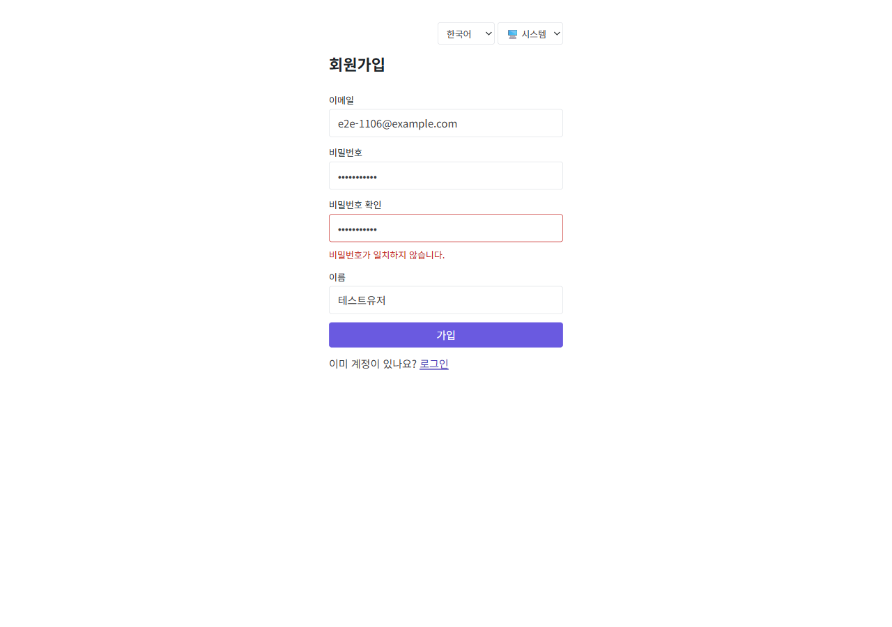 | 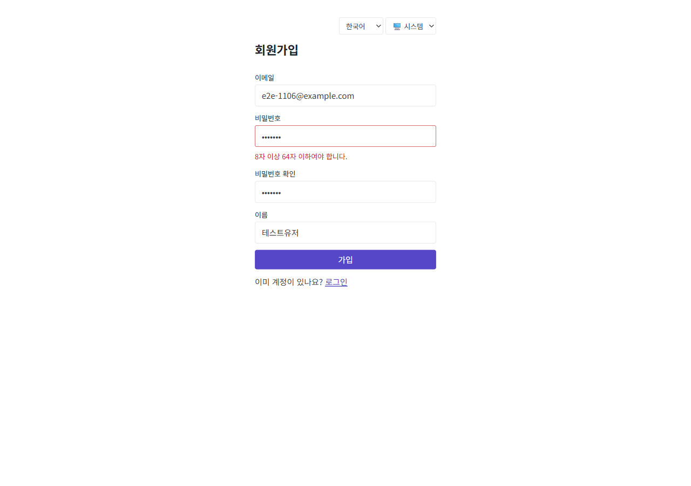 |  |

### SC-02 로그인 / 로그아웃 / 인증 보호

| ID | 확인 내용 | 기대 | 실제 | 결과 |
|---|---|---|---|---|
| 단계 2 | 내비게이션 사용자 이름 | U1 이름 표시 | '테스트유저' → 이름 변경 후 '김학생' | ✅ |
| 단계 2 / BR-03 | U2 데이터 비노출 | 목록·캘린더·카테고리·필터에 T9·C9 없음 | `/todos`·`/calendar`·`/categories` 응답과 필터 선택지 모두에 없음 | ✅ |
| 단계 3 | 로그아웃 | 쿠키 삭제, refresh 무효화 | `/login` 이동, 이후 `/api/me` 401, `/api/auth/refresh` 401 | ✅ |
| 단계 4 | 로그아웃 상태에서 `/todos` 접근 | 로그인 화면 이동 | `/login`으로 이동 | ✅ |
| E-02-1 | 틀린 비밀번호 (비밀번호 변경 전 값) | 401 `INVALID_CREDENTIALS`, 폼 상단 사유 | "이메일 또는 비밀번호가 올바르지 않습니다." | ✅ |
| E-02-1 | 가입되지 않은 이메일 (API) | 401 `INVALID_CREDENTIALS` (구분 없음) | 401 `INVALID_CREDENTIALS` | ✅ |
| 정상 | 새 비밀번호로 로그인 | 목록 이동 | `/todos`, '김학생' 표시 | ✅ |
| E-C1 대안 | access 쿠키만 삭제한 뒤 완료 토글 | 자동 갱신 후 재요청, 로그인 화면으로 가지 않음 | `PATCH 401` → `POST /auth/refresh 204` → `PATCH 200` → `GET /todos 200`, 토글 반영 | ✅ |

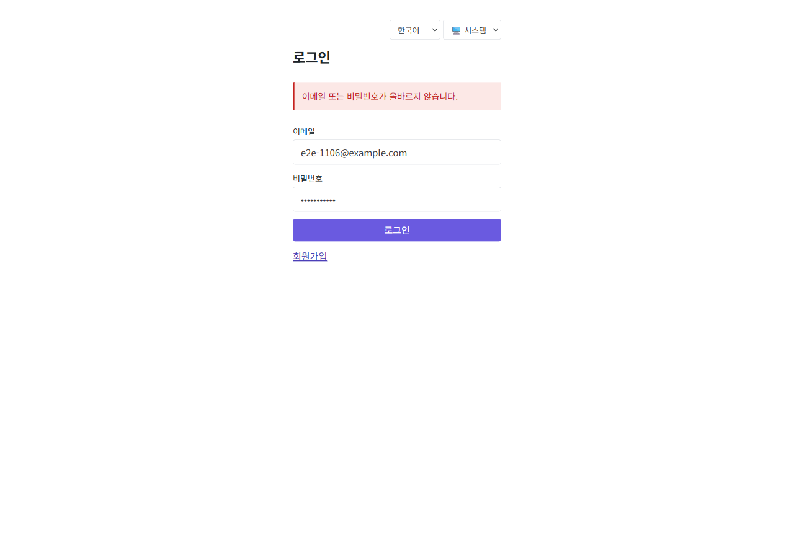

### SC-03 카테고리

| ID | 확인 내용 | 기대 | 실제 | 결과 |
|---|---|---|---|---|
| 단계 1 | '기본' 수정·삭제 | 비활성 | 두 버튼 모두 `disabled` | ✅ |
| 단계 1 | 목록 순서 (BR-23) | 기본, 업무, 학습 | 기본, 업무, 학습 | ✅ |
| E-03-1 | '업무' 중복 추가 | 409, 사유 표시 | "이미 있는 카테고리 이름입니다." | ✅ |
| E-03-1 | '학습' → '기본'으로 이름 변경 | 409, 변경 없음 | 상단 같은 사유, 변경 없음 | ✅ |
| E-03-3 | 이름 31자 | 400, 입력란 옆 사유 | "1자 이상 30자 이하여야 합니다." | ✅ |
| E-03-2 | API로 '기본' 이름 변경·삭제 | 400 `DEFAULT_CATEGORY_IMMUTABLE` | 두 요청 모두 400 `DEFAULT_CATEGORY_IMMUTABLE` | ✅ |
| E-C2 | U2 카테고리 C9 삭제 (API) | 404 `NOT_FOUND` | 404 `NOT_FOUND` | ✅ |
| 단계 3 | '학습' → '시험' | 이름 변경 | 변경됨 | ✅ |
| 단계 4 | '업무' 삭제 확인에서 취소 | 삭제 안 됨 | '업무' 유지 | ✅ |
| 단계 4 | '업무' 삭제 확인 (P-19) | 안내 문구 후 삭제, T1 → '기본' | "소속 할일은 '기본'으로 옮겨집니다." 표시 후 삭제, T1이 '기본' 소속 | ✅ |
| 단계 5 | 필터 '기본' | T1, T4, T3 순 | 보고서 작성, 장보기, 여행 준비 | ✅ |

| 중복 추가 | 31자 | 이름 변경 중복 | 삭제 확인 | 필터 '기본' |
|---|---|---|---|---|
| 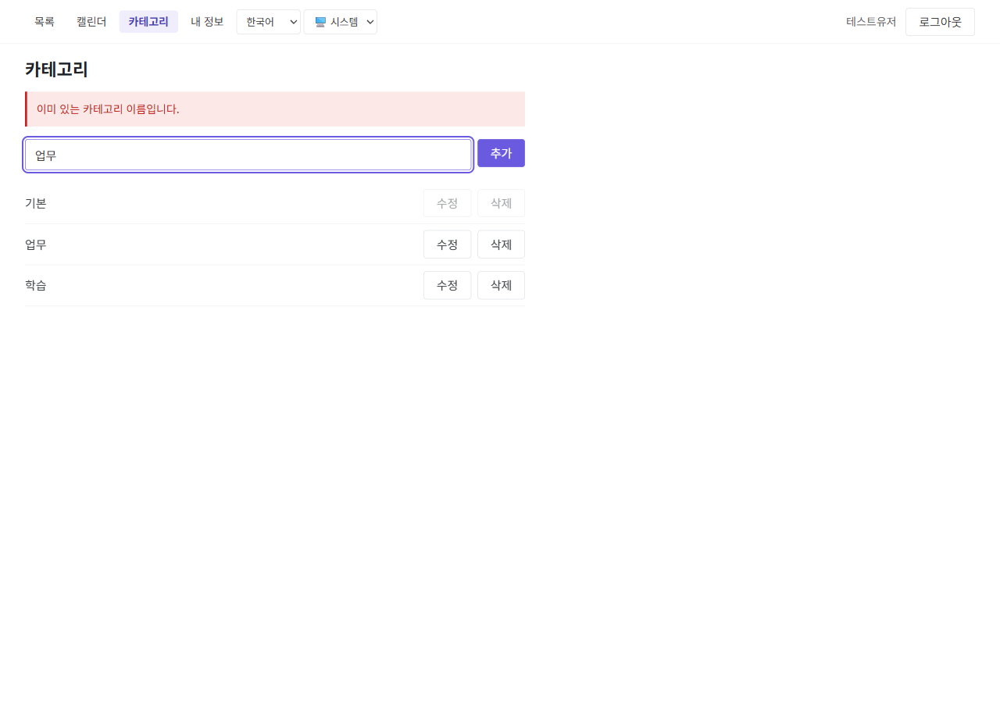 | 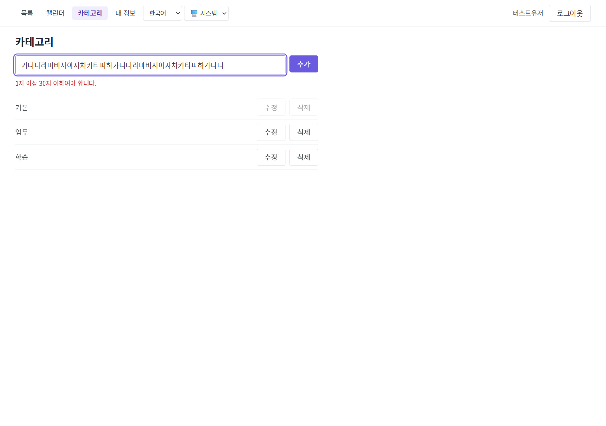 | 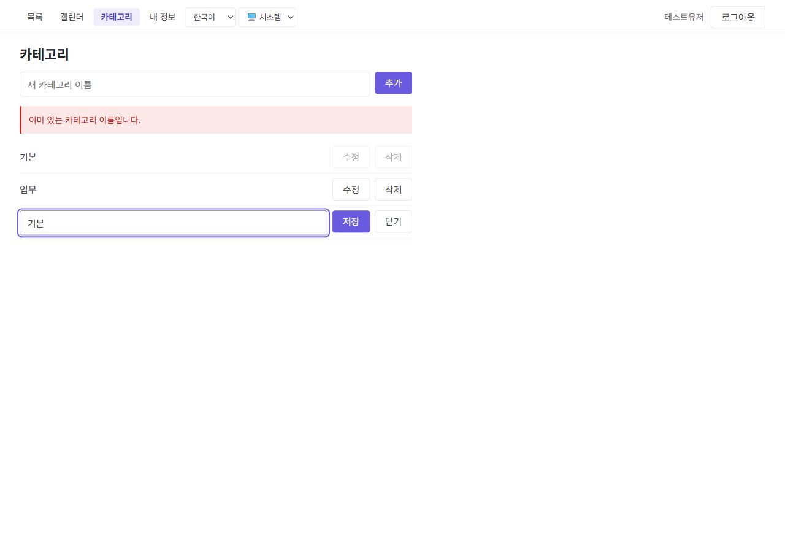 | 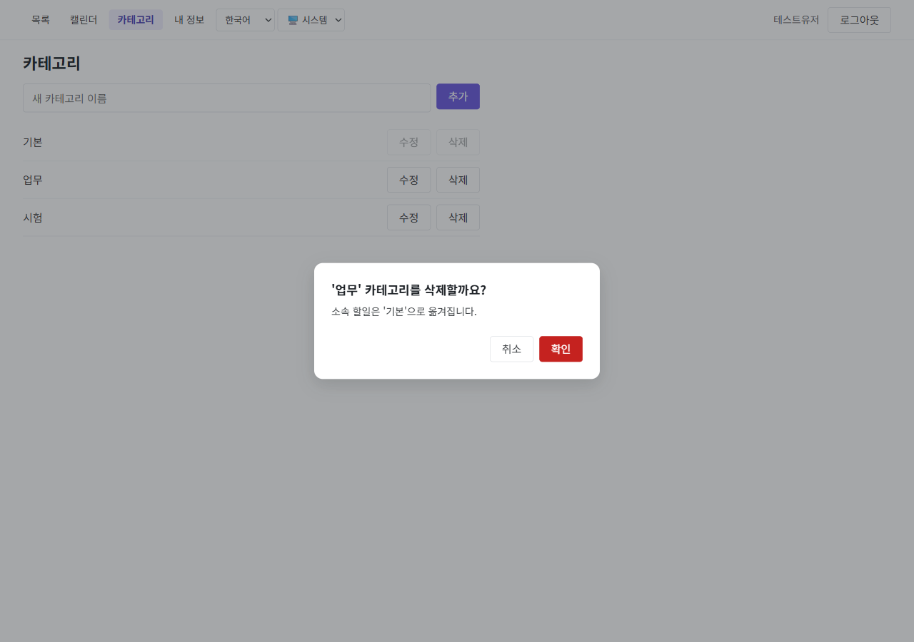 | 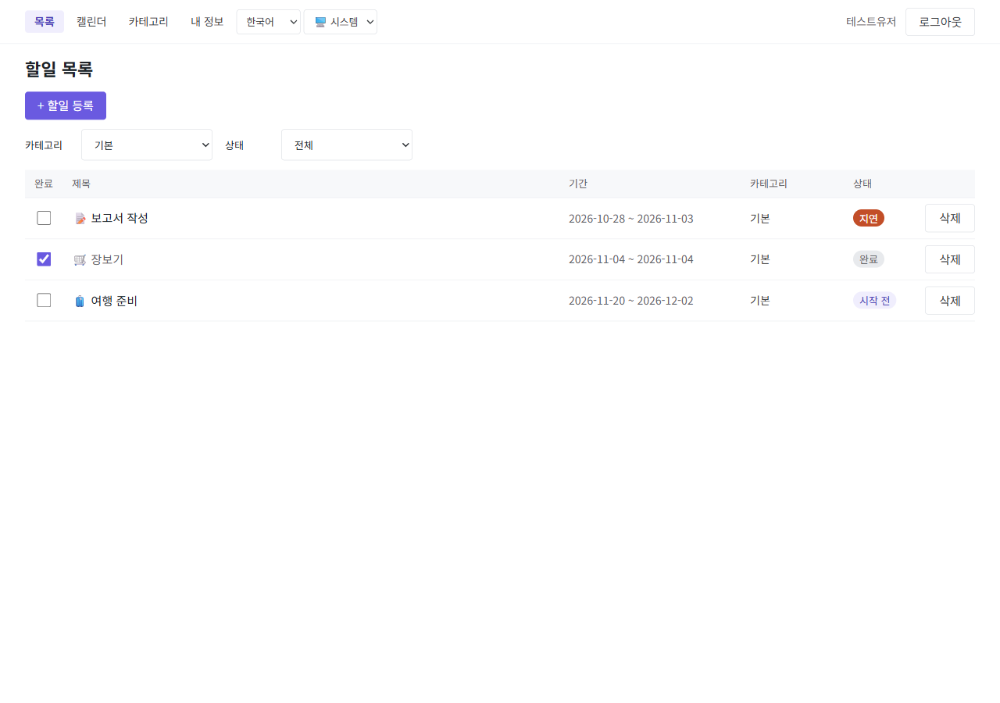 |

### SC-04 할일 등록

| ID | 확인 내용 | 기대 | 실제 | 결과 |
|---|---|---|---|---|
| E-04-1 | 빈 폼 저장 | 제목·시작일·종료일 옆에 사유 | 세 칸 모두 "필수 항목입니다." | ✅ |
| E-04-1 | 제목이 공백만 (API) | 400 | 400 `VALIDATION_ERROR` | ✅ |
| E-04-2 | 시작일 11-10 > 종료일 11-02 | 400, 미저장 | "종료일은 시작일과 같거나 이후여야 합니다." | ✅ |
| E-04-3 | 제목 101자 / 설명 1001자 (API) | 400 | 둘 다 400 `VALIDATION_ERROR` | ✅ |
| E-04-4 | U2 카테고리 C9 지정 (API) | 404 | 404 `NOT_FOUND` | ✅ |
| 단계 2·3 | '시험 공부' 11-02~11-10, '학습' | 저장 후 '진행 중' | 목록으로 돌아가 '진행 중' 표시 | ✅ |
| A-04-1 | 카테고리 미지정 (T3·T4) | '기본'에 저장 | `categoryName: "기본"` | ✅ |

| 빈 폼 저장 | 시작일 > 종료일 |
|---|---|
| 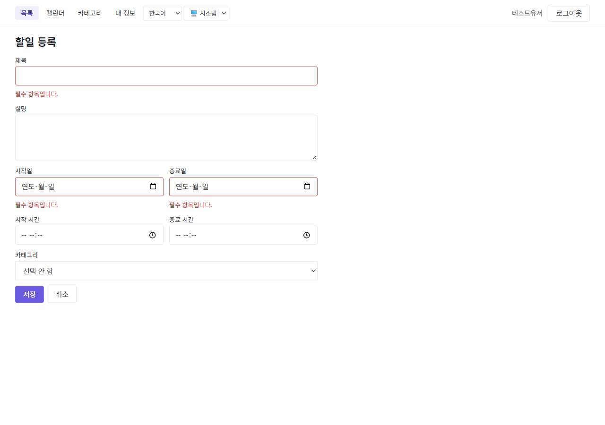 | 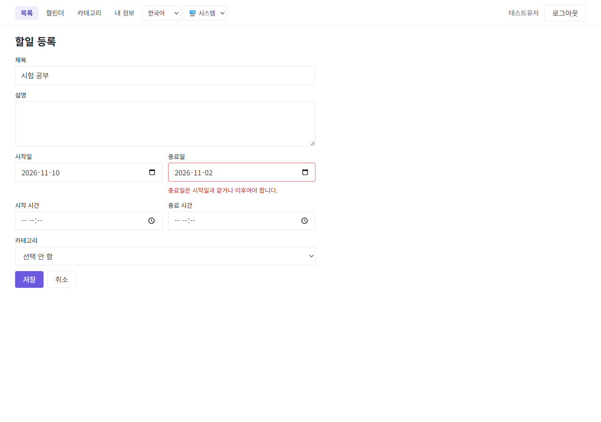 |

### SC-05 할일 수정 · SC-12 캘린더에서 편집

| ID | 확인 내용 | 기대 | 실제 | 결과 |
|---|---|---|---|---|
| 단계 0 | 목록에서 제목 클릭 | 현재 값이 채워진 편집 화면 | 제목·기간·카테고리 '학습' 채워짐 | ✅ |
| A-05-4 | 제목을 바꾼 뒤 취소 | 확인 없이 목록 복귀, 변경 없음 | `/todos` 복귀, 원래 제목 유지 | ✅ |
| 단계 1·2 | 설명 추가, 종료일 11-12 저장 | 목록 복귀, 11-12, '진행 중' | `2026-11-02 ~ 2026-11-12` '진행 중' | ✅ |
| A-05-5 | `/todos/{id}/edit`로 직접 들어가 저장 | `/todos`로 이동 | `/todos` | ✅ |
| E-05-2 | U2 할일 T9 수정 (API) | 404 | 404 `NOT_FOUND` | ✅ |
| E-C2 (화면) | `/todos/{T9}/edit` 직접 접근 | 데이터를 노출하지 않음 | "대상을 찾을 수 없습니다." | ✅ |
| SC-12 | 캘린더 막대 클릭 → 취소 | 진입한 캘린더로 복귀 | `/calendar?view=month&date=2026-11-06` | ✅ |

> 캘린더 기대값을 맞추려고 SC-05가 끝난 뒤 T2의 종료일을 API로 11-10에 되돌렸다.

| 편집 화면 | 저장 후 목록 | 타인 할일 URL 접근 |
|---|---|---|
| 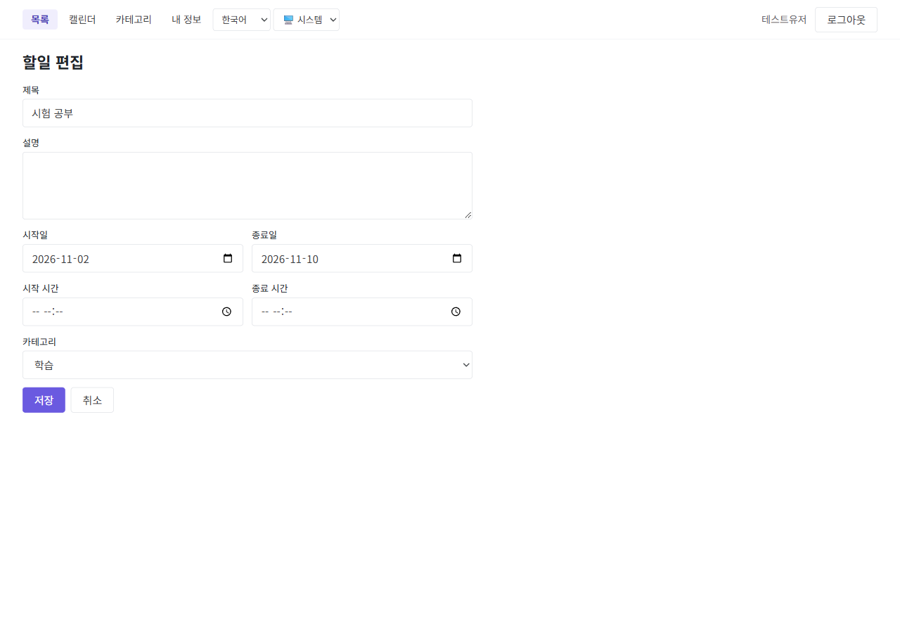 | 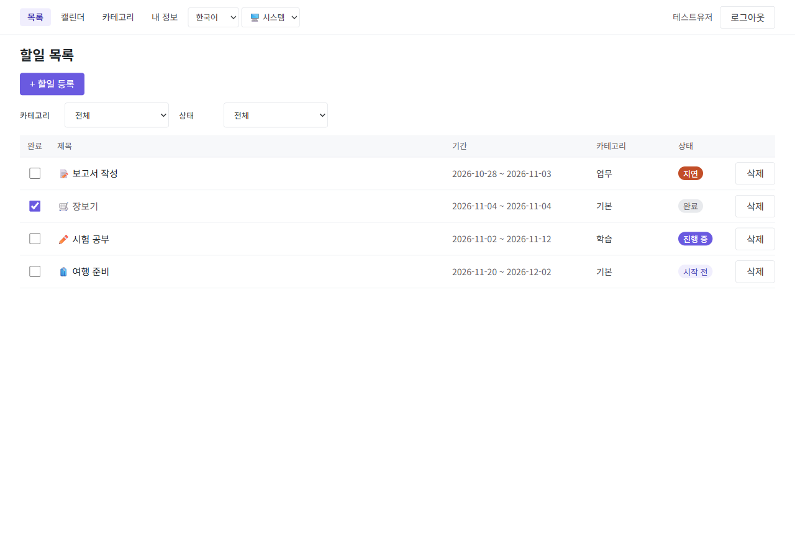 | 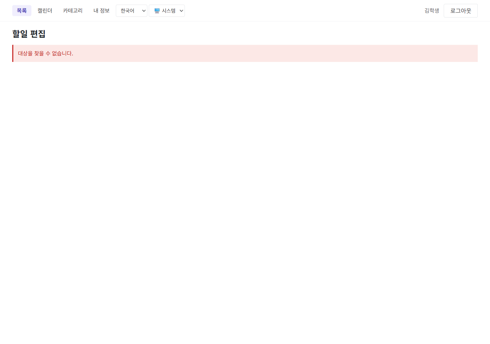 |

### SC-06 완료 / 완료 취소

| ID | 확인 내용 | 기대 | 실제 | 결과 |
|---|---|---|---|---|
| 단계 1 | T2 완료 | '완료' | '완료' | ✅ |
| 단계 2 | T2 완료 취소 | '진행 중' | '진행 중' | ✅ |
| A-06-1 | T1(지연) 완료 → 취소 | 완료 → 지연 | 완료 → 지연 | ✅ |
| 사전 | T4(11-04 하루) 완료 | '완료' | '완료' (완료 전에는 '지연') | ✅ |
| BR-19 | 완료 항목이 캘린더에 보임 | 표시됨 | 월 뷰 11-04에 '장보기 (완료)' | ✅ |
| E-06-1 | U2 T9 완료 (`PATCH /todos/:id/completed`) | 404 | 404 `NOT_FOUND` | ✅ |

| 목록 전체 (BR-20 정렬) | 완료 토글 후 |
|---|---|
| 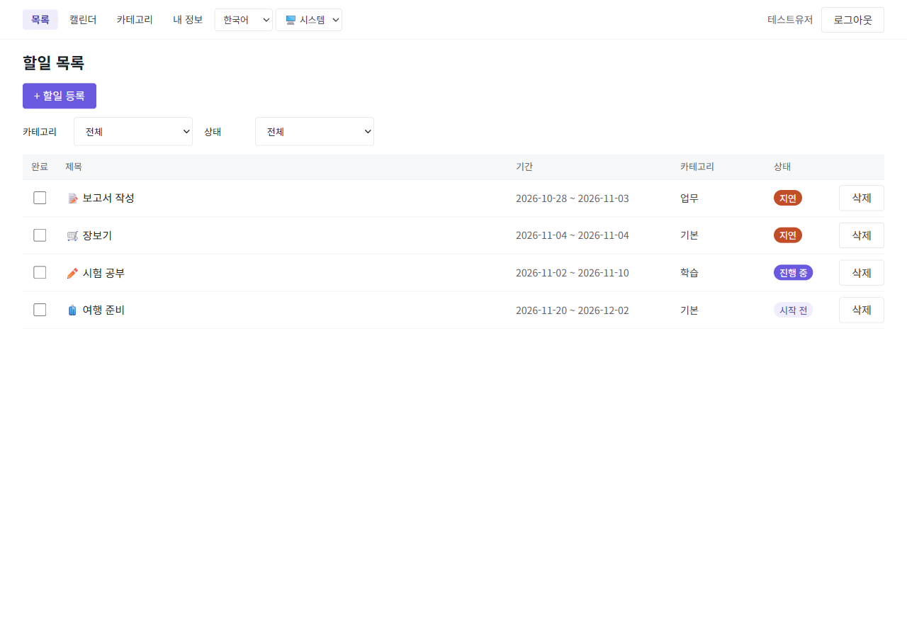 | 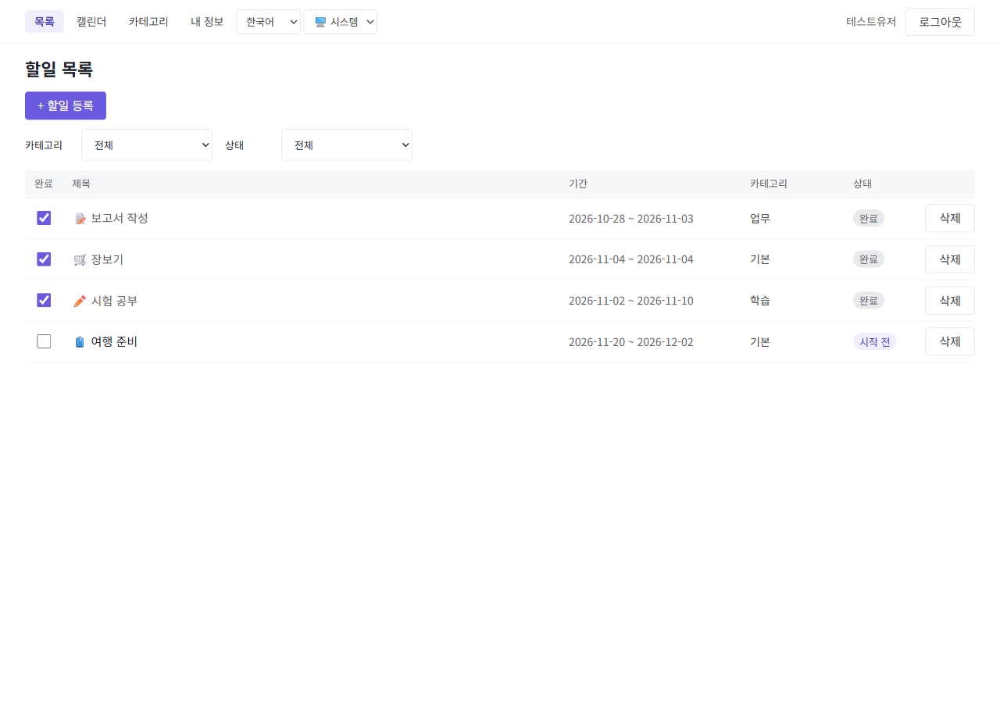 |

### SC-07 할일 삭제

| ID | 확인 내용 | 기대 | 실제 | 결과 |
|---|---|---|---|---|
| 단계 1 | T3 삭제 | 확인 대화상자 | "이 할일을 삭제할까요?" | ✅ |
| 대안 | 대화상자에서 취소 | 삭제 안 됨 | '여행 준비' 유지 | ✅ |
| 단계 2·3 | 확인 후 목록·11월·12월 캘린더 | T3 없음 | 목록에서 사라짐, 11월·12월 캘린더 API 응답에 없음 | ✅ |
| E-07-1 | U2 T9 삭제 (API) | 404 | 404 `NOT_FOUND` | ✅ |

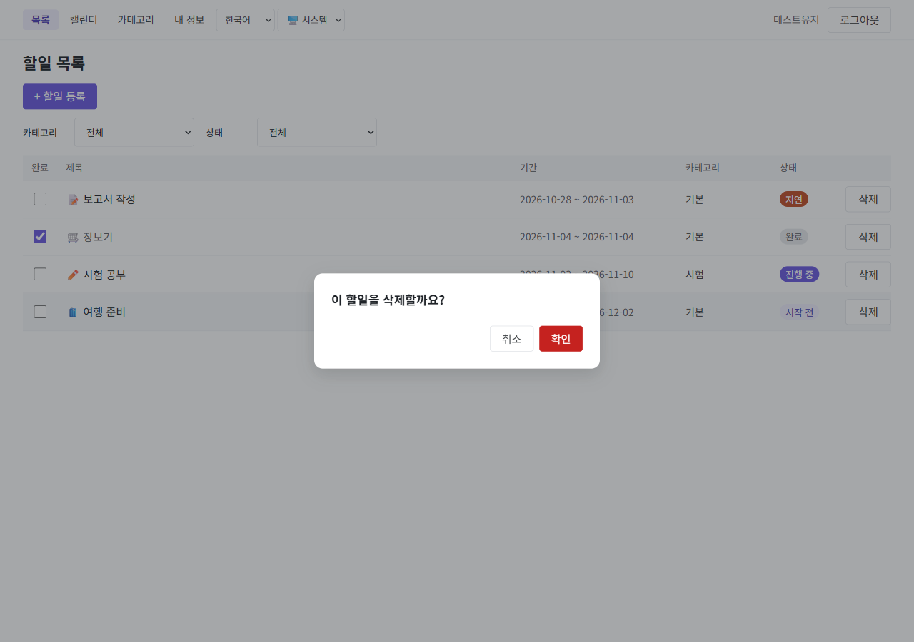

### SC-08 목록 조회와 필터

| ID | 확인 내용 | 기대 | 실제 | 결과 |
|---|---|---|---|---|
| 단계 1 | 필터 없음 | T1, T4, T2, T3 | 보고서 작성, 장보기, 시험 공부, 여행 준비 | ✅ |
| 단계 4 | '업무' + '진행 중' | 0건 | "할일이 없습니다." | ✅ |
| 단계 5 | '학습' + '진행 중' | T2만 | 시험 공부만 | ✅ |
| E-08-1 | `today` 누락 / `2026-13-01` | 400 | 둘 다 400 `VALIDATION_ERROR` | ✅ |
| E-08-2 | 필터에 U2 C9 / 없는 카테고리 | 404, 두 응답이 같음 | 둘 다 404 `NOT_FOUND` | ✅ |
| E-08-3 | 상태 `DONE_X` | 400 | 400 `VALIDATION_ERROR` | ✅ |

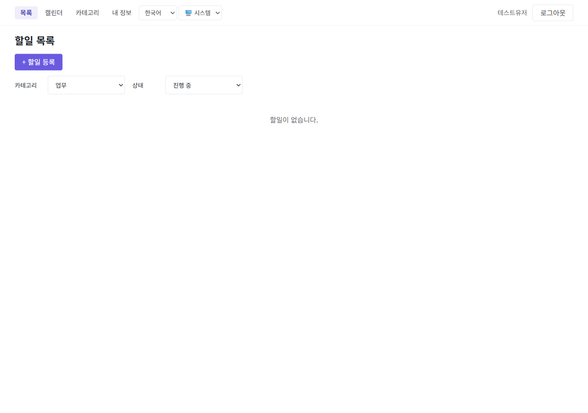

### SC-09 캘린더 월 뷰

| ID | 확인 내용 | 기대 | 실제 | 결과 |
|---|---|---|---|---|
| 단계 1 | 2026-11 막대 | T1 11-01~03, T2 11-02~07과 11-08~10(주 경계에서 끊김), T4 11-04, T3 11-20~30 (3개로 나뉨) | 기대와 같음 | ✅ |
| 단계 2 | 2026-10 | T1만 | '보고서 작성 (지연)'만 | ✅ |
| 단계 3 | 2026-12 | T3만 | '여행 준비 (시작 전)'만 | ✅ |
| A-09-2 | 11-04에 4건 | 3줄 + '+1', T2 막대가 끊기지 않음 | 장보기 / 시험 공부(막대) / 회의 + '+1' | ✅ |
| A-09-2 | '+1' 클릭 | 4건을 BR-20 순서로 | 장보기, 회의, 운동, 시험 공부 | ✅ |
| A-09-1 | 360px 날짜 칸 개수 | 01=1, 02~04=2, 05~10=1, 11~19=0, 20~30=1 | 기대와 같음 | ✅ |
| A-09-1 | 11-04 클릭 | T4 '완료', T2 '진행 중' | 기대와 같음 | ✅ |
| NFR-13 | 가로 스크롤 | 없음 | 캘린더 `scrollWidth` 360, 목록 345 (뷰포트 360) | ✅ |
| E-09-1 | `today` 누락 (API) | 400 | 400 `VALIDATION_ERROR` | ✅ |
| E-09-2 | 시작 > 끝 / 날짜 형식 오류 (API) | 400 | 둘 다 400 `VALIDATION_ERROR` | ✅ |

| 월 뷰 2026-11 | '+1'과 그날 목록 |
|---|---|
| 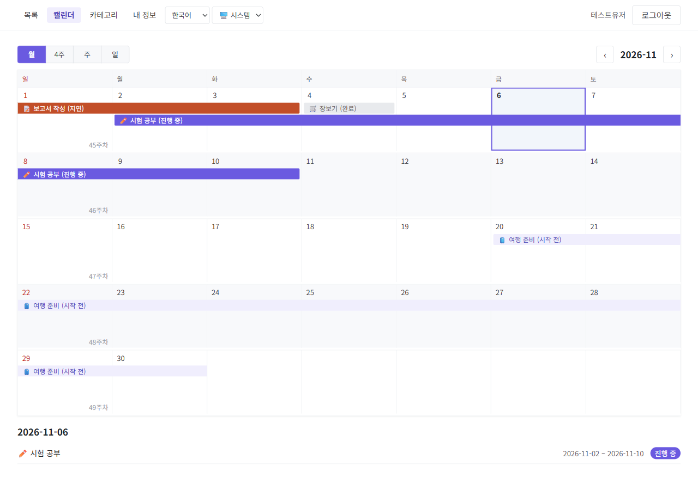 | 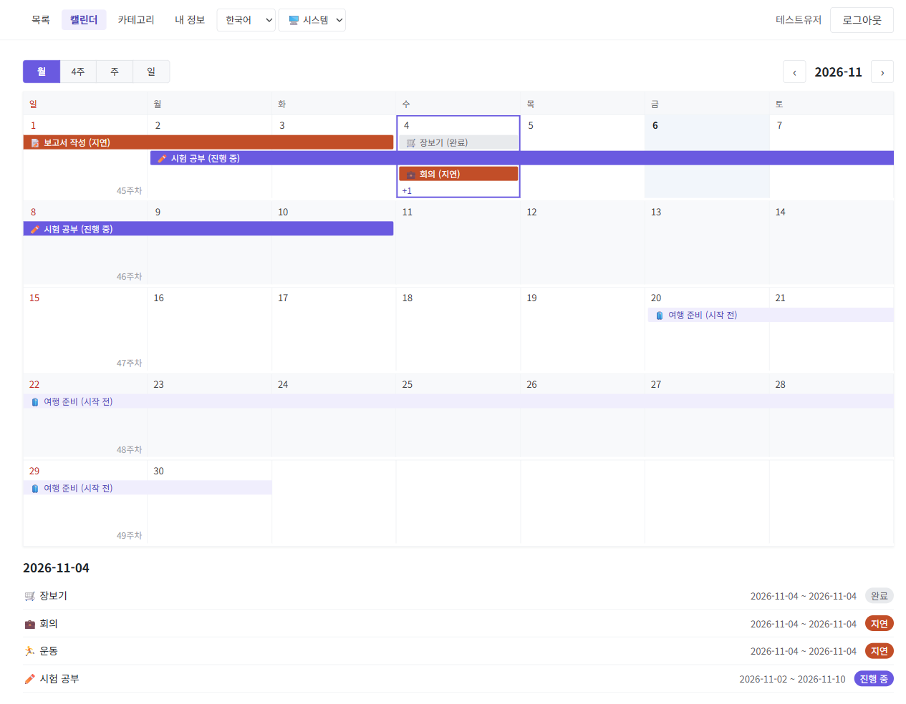 |

| 모바일 월 뷰 | 모바일 11-04 목록 | 모바일 할일 목록 |
|---|---|---|
| 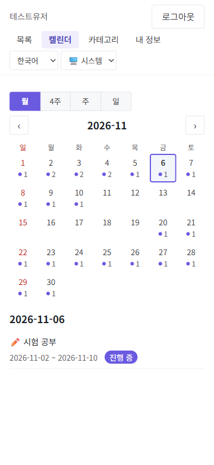 | 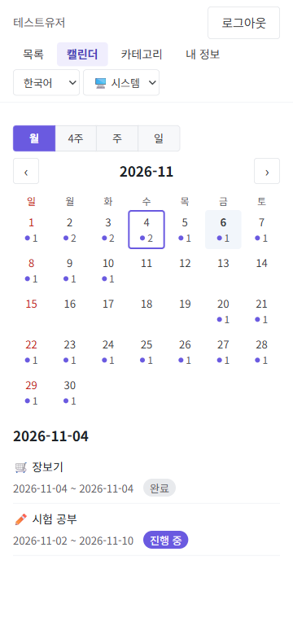 | 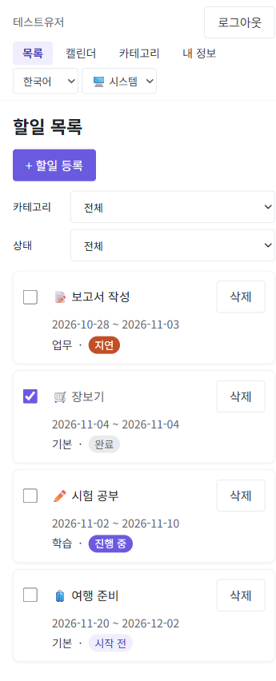 |

### SC-10 주 뷰 / 일 뷰

| 단계 | 기대 | 실제 | 결과 |
|---|---|---|---|
| 1 주 뷰 11-01~07 | T1, T2, T4 | 보고서 작성(지연), 시험 공부(진행 중), 장보기(완료) | ✅ |
| 2 다음 주 11-08~14 | T2 | 시험 공부 | ✅ |
| 3 10-25~31 | T1 | 보고서 작성 | ✅ |
| 4 일 뷰 11-04 | T4 '완료', T2 '진행 중' | 같음 | ✅ |
| 5 11-03 | T1 '지연', T2 | 같음 | ✅ |
| 6 11-05 | T2만 | 같음 | ✅ |

| 주 뷰 | 일 뷰 11-04 |
|---|---|
| 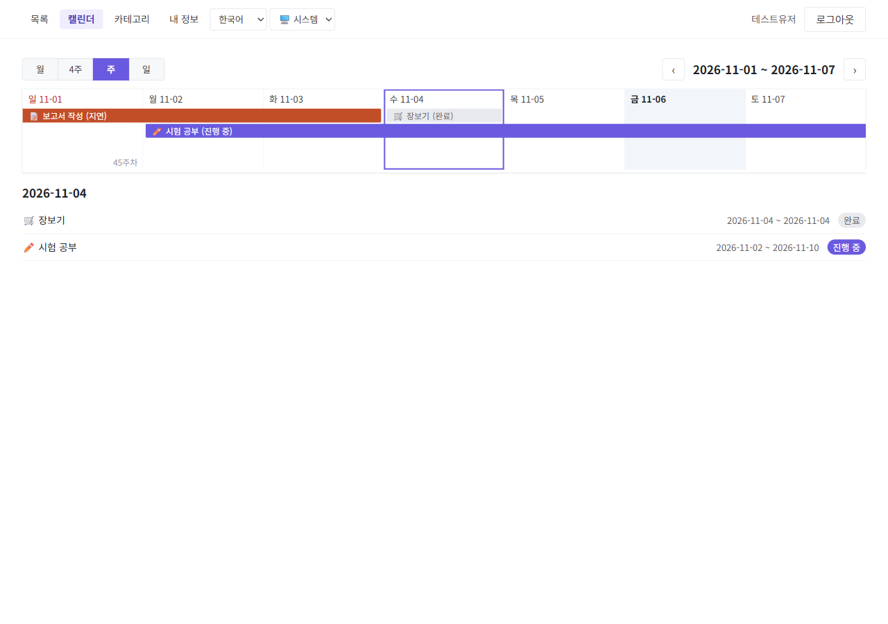 | 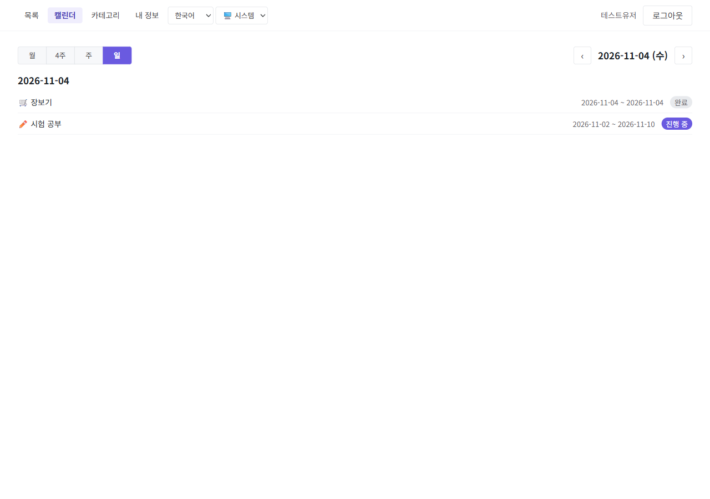 |

### SC-11 내 정보

| ID | 확인 내용 | 기대 | 실제 | 결과 |
|---|---|---|---|---|
| 단계 1 | 이메일 읽기 전용 | readOnly | `readOnly: true` | ✅ |
| E-11-1 | 이름이 공백만 | 400, 입력란 옆 사유 | "필수 항목입니다." | ✅ |
| 단계 2 | 이름 '김학생' | 입력란과 내비게이션 반영 | 둘 다 '김학생' | ✅ |
| E-11-4 | 새 비밀번호 확인 불일치 | 요청 미전송, 확인란 옆 사유 | "비밀번호가 일치하지 않습니다." | ✅ |
| E-11-2 | 현재 비밀번호 틀림 | 400 `INVALID_PASSWORD`, 로그아웃 안 됨 | "현재 비밀번호가 올바르지 않습니다.", 세션 유지 | ✅ |
| 단계 3 | 비밀번호 변경 성공 | 현재 세션 유지 | 입력란 비워짐, `/api/me` 200 | ✅ |
| 사후 | 이전 비밀번호로 로그인 / 새 비밀번호로 로그인 | 실패 / 성공 | 401 / 성공 | ✅ |

| 현재 비밀번호 틀림 | 변경 후 |
|---|---|
| 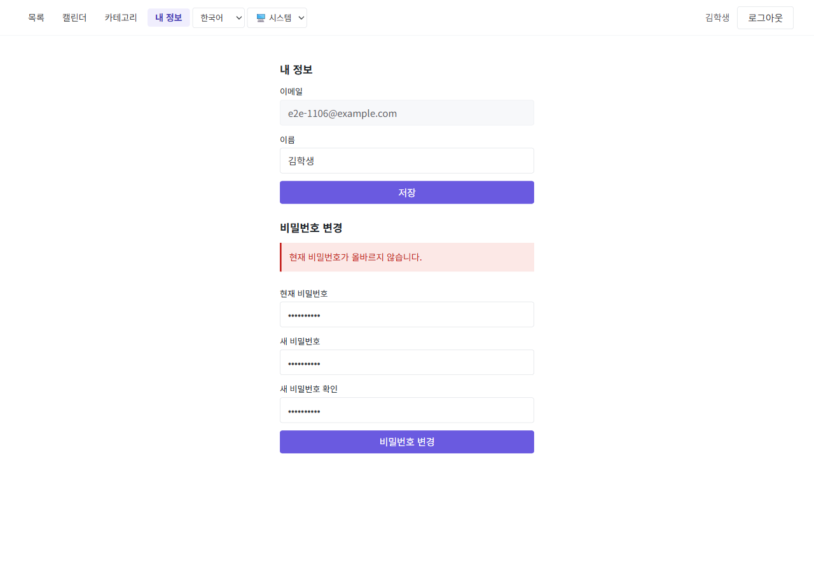 | 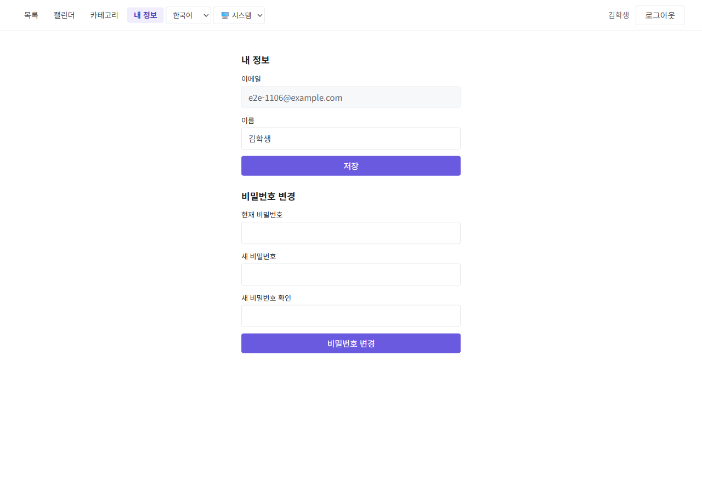 |

### SC-14 캘린더 4주 뷰 (시나리오 v0.12)

U3로 로그인해 3.0 예시 데이터(T1~T4, T4 완료) 그대로 실행했다.

| ID | 확인 내용 | 기대 | 실제 | 결과 |
|---|---|---|---|---|
| 단계 1 | 월 뷰 2026-11에서 '4주' 클릭 | 2026-11-01 ~ 11-28, 28칸, 빈칸 없음, 첫 칸 '11/1' | `view=4weeks`, 라벨 `2026-11-01 ~ 2026-11-28`, 28칸, 첫 칸 '11/1', 나머지는 일만 | ✅ |
| 단계 1 | 막대 배치 | 월 뷰와 같음(T1 11-01~03, T2 두 막대, T4, T3 두 막대) | 보고서 작성(지연), 시험 공부(진행 중)×2, 장보기(완료), 여행 준비(시작 전)×2 | ✅ |
| 단계 1 / P-20 | 아래 그날 목록 | 오늘의 그날 목록 | '2026-11-06' 목록(시험 공부). 시나리오의 '11-04'는 오늘 = 11-04 전제라 실행일 기준으로 판정 | ✅ |
| 단계 2 | 다음 | 2026-11-29 ~ 12-26, '11/29'·'12/1' | 같음 | ✅ |
| 단계 2 | T3가 달 경계에서 끊기지 않음 | 11-29~12-02 막대 하나 | 막대 1개(일~수 4칸 폭) | ✅ |
| 단계 3 | 이전 두 번 | 2026-10-04 ~ 10-31, T1 10-28~10-31 | 같음(T1 막대가 수~토 4칸) | ✅ |
| 대안 | 모바일 360px 28칸 개수 | 할일 개수 점·숫자 | 11-01=1, 02~04=2, 05~10=1, 11~19=0, 20~28=1 | ✅ |
| 대안 | 모바일 11-04 클릭 | 그날 목록 | 장보기(완료), 시험 공부(진행 중) | ✅ |
| 대안 | 모바일 가로 스크롤 | 없음 | 없음 | ✅ |
| 대안 / P-30 | 모바일 첫 칸·매달 1일 표기 | P-30: 첫 칸과 매달 1일은 'M/D'(모바일 예외 없음) | 첫 실행: 11-01 칸이 '1'로만 표시(`MobileCounts`가 일 숫자만 그림). 수정 후: 11-01 '11/1', 다음 28일 '11/29'·'12/1', 월 뷰는 일만, 칸 넘침·가로 스크롤 없음 | ✅ (수정 후) |

| 데스크톱 4주 | 다음 28일 | 모바일 4주 |
|---|---|---|
| 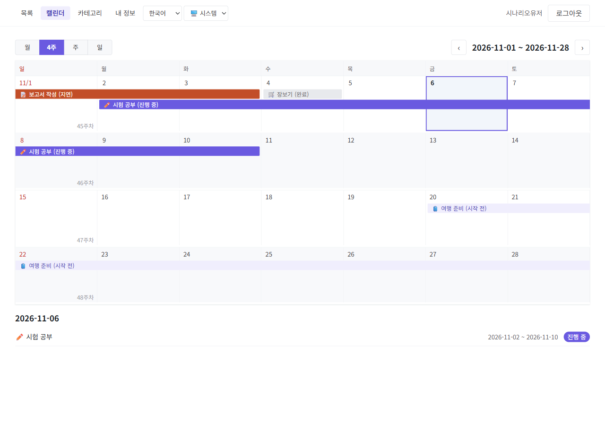 | 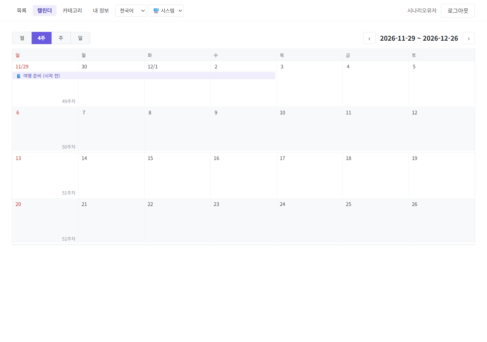 | 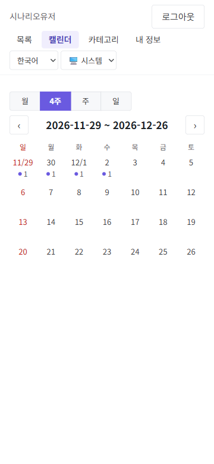 |

### SC-15 언어·화면 모드 선택 (시나리오 v0.12)

쿠키·localStorage를 비우고, 브라우저 언어 `ko-KR`, OS 밝은 모드(`prefers-color-scheme: light` 에뮬레이션)에서 시작했다.

| ID | 확인 내용 | 기대 | 실제 | 결과 |
|---|---|---|---|---|
| 단계 1 | 로그인 화면 기본값 | 언어 '한국어', 모드 '시스템', 밝은 모드 | '한국어'·'🖥️ 시스템', `data-theme=light`, 저장값 없음 | ✅ |
| 단계 2 | 'English' 선택 | 문구 영어, 브라우저에 저장 | 'Log in' 제목·버튼, `localStorage.lang = en` | ✅ |
| 단계 3 | 로그인 후 목록 | 내비·버튼·필터·상태 영어, 사용자 데이터 그대로 | List/Calendar/Categories/My info, 'Tasks', 'In progress'·'Overdue' 등, 제목 '시험 공부'·카테고리 '학습' 유지 | ✅ |
| 단계 4 | 다크 선택 | 어두운 모드, 저장 | `data-theme=dark`, 바탕 `rgb(22,24,29)`, `localStorage.theme = dark` | ✅ |
| 단계 5 | 새로고침 | 첫 화면부터 영어·다크, 깜빡임 없음 | 문서 해석 시점(`readyState=interactive`)에 이미 `data-theme=dark`, 'Tasks' | ✅ |
| 단계 6 | '시스템'으로 되돌린 뒤 OS 다크 | 바로 어두운 모드 | 시스템 선택 시 light → OS 다크 에뮬레이션 즉시 dark, 다시 light로 복귀 | ✅ |
| 대안 | 회원가입 화면 선택 상자 | 두 선택 상자 | 'English'·'🖥️ System' 표시 | ✅ |
| 대안 | 서버 오류 문구 번역 | 알려진 문구는 선택 언어로 | 중복 이메일 409 → "This email is already registered." | ✅ |
| 대안 | 날짜 형식 | 언어와 무관 `YYYY-MM-DD` | 영어 목록에서도 `2026-11-02 ~ 2026-11-10` | ✅ |

| 기본(한국어·시스템) | 영어 로그인 | 영어 목록 | 영어·다크 | 가입 화면 서버 오류 번역 |
|---|---|---|---|---|
|  | 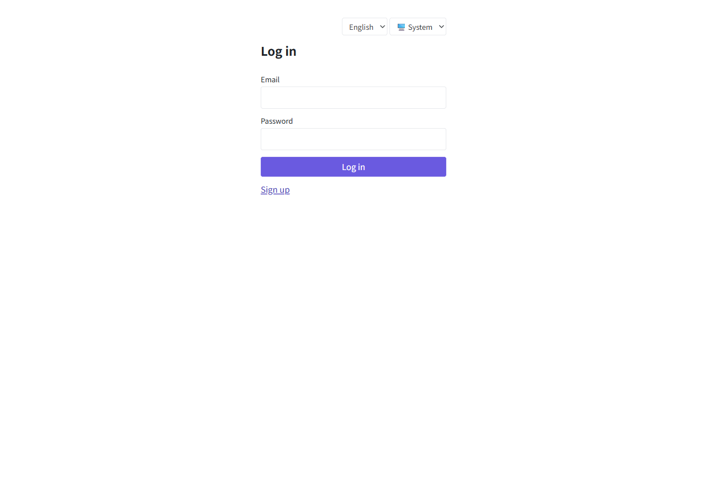 | 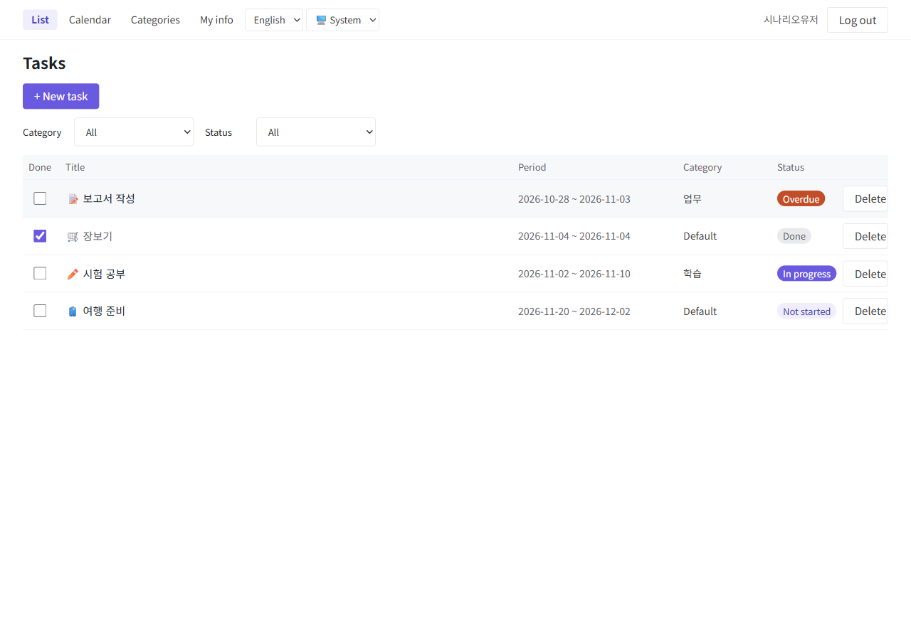 | 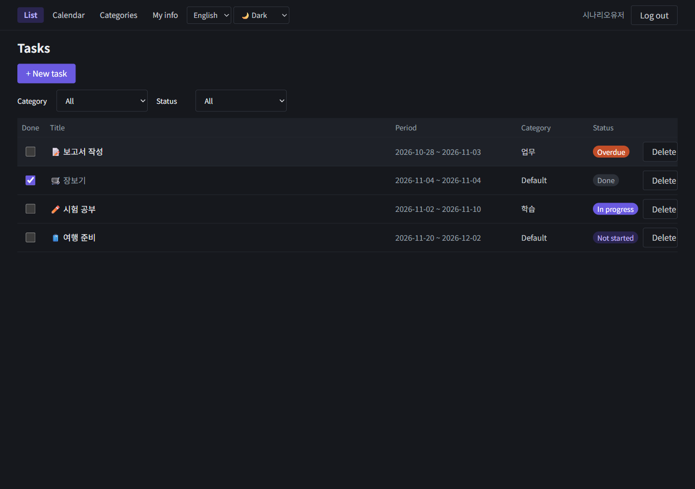 | 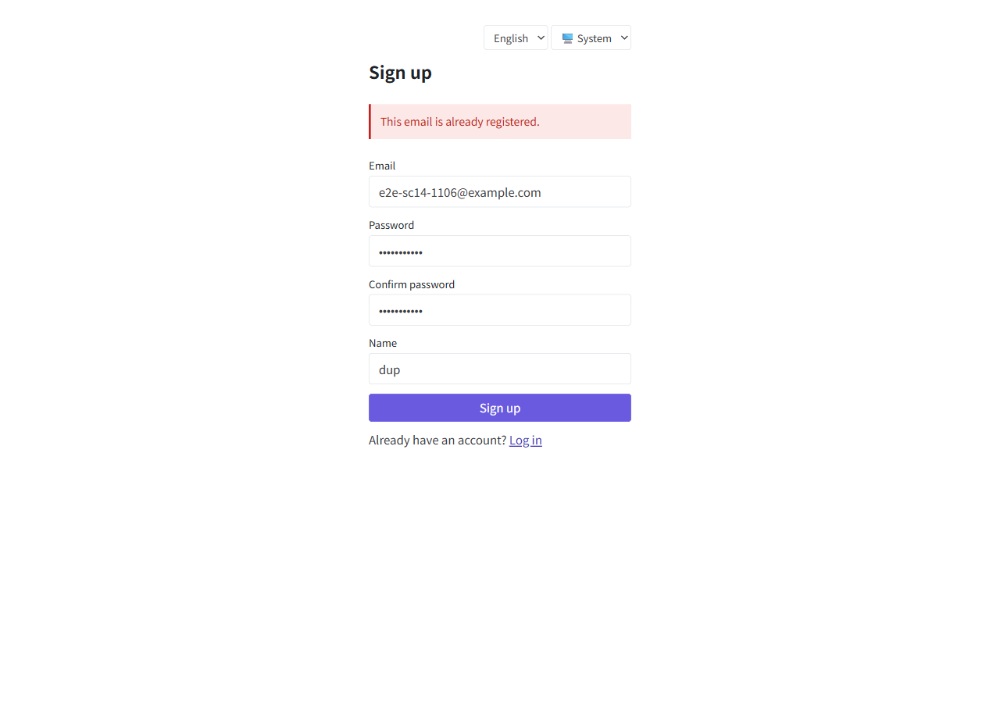 |

## 3. 발견 사항

SC-01~13에서 시나리오를 위반한 결함은 **없다**. SC-14에서 문서와 구현이 다른 곳 1건(#3)을 찾아 코드를 고쳤다.

| # | 구분 | 내용 | 심각도 |
|---|---|---|---|
| 1 | 관찰 | `/favicon.ico` 요청이 404로 콘솔 오류에 남는다. 기능에는 영향이 없다. | 낮음 |
| 2 | 관찰 | 이름 저장과 비밀번호 변경이 성공해도 성공 메시지가 없다. 비밀번호 변경은 입력란이 비워지는 것만 보인다. 시나리오가 요구하는 사항은 아니므로 UX 개선 후보로만 남긴다. | 낮음 |
| 3 | 불일치 → **수정함** | 모바일 4주 뷰에서 첫 칸·매달 1일이 'M/D'가 아니라 일 숫자만 보였다(11-01과 12-01이 모두 '1'). PRD P-30은 모바일 예외를 두지 않는다. 표기 규칙을 `range.ts`의 `dayLabel()`로 옮겨 데스크톱(`MonthGrid`)·모바일(`MobileCounts`)이 함께 쓰게 했다(단위 테스트 추가). | 낮음 |

콘솔 오류 35건(`console-errors.log`)은 모두 의도적으로 일으킨 400·401·404·409 응답이다. 5xx는 0건이다.

## 4. 미검증 항목

| 항목 | 사유 |
|---|---|
| E-C3 / E-06-2 (500 오류, 저장 실패 시 토글 원복) | 서버 장애를 주입하는 수단이 없다 |
| P-22 저장 중 토글·삭제 비활성 | 로컬 응답이 너무 빨라 비활성 상태를 관찰하지 못했다 |
| A-08-2 자정이 지난 뒤 재조회 | 시간 조작이 필요하다 |
| refresh 토큰 7일 만료, 비밀번호 변경 후 **다른** 세션 무효화 | 시간 조작 또는 두 번째 브라우저 세션이 필요하다 |
| E-01-3 이메일 255자·이름 51자, E-11-1 이름 51자, E-11-3 새 비밀번호 7·65자 | 같은 검증기를 쓰는 대표 사례(형식 오류·공백·7자)만 확인했다 |
| A-05-1~3, A-06-2·3, A-04-2~4 | 상태 판정 로직은 다른 단계에서 4개 상태가 모두 확인됐다 |
| SC-13 한 번에 실행 | 단계별로는 모두 확인했지만 새 계정으로 처음부터 끝까지 이어서 돌리지는 않았다 |

## 5. 남은 테스트 데이터

DB에 다음 데이터가 남아 있다. 필요하면 삭제한다.

- 사용자 `e2e-1106@example.com` (비밀번호 `newpass123`, 이름 '김학생'): 카테고리 '기본'·'시험', 할일 '보고서 작성'·'장보기'·'시험 공부'
- 사용자 `e2e-u2-1106@example.com` (비밀번호 `password123`): 카테고리 '비밀', 할일 'U2 비밀 할일'
- 사용자 `e2e-sc14-1106@example.com` (비밀번호 `password123`, 이름 '시나리오유저'): 카테고리 '기본'·'업무'·'학습', 할일 T1~T4(3.0 예시 데이터)
